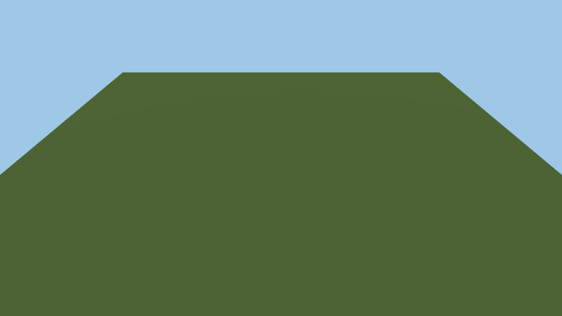
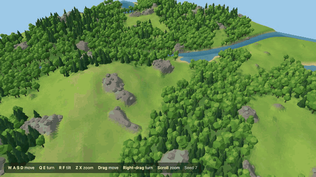
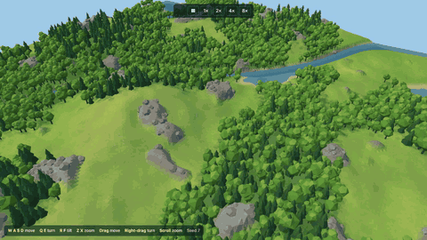
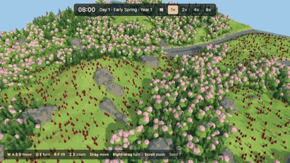
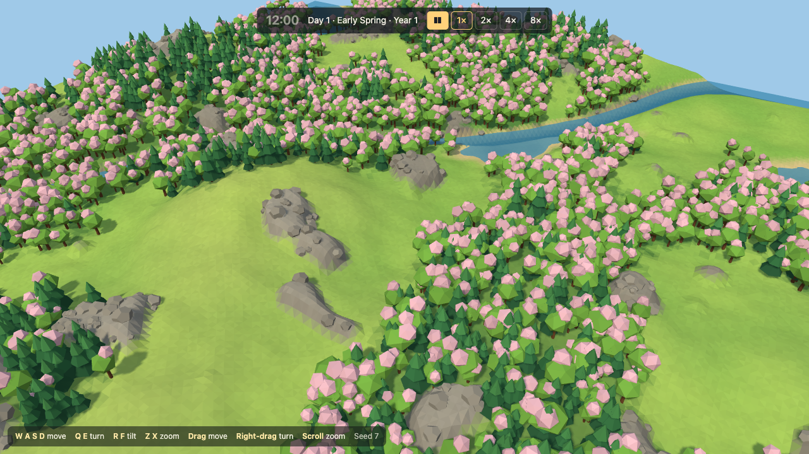
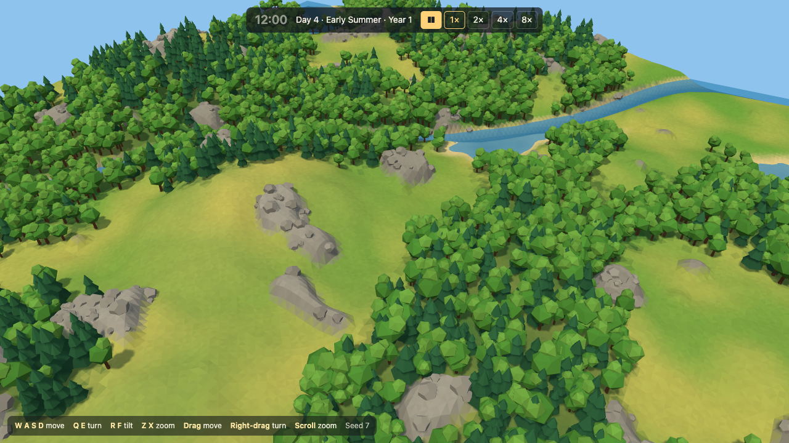
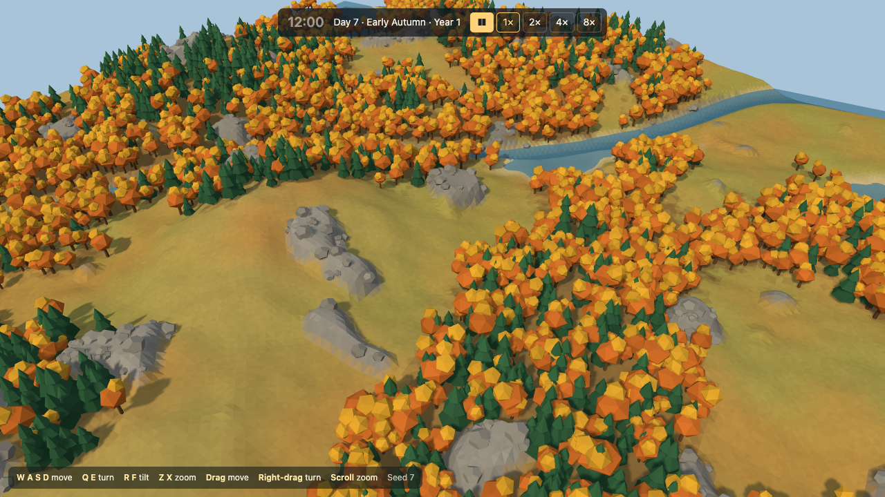
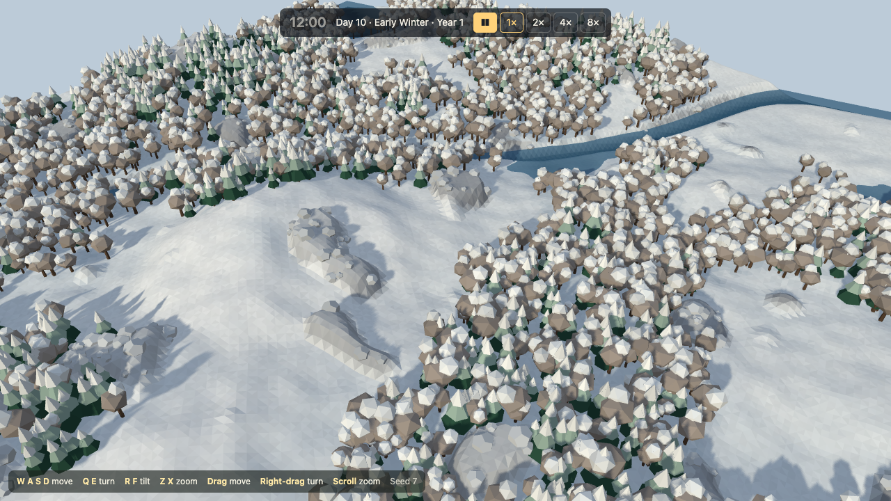

# Stage 1 demo: foundation

The five pull requests of stage 1 are merged. One measurement that the brief asked for is still open: the frame rate in a real browser, which only the owner can take. You can open the game, fly a camera over a seeded map, watch days and seasons pass, and see 1500 villagers and 3000 monsters move. Nothing in the world has behavior yet. The brief is `docs/design/stage-1-foundation.md`.

Every clip below was captured by the verification skill from a production build in headless Chromium. Headless Chromium renders on the CPU, so the clips are choppy and their frame rate says nothing about real hardware.

## The pull requests

### 1.1 Scaffold the app and the verification skill (#4)

An empty lit scene, the checks that run on every pull request, and the skill that captures the proof for every later one.

### 1.2 Draw a seeded terrain with a free camera (#6)

A 256 by 256 tile map of hills, water, forest, and rock outcrops from a seed, and a camera that pans, turns, tilts, and zooms.

### 1.3 Run the clock in a worker (#7)

The simulation runs in a Web Worker at 10 ticks per second. The interface shows the time, the day, the season, and the year, with pause and four speeds.

### 1.5 Benchmark 1500 villagers and 3000 monsters (#8)

Villagers walk between random points, and monsters follow one flow field to the center of the map. `bun run bench` measures the tick without a browser.

### 1.4 Light the world by the clock (#10)

The sun, the sky, and the shadows follow the clock. The night is 30% of the day in summer, 40% in spring and autumn, and 55% in winter. The land changes color with the season.

| Spring | Summer | Autumn | Winter |
| --- | --- | --- | --- |
|  |  |  |  |

## What the stage decided

The brief asked the stage to settle three things.

- **The 512 map holds for the simulation.** With 1500 villagers and 3000 monsters that only move, the 99th percentile tick is 0.036 ms on the 256 map and 0.035 ms on the 512 map, and the heap does not grow across the measured ticks. The benchmark runs on Bun, which uses JavaScriptCore, and the game's worker runs on V8 in Chromium.
- **The 4 ms limit stays, which departs from the brief.** The brief says a measured tick time replaces the 4 ms proposal. The measured tick is about a hundredth of the limit, but the benchmark units only move. The limit is the budget for the behavior that stages 2 and later add, so a measurement of movement alone is a poor replacement. Stage 2 measures the tick again with villagers that work. The stage 2 brief carries the 4 ms limit forward, so the owner confirms or changes this when they accept that brief.
- **The frame rate with 4500 units is not measured, so this decision is open.** It needs a real browser on the owner's machine. Since 1.4 every frame also draws a shadow pass, and the units cast shadows. To measure, run `bun run dev`, open the game, and read the frame rate from the browser's rendering tools at the farthest and the nearest zoom. `?swarm=off` gives the frame rate of the bare map for comparison.

The second risk the stage tested was whether a pull request can prove its own work. It can. Each of the five pull requests carried a clip and screenshots from the verification skill, and the skill now has seven scenarios that pass on `main`: `window`, `terrain`, `camera`, `clock`, `swarm`, `daylight`, and `seasons`.

## Choices made along the way

No decision in `docs/design.md` changed. These choices filled gaps the brief left open, and each is cheap to change.

- The default seed is 7, and the `seed` URL parameter chooses another.
- The point the camera looks at stays on the map, and the camera body can sit past the map edge.
- "Day N" counts days since the start of the game, not the day of the year.
- A new game opens at 08:00 on Day 1, in daylight.
- A monster moves 1 tile per second. If the center of the map is cut off by water or rock, the monsters' goal moves to the nearest tile they can reach.
- `?swarm=off` opens the game with no units.

## Known gaps

- No pixel check covers the direction of the shadows or the shadows of the units.
- The turn from one season to the next has unit tests and no clip.
- The `daylight` scenario first measured the dark share of a spring day from screenshots of a running clock. It read 43.2% and 46.2% in two runs of one revision, against a limit of 47%. The check now reads paused stops beside dusk and dawn instead, and gives the same reading on every run.
- The camera checks run with `?swarm=off`, because the software renderer became too slow for them with unit shadows. More render cost can break them again.
- The build warns that the Three.js bundle is larger than 500 kB.
