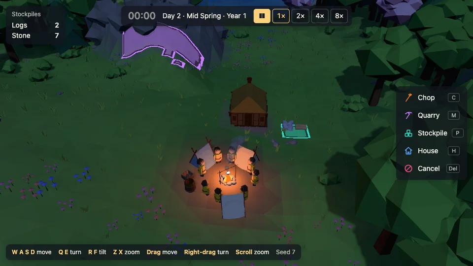
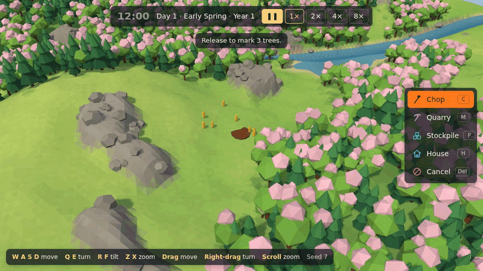
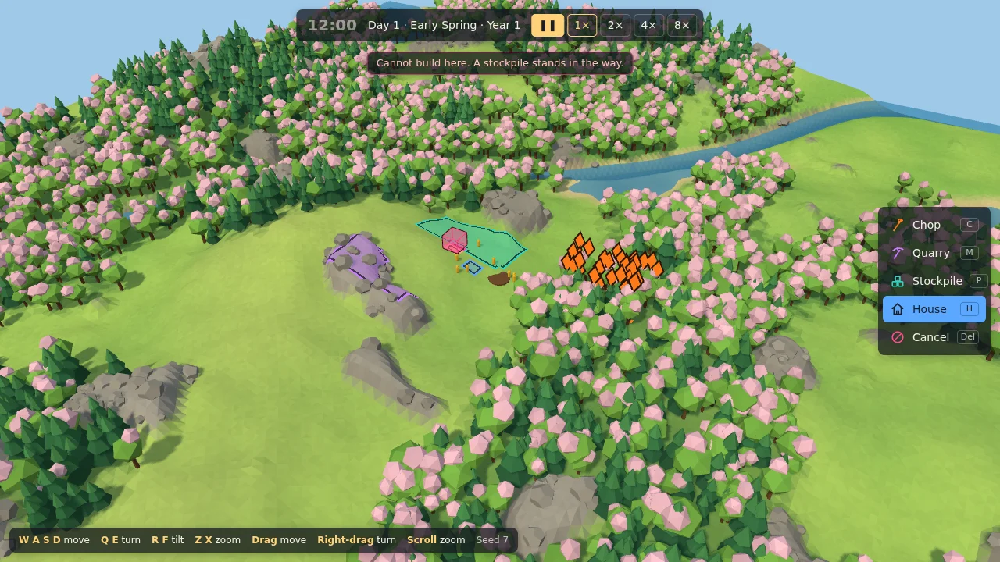
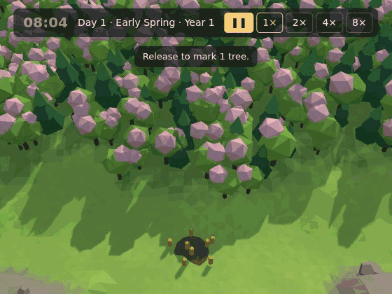
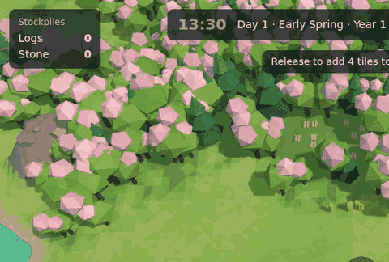
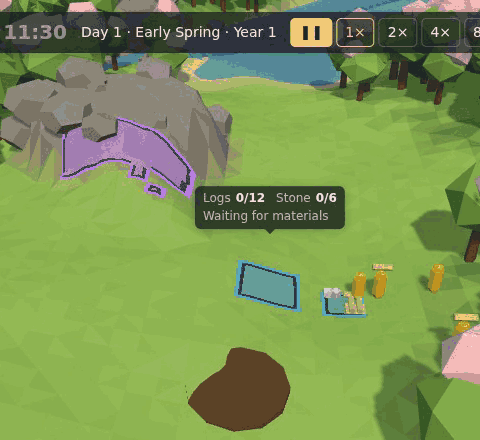
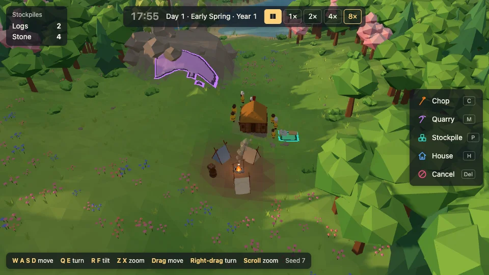
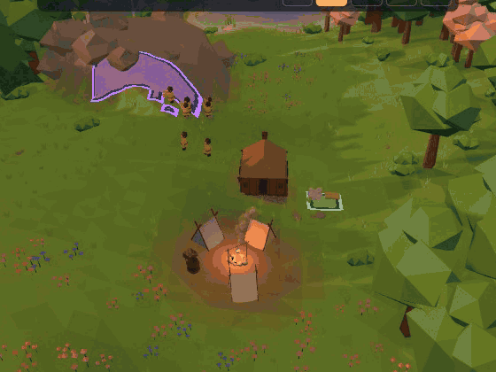
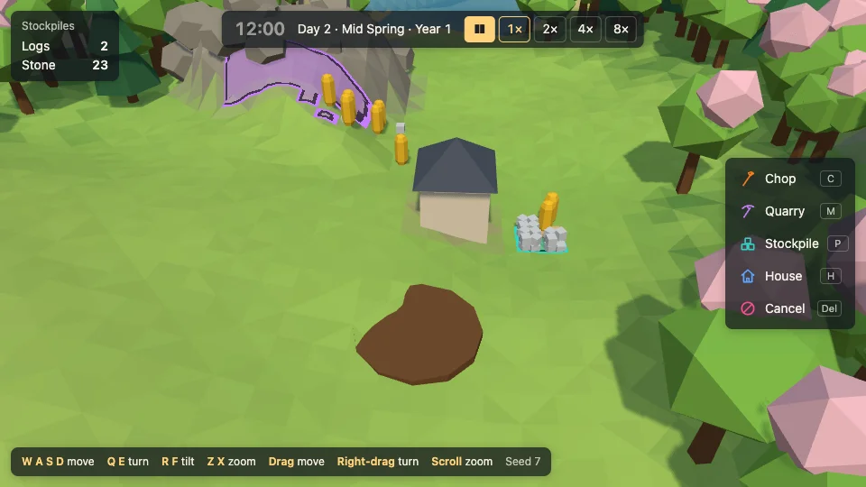
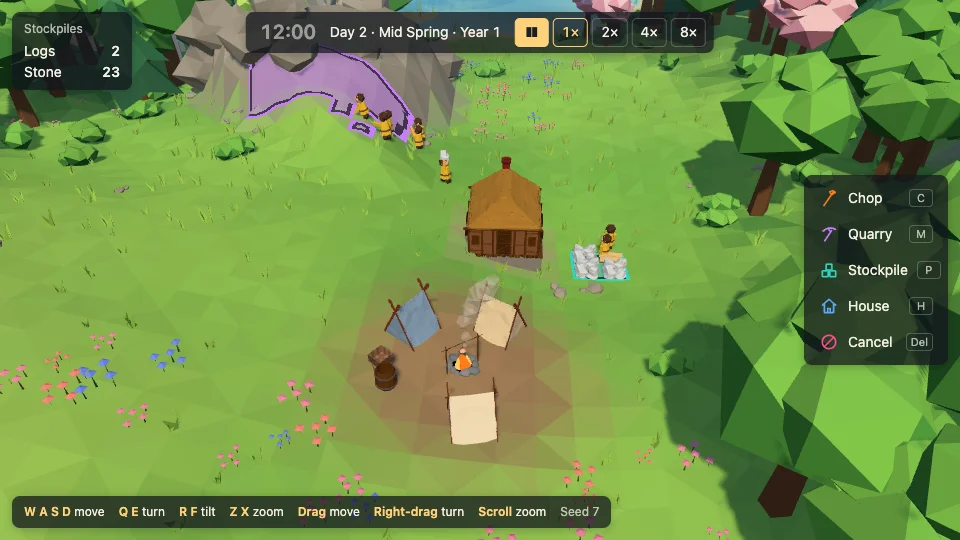

# Stage 2 demo: villagers and physical goods

The six pull requests of stage 2 are merged, and so is one later fix of a check. You can start with 8 settlers at a camp, mark trees, rock, and a stockpile, and place a house. The settlers chop and quarry, carry the logs and stone one unit at a time, and build the house. The settlement has the look of the purchased low-poly packs. The brief is `docs/design/stage-2-villagers-and-goods.md`.

Every clip below was captured by the verification skill from a production build in headless Chromium, on seed 7. Headless Chromium renders on the CPU, so the clips are choppy and their frame rate says nothing about real hardware.

The clips and screenshots below are the stage's demo set, on the `pr-media` branch under `stage-2/`. The media in the stage's pull requests is pruned from `pr-media` when the stage closes. The demo set is 10 files and 14.8 MB, copied unchanged from the pull requests. Pull request 2.6 (#20) changed the look of everything on screen. The clips of 2.2 to 2.5 and the screenshot of 2.2 show the look before it. The screenshots of 2.1 and 2.5 come from 2.6 and show the look of today.

The demo set leaves out the dusk and dawn clip of 2.1 (#15), 3.0 MB, because the set holds one clip for each of the other five pull requests and has no room for a sixth. The clip of 2.6 shows the same walk home at dusk in the look of today.

## The owner's decisions during the stage

- **The look comes from purchased low-poly packs.** On 2026-11-15 the owner decided that the camp, the goods, and the house are models from the purchased packs. The packs and the models converted from them live in the private repository `ramtinJ95/survive-n-conquest-assets`, cloned at `game-assets/`, and never in this repository. Without the clone the game draws stand-in shapes and says so on screen. The settlers, the trees, the rock, and the ground cover stay shapes built in code. The decision is in the brief's text for 2.6, and #20 carries it out.
- **The look is frozen.** On 2026-11-15, after the pictures of the second round of #20, the owner decided that the look is not tuned further until the mechanics can be playtested. The stage 3 brief records the decision. #20 records these weak points for a later pass.
  - The house, the tents, and the scaffold read as toys. The house is one pack model stretched to 1.3 times its width.
  - Autumn is one hue of mustard and orange across the whole forest.
  - The camp's soil follows the tile grid and looks blocky.
  - The settlers are small. At the farthest view a settler is less than a pixel.
  - The open sea is flat and empty, and the sky has no clouds. Where land reaches the border of the map, the cut side of the ground still shows above the water.
  - Shadows have hard edges.
  - The night is dark away from the fire.
  - Motion follows the game clock, so the wind and the waves run 8 times faster at 8×, and every day repeats the same motion.
  - The greens at noon are strong, and the hour before sunset is olive on open ground.
  - No path wears into the ground between the camp and the work.

## The pull requests

### 2.1 Start with settlers at a camp (#15)

The game opens with 8 settlers at a camp near the center of the map, not with the stage 1 swarm. By day they wander near the camp. At dusk they walk back to it and stay until dawn. They walk around water and rock. `?swarm=on` brings back the 1500 villagers and 3000 monsters. The worker owns the map from here on.

The picture is from #20 and shows the camp at midnight on day 2, in the look of today, with the settlers in their ring around the fire.

### 2.2 Give orders to the land (#16)

A toolbar offers Chop, Quarry, Stockpile, House, and Cancel. A drag marks trees, rock, or a stockpile zone. A house goes on the tile grid, and a house that does not fit shows that before it is placed. The status line says why. Every order is a simulation command. No villager acts on an order yet.

The clip and the screenshot show the look before #20. The clip marks trees with Chop. The screenshot shows every kind of mark at spring noon: chop pins, rock to quarry in violet, the stockpile in teal, a house site in blue, and a house refused over the stockpile's edge.

### 2.3 Chop trees and quarry rock (#17)

Settlers walk to marked trees and rock and work them. A felled tree leaves 2 logs on its tile. Each 20 seconds of quarrying leaves 1 stone, and a rock tile turns to bare ground after 8. At dusk the settlers drop the work, and at dawn they take it up again. This pull request built the task system that 2.4 and 2.5 extend.

The clip shows the look before #20. A drag marks 12 trees just after 08:00, and at 8× the settlers fell them by 12:42.

### 2.4 Carry goods to a stockpile (#18)

Settlers pick up logs and stone from the ground, one unit at a time, and stack them in the stockpile zone. Each task reserves one unit and one place, so two settlers never walk for the same log or the same gap. A panel at the top left shows the totals in the stockpiles. At dusk a carrier puts its unit down, and after dawn the settlers carry it on.

The clip shows the look before #20. The stockpile is marked at 13:30 beside a cleared grove, and the clip runs at 8× to 17:30. The Logs total climbs 0, 8, 16, 20, 22.

### 2.5 Build a house (#19)

Settlers carry 12 logs and 6 stone to a placed house, from the ground and from stockpiles, then build it. Up to 4 share the work. A label over the site shows what has arrived and how far the work is. The finished house blocks its nine tiles, the routes go around it, and it cannot be cancelled. Cancel now ends a task at once.

The clip shows the look before #20. It runs at 8× from the empty site at 11:30 to the finished house at 17:56. The picture is from #20 and shows the house of today at 17:55.

### 2.6 Give the settlement its look (#20)

The house, the tents, the pot, the fire ring, the barrel, the crates, the log, and the stone are models from the purchased packs. The map is an island in a sea. Trees, rock, and ground cover are built in code and turn with the seasons. The fire lights the camp at night. Trees, grass, water, flame, and smoke move with the clock. A settler is a figure built in code that walks, works, and holds its load up. The camera zooms in to 14 m. This pull request ran on `claude-fable-5-2` on the owner's Mac.

The clip shows a working settlement at dusk. The settlers quarry the rock face, the light turns, and they walk back toward the fire.

Before and after, from the same scene, seed, and camera, at noon. Before is `main` before #20 at its nearest view of 22 m.

| Before #20 | After #20 |
| --- | --- |
|  |  |

### After the stage: the hauling check holds in a pylon (#23)

The `hauling` scenario failed on `main` in a pylon. Its dawn check read the route at 07:00, while the carriers lift the dropped logs and the light brightens fast, so a stop a few ticks off read a very different number. The check now reads the route at 11:00, when it is clear. No game code changed. The fix has no clip.

## What the stage measured

Every number below is taken from the pull request named beside it. Nothing was measured again for this summary.

### The first house with 8 settlers

The brief's target is that 8 settlers finish the first house within two spring days when the trees and the rock are within 40 tiles of the site.

- A test on seed 7 with 8 settlers on the 256 map places the house at the legal site nearest the camp, a 16-tile stockpile beside the camp, and marks every tree and rock tile within 40 tiles. The house is finished **1196 ticks after placement, 119.6 seconds of game time at 1×, all in daylight**. Building work begins at tick 924. The run is deterministic, so the test asserts the exact number. (#19)
- In the browser scenario, with fewer marks, the house is placed at 11:30 and stands at 17:56, 6.4 game hours later. Most of the wait is for the last stone. (#19)

### The tick time against the 4 ms limit

These are pylon numbers from `bun run bench` on rj-firebat (AMD Ryzen 7 255, 6 cores, bun 1.3.14), with 1500 villagers and 3000 monsters. The 4 ms limit is defined on the owner's machine, and no pull request of the stage measured there. From 2.3 on, the benchmark villagers run every task system that has landed. Each pull request ran the benchmark its own way, as its column says.

| Pull request | Runs | p99, 256 map | p99, 512 map |
| --- | --- | --- | --- |
| 2.1 (#15) | 1 | 0.081 ms | 0.078 ms |
| 2.2 (#16) | 1, a second run in brackets | 0.088 ms (0.087) | 0.093 ms (0.090) |
| 2.3 (#17), chop and quarry | Median of 5 | 0.241 ms | 1.130 ms |
| 2.4 (#18), carry | Range of 3 | 0.457 to 0.468 ms | 1.106 to 1.162 ms |
| 2.5 (#19), build | Range of 3 | 0.856 to 0.887 ms | 1.620 to 1.664 ms |

- Every p99 passes. The highest, 1.664 ms on the 512 map after 2.5, is about 42% of the limit. (#19)
- After 2.5, 98.4% of daytime villager-ticks held a task on both maps. On the 256 map the measured ticks felled 6794 trees, quarried 1438 stone, carried 14,382 units onto stockpile tiles, delivered 658 units to sites, and built 90 houses. (#19)
- The slowest tick is the dawn rush, when all 1500 villagers take tasks within ten ticks. After 2.5 it is 7.61 to 8.38 ms on the 256 map and 21.1 to 23.4 ms on the 512 map, which is over the 12.5 ms tick at 8×. Only the p99 has a limit. (#19)
- The p99 doubled in 2.5 because a unit for a site travels far. Those trips average 76.1 tiles on the 256 map and 101.6 on the 512 map, against 1.5 tiles for a haul to a stockpile in the benchmark's layout. (#19)

### The cost of the look

Draw calls and triangles of one frame on seed 7, shadow pass included, from the `look` scenario. (#20)

| View | Before #20 | After #20 |
| --- | --- | --- |
| Working settlement, site supplied | 20 calls, 859,078 triangles | 38 calls, 1,313,542 triangles |
| Settlement with the finished house, noon | 22 calls, 859,510 triangles | 38 calls, 1,337,510 triangles |
| `?swarm=on`, noon | 20 calls, 1,364,726 triangles | 38 calls, 2,467,830 triangles |

Frame times on the owner's Mac (Apple M5 Pro, headless Chromium on ANGLE Metal, 960 by 540, no frame cap), from the `frames` scenario. Each range is over the medians of the drives of one build, three before #20 and five after. (#20)

| | Before #20 | After #20 |
| --- | --- | --- |
| Settlement at work, frames a second | 644 to 666 | 590 to 624 |
| Settlement at work, work of a frame | 1.43 to 1.48 ms | 1.39 to 1.61 ms |
| Swarm, frames a second | 640 to 673 | 480 to 600 |
| Swarm, work of a frame | 1.19 to 1.25 ms | 1.55 to 1.94 ms |

#20 reads a cost in the settlement's frames a second, because every drive after it is below every drive before it. The swarm's numbers move with the state of the machine as much as with the build. A frame takes under 2 ms of work at this size on this GPU. A weaker GPU and a full-screen Retina window were not measured.

## What the stage decided

The brief asked the stage to settle three things.

- **Orders to the land, taken by the nearest free villager, are enough until workplaces arrive.** Every behavior of the stage runs on them. Building comes first, then carrying to a site, then carrying to a stockpile, then chopping and quarrying. The stage 3 brief keeps them and adds workplaces beside them. No one has played the game yet, so whether the orders feel right is still a question for the first playtest.
- **A load of 1 and the proposed work times stay.** The first house took 119.6 seconds of game time, far inside the target of two spring days, so nothing had to change. (#19) The target is a ceiling, and the brief sets no floor. Whether a house that 8 settlers build in two minutes of daylight is too quick is a question for a playtest.
- **The tick time with 1500 working villagers is within the 4 ms limit in a pylon.** The p99 rose from 0.08 ms to 1.66 ms across the stage. (#15, #19) No pull request measured it on the owner's machine, where the limit is defined.

## Choices made along the way

No decision in `docs/design.md` changed. These choices filled gaps the brief left open.

- A stockpile or a site may not touch any tile under the camp's disc, which goes beyond the brief's single camp tile. (#16)
- Chop is orange and Cancel is raspberry, so no mark looks like a settler or a monster to the pixel checks. (#16)
- A settler with no task wanders near the camp, and a settler whose task just ended waits where it stands until it next looks for work. (#17)
- A settler that cannot put a unit down keeps it in its hands. (#18)
- When a house is finished, a settler or a monster on land that reached the camp only across the site moves too, not only one on the house's nine tiles. (#19)
- A site's label hides while an order tool is active, so it never covers a house preview or a mark. (#19)
- The map is an island in a sea. The trees, rock, and ground cover are built in code, not taken from the packs. The settlers are 1.1 m tall, because the house cannot grow past its nine tiles. The camera's nearest view is 14 m, not 22 m. (#20)
- The brief gave 2.2 to Fable 5.2. Fable is not available in a pylon, so 2.2 ran on `claude-opus-5-5`, and 2.6 passed over its look again. (#16)

## Left open for the owner

- **A house finished after quarrying can cut off land.** The divide test runs only when a site is placed, so quarrying can later connect land that reaches the camp only across the site. Tasks and goods on that land close when the house is finished, and no settler stays on it, so nothing breaks. No rule of the stage settles it. (#17, #19)
- **The tick time on the owner's machine.** Every tick time of the stage is a pylon number. The dawn rush on the 512 map, 21.1 to 23.4 ms, is over the 12.5 ms tick at 8×. (#19)
- **The frame rate on real hardware.** #20 measured frame times on the owner's Mac, in headless Chromium at 960 by 540. A full-screen Retina window and a weaker GPU were not measured. (#20)
- **Fewer villagers reach the camp by each midnight in the benchmark.** After 2.5 it is 1212, 981, then 604 of 1500 on the 256 map. `main` before 2.5 declined too, with 1500, 1470, then 536. #19 guesses that the work front moves away from the camp and did not check. (#19)
- **The game takes whatever `models.glb` the clone holds.** No revision of the assets repository is pinned. (#20)
- **The hauling check is calibrated in a pylon.** #23 did not run it again on the Mac's GPU. (#23)

## Known gaps

- No pixel check covers carrying stone in the browser, or that no settler stands inside a finished house. Unit tests cover both. (#18, #19)
- The look's checks stop in spring and winter. Autumn and summer have no capture of the marks, the logs, or the stone. (#16, #17, #20)
- The browser scenarios run on seed 7 only. (#20)
- Motion at 8× was not verified. #20 looked at the wind, the waves, and the smoke only in stills and in the dusk clip at 1×. (#20)
- How several site labels read when sites stand close together was not checked. (#19)
- The `frames` scenario counts more triangles for the swarm than `look` does on the same view, on every build, and #20 did not find why. (#20)
