# Stage 3 demo: food

The six pull requests of stage 3 are merged. The 8 settlers are now 4 named households, and a finished house becomes the home of one of them. Each settler eats once a day from its household's store, goes hungry after a missed meal, and dies at its third missed meal in a row. You can click a settler, a building, a site, or the camp and read what it is doing. You can place a forager's hut, a barn, and a hunter's lodge, set how many places a workplace fills, and watch foragers pick food in the forest and hunters stalk and shoot deer. On seed 7 a player who builds a hut, a barn, and a lodge in the first spring brings all 8 settlers through the first winter with no missed meal. The brief is `docs/design/stage-3-food.md`.

Every clip below was captured by the verification skill from a production build in headless Chromium, on seed 7. Headless Chromium renders on the CPU, so the clips are choppy and their frame rate says nothing about real hardware.

The clips and screenshots below are the stage's demo set, on the `pr-media` branch under `stage-3/`. The media in the stage's pull requests is pruned from `pr-media` when the stage closes. The demo set is 13 files and 14.97 MB (14,974,314 bytes): seven clips and six screenshots. The hunt clip of 3.6 and the six screenshots are copied unchanged. The other six clips were re-encoded to fit the set under 15 MB. The site clip of 3.1 drops the frames that repeat the one before. The clips of 3.2, 3.3, 3.4, 3.5, and the deer clip of 3.6 drop repeated frames and then keep every second frame. Each kept frame shows for the time of the frames it replaces, so every clip runs as long as before and moves less smoothly. The re-encoded clips were looked at frame by frame after the change, and the clock, the panels, and the totals in them still read.

The demo set leaves out these files of the stage's pull requests, for the reasons given.

- **The settler clip of 3.1 (#22), 3.96 MB.** The set has no room for it beside the site clip, which is 0.77 MB. The screenshot of a settler's panel from the same run stays, and every later clip follows a selected settler's panel.
- **The site, house, and camp screenshots of 3.1 (#22).** The site clip shows the site's panel and the house's panel.
- **The midnight screenshot of 3.2 (#25).** The clip shows the same night.
- **The died-out screenshot of 3.3 (#26).** The clip ends on the same dialog.
- **The forager's panel of 3.4 (#27).** The clip follows a forager's panel with its `Job` row.
- **The barn's panel of 3.5 (#29), 56 KB.** It would take the set over 15 MB. Its text is quoted in 3.5 below.

## The owner's decisions during the stage

- **The look is frozen.** On 2026-11-15 the owner decided that the look is not tuned further until the mechanics can be playtested. The stage brief records the decision. The barn, the hut, the lodge, and the deer are therefore plain shapes built in code.
- **Stage 2 is closed.** On 2026-11-16 the owner accepted the stage 2 summary, and its pull request media was pruned from `pr-media`.
- **No `/pr-diary` reminder.** On 2026-11-16 the owner said that this project has no `/pr-diary` reminder. (#28)
- **Foraging is a bit too generous.** On 2026-11-16 the owner found foraging "a bit too generous". The work for one unit will go from 20 seconds to 25 or 30. The owner has not chosen the number, and the game still uses 20.
- **Starving away from home is a bit too strict.** On 2026-11-16 the owner found it "a bit too strict" that a settler who does not get home starves. A settler dies at the third missed meal in a row, not after one day. No rule has changed yet.

## The pull requests

### 3.1 Select a villager or a building and read it (#22)

With no tool active, a click selects a settler, a house, a site, or the camp. A ring in the interface's accent marks the selected thing on the map and follows a walking settler. A panel at the bottom left says what it is and what it is doing. A settler's panel reads `Doing` and `Carries`. A site's panel reads its logs, stone, work, and builders. A house's panel reads `A finished house.` A click on bare ground, the close button, or Escape clears the selection. Every later pull request of the stage adds its rows to this panel.

The clip runs at 8× on day 1 from 16:59 to 17:53. A house site is selected. Its panel reads `Logs 12/12`, `Stone 6/6`, and `Builders 4`, and its work climbs from 51% at 16:59 to 61% at 17:10 and 97% at 17:49. At 17:53 the house stands and the panel reads `House` and `A finished house.` The screenshot is from the settler clip at day 1 11:15, before 3.2 gave the settlers names, so the panel's title is still `Settler`. It reads `Walking to pick up a log` and `Carries Nothing`.

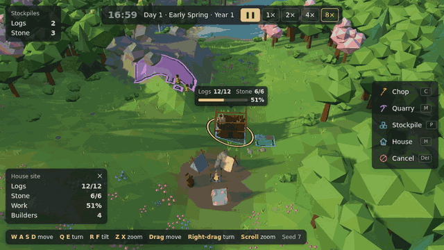

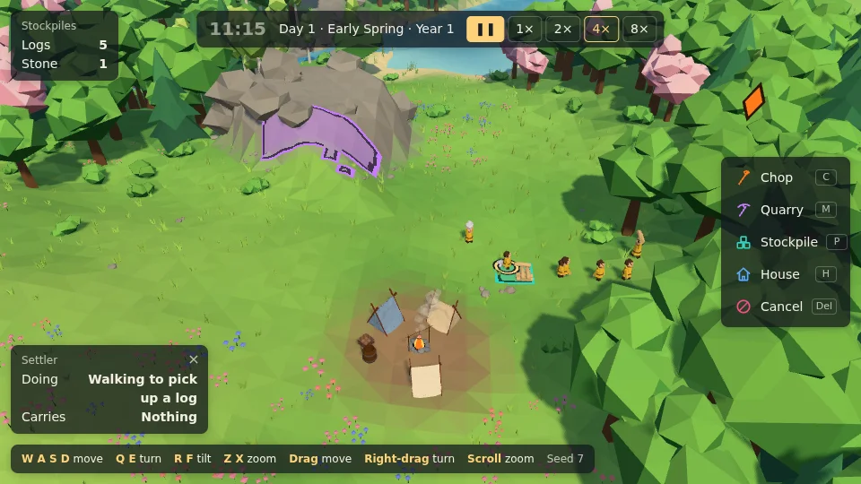

### 3.2 Households move into houses (#25)

The 8 settlers are 4 households of one man and one woman, with names the seed chooses. On seed 7 they are Merek and Elsi, Ulvar and Ysa, Jorrin and Fenna, and Dorran and Nella. A finished house becomes the home of the lowest-numbered household without one. At dusk a household with a home walks to its house and goes inside, and the other households walk to the camp. At dawn the housed settlers come out beside their houses. A settler's panel is titled with its name and reads its sex, its household, and its home.

The clip runs from day 2 19:00 to day 3 04:59, with two houses standing near the camp. At 19:00 the settlers work at the rock marked for quarrying. By 19:36 they walk down toward the houses and the camp. From 21:36 to 04:21 settlers sit at the fire and nobody stands by the houses. The scenario's pixel check reads the camp at midnight as the two households without a home. (#25) At 04:59 the settlers are out again, some beside each house.

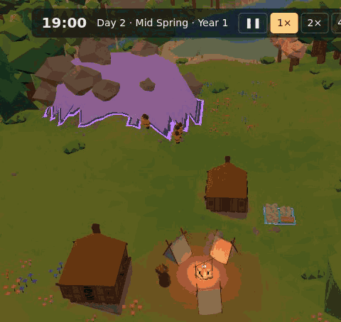

### 3.3 Settlers eat, go hungry, and starve (#26)

The camp starts with 24 food. Each settler eats 1 unit when it comes home at dusk, from its house or from the camp. A settler that finds no food misses the meal, works at half the rate after it, and dies at its third missed meal in a row. A household with a house carries food home from the camp before any other work. The top-left panel shows the food at the camp and the food in homes, a news log names who went hungry and who starved, and a dialog says when the settlement has died out. Nothing produces food yet, so every game ends.

The clip runs at 8× from day 3 19:08, when the camp holds 8 food, to day 6 20:54. The camp reads 0 from the night of day 3 on. From day 4 22:02 the news reads "Day 4, 20:29. Merek, Elsi, Ulvar, Ysa, Jorrin, Fenna, Dorran and Nella went hungry." The last frame shows the dialog "The settlement has died out" with `New map`, and the news reads "Day 6, 20:25. Merek, Elsi, Ulvar, Ysa, Jorrin, Fenna, Dorran and Nella starved." The screenshot shows Elsi's panel at day 5 12:00, `Missed meals 1, hungry`.

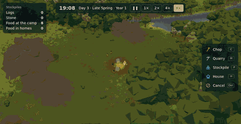

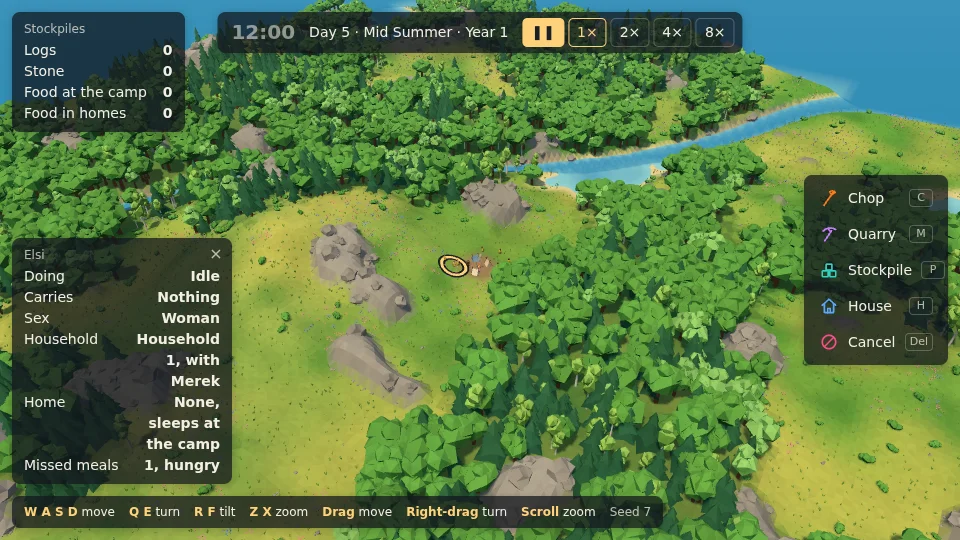

### 3.4 Assign foragers to a hut (#27)

The `Hut` tool on `G` places a forager's hut, and the settlers build it. Its two places go to the nearest settlers without a job, who become foragers. A forager picks 1 food at a tree within 20 tiles of the hut and carries it to the camp. A picked tile bears again after 2 days, and nothing bears in winter. The hut's panel names its foragers and sets its places with `−` and `+`. A settler with a job takes no order to the land. The top-left panel counts the settlers with a job and without one. Houses and huts now share one buildings table.

The clip runs on day 2 from 05:03 to 19:00. Elsi is selected, and her panel reads `Job Forager`. She walks from the camp to the trees near the hut, forages, and carries food back, and `Food at the camp` climbs from 20 to 28. The screenshot shows the hut's panel at day 1 12:16 with `Foragers Elsi and Ulvar` and `Places 2 of 2`, and the news line "Day 1, 12:13. Elsi and Ulvar became foragers."

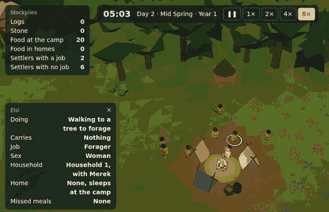

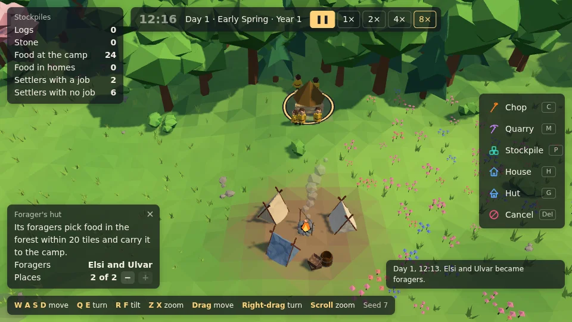

### 3.5 Store food in a barn (#29)

The `Barn` tool on `B` places a barn, and the settlers build it. A finished barn holds 120 food. Foragers carry each unit to the store nearest the tree, the camp or a barn, that has room. Settlers without a job carry food that lies on the ground to the nearest store with room. Food that nobody carries is gone at the second dawn after it was put down. A household with a house fetches its food from the store nearest its house. The top-left panel reads `Barn and camp food` and `Food in homes`. The barn's panel reads "Barn; A finished barn. Food in it keeps.; Food: 0 of 120" when it is finished, by the `storing` scenario's check. (#29)

The clip runs on day 4 from 03:26 to 06:30 and follows Merek, a forager whose household has a house. At 03:42 his panel reads `Carrying food home` and `Carries 1 food`. By 03:46 `Food in homes` has gone from 4 to 6, and `Barn and camp food` from 17 to 15. He then walks to a tree and forages. His panel reads `Foraging` at 06:02, and at 06:05 it reads `Carrying food to a barn` and `Carries 1 food`. `Barn and camp food` climbs back to 17 by 05:56. The screenshots show the ground beside the camp at day 3 12:00 and day 4 12:00, on a page where four huts take all 8 settlers, so nobody carries food from the ground. Small sacks lie left and right of the camp on day 3 and are gone on day 4.

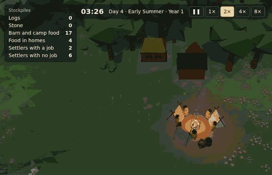

| Food on the ground on day 3 | The same ground on day 4 |
| --- | --- |
| 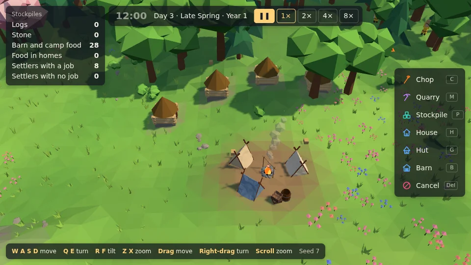 | 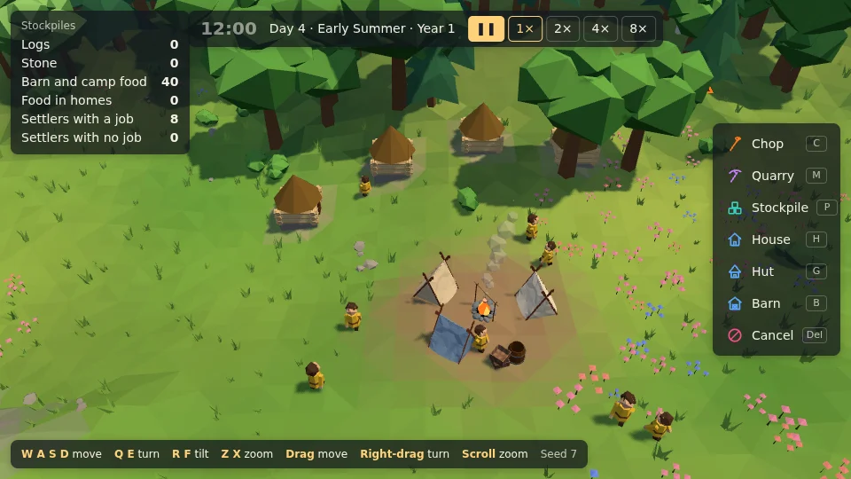 |

### 3.6 Hunt deer (#30)

Deer wander the grass and the forest and run from any settler within 6 tiles. The `Lodge` tool on `L` places a hunter's lodge, and the settlers build it. Its two hunters stalk the nearest deer within 40 tiles of the lodge, aim for 4 seconds from 10 tiles or nearer, and hit 2 times in 3. A hit leaves 6 food on the deer's tile, and the hunter and the settlers without a job carry it to the nearest store with room. A deer walks in from the map's edge at each dawn while the map holds fewer than its number. The lodge's panel names its hunters and sets its places.

The hunt clip runs on day 2 from 14:16 to 17:22 and follows the hunter Merek. His panel reads `Stalking a deer` at 14:16, `Aiming at a deer` from 14:18 to 14:33, and `Looking for deer` at 14:36 after the miss. He stalks again, aims at 15:10, and reads `Looking for deer` at 15:25. From 15:41 he reads `Walking to a kill to pick up food`, and from 16:21 `Carrying food to a barn` with `Carries 1 food`. The clip ends at 17:22 at the barn's door, just before the delivery, with Merek still carrying his unit. `Barn and camp food` reads 16 through the clip and 17 in its last frame. The scenario's checks prove the delivery in a later run. There the barn's panel goes from "0 of 120" to "1 of 120" and `Barn and camp food` from 16 to 17, and at 18:04 the hunter's hands are empty 73 px from the barn's roof. (#30)

The deer clip runs at 1× on day 2 from 05:48 to 06:16. A deer walks toward the settlers at the rock, turns at about 05:56, and runs across the meadow out of the left of the frame. The screenshot shows the lodge's panel at day 2 14:13, `Hunters Merek and Elsi` and `Places 2 of 2`, with the news line "Day 2, 14:12. Merek and Elsi became hunters."

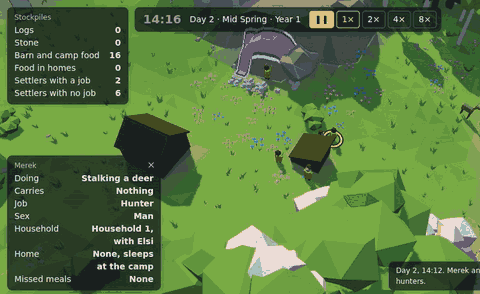

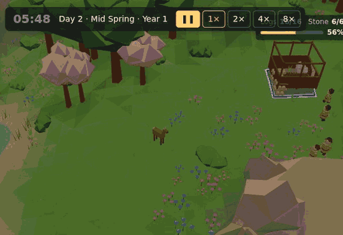

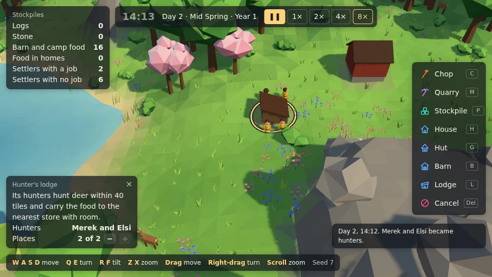

### During the stage: no `/pr-diary` reminder (#28)

`CLAUDE.md` no longer tells the orchestrator to remind the owner about `/pr-diary`, and nobody runs it for the owner. No code changed.

## What the stage measured

Every number below is taken from the pull request named beside it, with one exception. The year with a hut and no barn at 25 and 30 seconds of foraging comes from 3.5's report to the orchestrator, as its section says. Nothing was measured again for this summary.

### Seed 7 with no orders

The camp hands out its 24 meals at the dusks of days 1 to 3. Every settler misses its first meal at the dusk of day 4 and its third at the dusk of day 6, in late summer. `src/sim/food.test.ts` asserts these times. (#26)

| Settler | Household | Died |
| --- | --- | --- |
| Ysa | 2 | Day 6, 20:24 |
| Jorrin | 3 | Day 6, 20:31 |
| Elsi | 1 | Day 6, 20:40 |
| Dorran | 4 | Day 6, 20:41 |
| Fenna | 3 | Day 6, 20:45 |
| Nella | 4 | Day 6, 20:48 |
| Merek | 1 | Day 6, 20:53 |
| Ulvar | 2 | Day 6, 20:54 |

The news log reads the first death as "Day 6, 20:25", because a news line takes the time of the frame that brought it. (#26) The later pull requests say that these times hold. (#27, #29, #30)

### One hut

Ysa, the first forager hired, picks 4 food on day 2 in spring and 4 on day 7 in autumn with both places filled. Alone in the hut she picks 5 and 4. Two foragers pick 8 a day in spring and autumn, which equals the 8 meals, and 10 a day in summer. (#27)

The first year on seed 7 has a hut at (136, 127) and Chop on its 4 nearest trees, because the camp starts with no logs. The hut stands at day 1 12:18. The table reads the food at each dusk, before the meals. (#27)

| Dusk | Season | Camp | Homes | Living |
| --- | --- | --- | --- | --- |
| Day 1 | Spring | 28 | 0 | 8 |
| Day 2 | Spring | 28 | 0 | 8 |
| Day 3 | Spring | 28 | 0 | 8 |
| Day 4 | Summer | 30 | 0 | 8 |
| Day 5 | Summer | 32 | 0 | 8 |
| Day 6 | Summer | 34 | 0 | 8 |
| Day 7 | Autumn | 34 | 0 | 8 |
| Day 8 | Autumn | 34 | 0 | 8 |
| Day 9 | Autumn | 34 | 0 | 8 |
| Day 10 | Winter | 27 | 0 | 8 |
| Day 11 | Winter | 19 | 0 | 8 |
| Day 12 | Winter | 11 | 0 | 8 |

Nobody dies. The foragers pick 75 units, and the settlers eat 96 meals and miss none. The camp never reaches its limit of 40. (#27) #29 ran the same year again with its dusk rule. The foragers still pick 75 units. They deliver 74 themselves, a settler without a job carries the other 1 in from the ground, and the camp's food at every dusk is the same. (#29)

### A barn beside the hut and a barn far away

These runs add a barn to #27's year, with Chop on 8 more trees and Quarry on one rock tile for its goods. Beside the hut, the barn stands on (139, 127), 2.5 tiles from the hut's middle and 12 from the camp. Far from it, the barn stands on (104, 127), 32.5 tiles from the hut and 23 from the camp. The tables read the food at each dusk, before the meals. (#29)

| Dusk | Season | Beside: barn | Beside: camp | Far: barn | Far: camp |
| --- | --- | --- | --- | --- | --- |
| 1 | Spring | 0 | 28 | 0 | 26 |
| 2 | Spring | 2 | 26 | 0 | 27 |
| 3 | Spring | 14 | 18 | 0 | 25 |
| 4 | Summer | 28 | 10 | 0 | 27 |
| 5 | Summer | 36 | 8 | 0 | 29 |
| 6 | Summer | 42 | 8 | 0 | 30 |
| 7 | Autumn | 46 | 8 | 0 | 30 |
| 8 | Autumn | 50 | 8 | 0 | 30 |
| 9 | Autumn | 53 | 8 | 0 | 31 |
| 10 | Winter | 46 | 8 | 0 | 23 |
| 11 | Winter | 38 | 8 | 0 | 15 |
| 12 | Winter | 30 | 8 | 0 | 7 |

| Run | Barn finished | Picked | From the ground | Barn to camp | Meals | Missed | Deaths |
| --- | --- | --- | --- | --- | --- | --- | --- |
| No barn, #27's year run again by #29 | none | 75 | 1 | 0 | 96 | none | none |
| Barn beside the hut | day 2 14:33 | 102 | 1 | 62 | 96 | none | none |
| Barn far from the hut | day 2 18:58 | 71 | 7 | 0 | 95 | Ulvar, day 12 17:52 | none |

The far barn never gets food, because the camp lies nearer every tree and never fills. (#29)

A second pair adds a house for each household west of the camp, with Chop on 24 more trees in the hut's reach and Quarry on 3 more rock tiles. (#29)

| Dusk | Beside: barn | Beside: camp | Beside: homes | Far: barn | Far: camp | Far: homes |
| --- | --- | --- | --- | --- | --- | --- |
| 1 | 0 | 28 | 0 | 0 | 28 | 0 |
| 2 | 0 | 28 | 0 | 0 | 27 | 1 |
| 3 | 0 | 26 | 0 | 0 | 22 | 6 |
| 4 | 4 | 9 | 15 | 0 | 11 | 18 |
| 5 | 6 | 0 | 24 | 0 | 4 | 24 |
| 6 | 10 | 0 | 24 | 0 | 4 | 24 |
| 7 | 10 | 0 | 24 | 0 | 3 | 24 |
| 8 | 11 | 0 | 24 | 0 | 1 | 24 |
| 9 | 11 | 0 | 24 | 0 | 0 | 23 |
| 10 | 3 | 0 | 24 | 0 | 0 | 15 |
| 11 | 0 | 0 | 19 | 0 | 0 | 7 |
| 12 | 0 | 0 | 11 | 0 | 0 | 0 |

| Run | Barn finished | Houses finished | Picked | Missed | Deaths |
| --- | --- | --- | --- | --- | --- |
| Houses, barn beside the hut | day 4 08:34 | days 3 to 5 | 73 | Elsi and Merek, day 3 20:00 and 20:03 | none |
| Houses, barn far from the hut | day 6 06:38 | days 2 to 5 | 62 | Merek day 2; Jorrin day 11; Fenna, Merek, Ysa, Ulvar, Elsi, Dorran, Jorrin, Nella day 12 | none |

The two meals missed on day 3 in the first house run come from a house finished at 18:58 with nothing in it yet. The houses' 48 logs fell trees in the hut's reach in both runs. (#29)

### The first year with a hut, a barn, and a lodge

All 8 settlers come through the first winter on seed 7 with a hut, a barn, and a lodge, with no missed meal and no death. They also come through with a barn and a lodge and no hut, and the barn ends that year empty. (#30)

The commands are #29's with the barn beside the hut. They add the lodge on (124, 129), Chop on 4 more trees, and Quarry on (121, 114). Every order is given at tick 0. The tables read the food at the last tick of each season and at each winter dusk, before the meals. `Ground` is food lying on the ground. `In reach` counts the deer within 40 tiles of the lodge. `Picked` and `Kills` count from the start of the year. (#30)

**With the hut, the barn, and the lodge.** The hut was finished at day 1 13:08, the lodge at day 2 10:01, and the barn at day 2 18:24. Ysa and Jorrin became foragers, and Merek and Ulvar hunters. (#30)

| When | Season | Barn | Camp | Homes | Ground | Deer | In reach | Picked | Kills | Living |
| --- | --- | --- | --- | --- | --- | --- | --- | --- | --- | --- |
| end of day 3 | Spring | 23 | 22 | 0 | 13 | 33 | 0 | 22 | 6 | 8 |
| end of day 6 | Summer | 77 | 27 | 0 | 0 | 31 | 1 | 62 | 11 | 8 |
| end of day 9 | Autumn | 117 | 9 | 0 | 0 | 32 | 1 | 96 | 13 | 8 |
| dusk of day 10 | Winter | 117 | 9 | 0 | 0 | 33 | 0 | 96 | 13 | 8 |
| dusk of day 11 | Winter | 116 | 8 | 0 | 0 | 33 | 0 | 96 | 14 | 8 |
| dusk of day 12 | Winter | 108 | 8 | 0 | 0 | 34 | 0 | 96 | 14 | 8 |
| end of day 12 | Winter | 108 | 0 | 0 | 0 | 34 | 0 | 96 | 14 | 8 |

The foragers picked 96 units and put 93 into a store. The hunters fired 17 shots and made 14 kills, and the kills left 84 food. 96 meals were eaten, none was missed, and nobody died. (#30)

**With the barn and the lodge, no hut.** The lodge was finished at day 2 06:09 and the barn at day 2 13:47. Merek and Ysa became hunters. (#30)

| When | Season | Barn | Camp | Homes | Ground | Deer | In reach | Picked | Kills | Living |
| --- | --- | --- | --- | --- | --- | --- | --- | --- | --- | --- |
| end of day 3 | Spring | 8 | 28 | 0 | 6 | 32 | 0 | 0 | 7 | 8 |
| end of day 6 | Summer | 20 | 16 | 0 | 0 | 32 | 0 | 0 | 10 | 8 |
| end of day 9 | Autumn | 18 | 0 | 0 | 0 | 34 | 1 | 0 | 11 | 8 |
| dusk of day 10 | Winter | 10 | 8 | 0 | 0 | 35 | 0 | 0 | 11 | 8 |
| dusk of day 11 | Winter | 8 | 8 | 0 | 0 | 35 | 0 | 0 | 12 | 8 |
| dusk of day 12 | Winter | 0 | 8 | 0 | 0 | 36 | 0 | 0 | 12 | 8 |
| end of day 12 | Winter | 0 | 0 | 0 | 0 | 36 | 0 | 0 | 12 | 8 |

The hunters fired 15 shots and made 12 kills, and the kills left 72 food. 96 meals were eaten, none was missed, and nobody died. (#30)

Seed 7's first shots run lucky. 14 of its first 17 shot draws hit, against 2 in 3 over a long run (0.6677 over many draws). (#30)

### The same year at 20, 25, and 30 seconds of foraging

These are measurements only. Each run used a copy of `src` with the work time of one unit of forage rewritten. The game and every test use 20 seconds. In every run with the lodge all 8 settlers survive with no missed meal. The last column is #29's year with the barn beside the hut and no lodge, at the dusks of day 9 and day 12, run again by #30 at each work time. (#30)

| Forage work | Picked | Kills | Barn at end of autumn | Barn at year end | Barn alone, no lodge (dusk 9 / dusk 12) |
| --- | --- | --- | --- | --- | --- |
| 20 s | 96 | 14 | 117 | 108 | 53 / 30 |
| 25 s | 84 | 14 | 108 | 96 | 41 / 17 |
| 30 s | 73 | 14 | 97 | 85 | 30 / 6 |

#29's body holds no year at 25 or 30 seconds.

The year with a hut and no barn at 25 and 30 seconds is not in any pull request. The worker of 3.5 measured it and gave it in its report to the orchestrator, and it was not checked again for this summary. Each run used a copy of `src` with the work time rewritten, driven by `scripts/barn-year.ts`, and no game code changed. Nobody dies inside the 12 days in either run. With 30 seconds the stores are empty at the last dusk and every settler has missed at least one meal. It is the only measured year of the stage that turns tight. The 20 second run is #27's year above. (3.5's report)

| Run | Work for one unit | Picked | Missed meals | Camp at each dusk, days 1 to 12 |
| --- | --- | --- | --- | --- |
| #27's year, no barn | 25 s | 70 | Fenna and Dorran, day 12 | 28 27 26 28 29 29 29 29 29 22 14 6 |
| #27's year, no barn | 30 s | 62 | Jorrin and Merek day 11; all 8 on day 12 | 26 26 24 26 26 26 24 23 22 14 6 0 |

### How much of a deer reaches a store

In the first year all of a deer reaches a store, 6 of 6 units, in both runs. No unit spoiled on the ground, and none lay there at the year's end. The hunters themselves carried about a third, 29 of 84 units with the hut and 16 of 72 without it. Settlers without a job carried the rest from the ground. (#30)

On the benchmark, hunters carried 1 of the 54 units their kills left on the 256 map and 0 of 42 on the 512 map. Settlers without a job, of whom there are hundreds, pick the food up first. No unit spoiled. (#30)

### The tick time against the 4 ms limit

These are pylon numbers from `bun run bench`, with 1,500 villagers and 3,000 monsters on seed 7. The 4 ms limit is defined on the owner's machine, and no pull request of the stage measured there. #22, #26, #27, #29, and #30 ran on rj-firebat with 6 CPUs. #25 does not name its node. It says that its pylon ran ticks about 3.5 times slower than rj-firebat, so its numbers do not compare with the others. Each pull request ran the benchmark its own way, as its column says.

| Pull request | Runs | p99, 256 map | p99, 512 map |
| --- | --- | --- | --- |
| 3.1 (#22), selection | 2, one 256 reading given | 0.851 ms | 1.644 and 1.624 ms |
| 3.2 (#25), households | Range of 5, alternated with `main` | 3.88 to 4.20 ms | 6.83 to 7.22 ms |
| 3.3 (#26), eating | Range of 3, alternated with `main` | 1.07 to 1.08 ms | 1.69 to 1.73 ms |
| 3.4 (#27), foraging | Range of 5, alternated with `main` | 0.908 to 0.930 ms | 1.775 to 1.827 ms |
| 3.5 (#29), barns | Range of 3, not alternated | 0.953 to 1.053 ms | 1.799 to 1.858 ms |
| 3.6 (#30), hunting | 3, alternated with `main` | 1.104 to 1.125 ms | 1.758 to 1.842 ms |

- Every p99 on rj-firebat passes. The highest, 1.858 ms on the 512 map after 3.5, is about 46% of the limit. (#29)
- #25's slower pylon read the 256 map at 3.42 to 3.70 ms on `main` and 3.88 to 4.20 ms on its branch, which straddles the limit, and the 512 map over the limit on both sides. (#25)

The largest tick in the 10 ticks after a dusk and after a dawn, in ms:

| Pull request | Dusk, 256 | Dawn, 256 | Dusk, 512 | Dawn, 512 |
| --- | --- | --- | --- | --- |
| 3.2 (#25), slower pylon | 6.7 to 7.0 | 36.8 to 38.2 | 6.1 to 6.9 | 67.8 to 71.7 |
| 3.3 (#26) | 1.08 to 1.24 | 9.4 to 9.7 | 2.41 to 2.57 | 21.8 to 22.0 |
| 3.4 (#27) | 0.78 to 0.88 | 5.69 to 5.78 | 1.60 to 1.70 | 27.7 to 28.7 |
| 3.5 (#29) | 0.75 to 0.97 | 8.49 to 8.94 | 1.39 to 1.58 | 18.5 to 19.0 |
| 3.6 (#30) | 1.088 to 1.158 | 6.774 to 6.829 | 1.465 to 1.979 | 16.093 to 16.181 |

#22 reports no tick at dusk or dawn. The largest dawn tick on the 512 map is over the 12.5 ms tick at 8× after every pull request that reports it. Only the p99 has a limit.

Deaths in the benchmark's measured ticks on the 512 map, split by cause. A death at a dawn is a villager that never got home and missed its third meal away from it. A death at a dusk is a villager at an empty store. No forager died in the runs of #27 and #29, and no hunter in the runs of #30, which does not report foragers. The 256 map had no deaths. (#26, #27, #29, #30)

| Pull request | Deaths, 512 map | Never got home (at a dawn) | Empty store (at a dusk) |
| --- | --- | --- | --- |
| 3.3 (#26), as #27 corrected it | 20 | 13 | 7 |
| 3.4 (#27) | 34 | 21 | 13 |
| 3.5 (#29) | 28 | 24 | 4 |
| 3.6 (#30) | 37 | 35 | 2 |

#26 first counted all 20 of its deaths as settlers that never got home. #27, which came later, ran the same split on `main` and found 13 at a dawn and 7 at a dusk. The table uses #27's correction. (#26, #27) #30's 9 more deaths come with the 12 lodge sites, because its run with no lodge sites matches `main` exactly. #30 guesses that the lodge sites' supply trips keep more villagers far from the camp at dusk, and did not measure it. (#30)

### Where the tick allocates

The tick allocates almost nothing. On `main` before 3.6 it allocates 32 KB over 10,000 ticks, less than 4 bytes a tick, with 0 collections in 100,000 ticks. One small array a tick would add 278 KB. (#30)

The heap growth that the benchmark reports is compiled code, not garbage. Over the first measured window the heap grows 236 KB on `main` and 353 KB with 3.6, and only code objects grow. Over a second window of 10,000 ticks it grows 32 KB and 40 KB. Growth comes in steps at dusk and dawn, as the engine compiles the code those ticks first run, and stops by about day 6. #30 infers from those counts that its 120 KB more is the compiled code of the hunt and the deer, and that #29's gap of about 23 KB was the code of its four new store functions. (#30) #29 had read its growth, 295 to 299 KB against 274 KB on the 256 map, as compiled code and said that this was not proven. (#29)

### Checks that moved in existing scenarios

Every moved reading still passes. #26, #27, #29, and #30 say that no limit changed. #25 says that its moved readings still pass and does not say whether a limit changed.

| Scenario and reading | Readings | Why it moved |
| --- | --- | --- |
| `terrain`, water on seed 7 | 37.1% before #27, 35.6% after #27, 35.0% after #29, 34.6% after #30 | The top-left panel grew and the toolbar gained a button in each, so the box the count leaves out is taller. #30 read 34.6% with deer left out too. (#27, #29, #30) |
| `window`, plants at 1280 by 720 | 74.6%, 73.1% after #27, 72.6% after #29, 72.1% after #30 | The same panels and toolbar. #30 did not run it again without deer, and says that the toolbar moving it is likely but not measured. (#27, #29, #30) |
| `orders`, chop pixels at the near view | 4,390, 4,034 after #27, 3,430 after #29, 3,283 after #30 | The taller toolbar box. #30 did not run it again without deer, and says that the toolbar moving it is likely but not measured. (#27, #29, #30) |
| `camera`, `seasons`, `daylight`, `swarm` | Moved by under 2 points or 2% | The taller panels. (#27) |
| `building`, the house's finish | 17:56 before #25, 17:57 after | Households walk other paths once a household has a home. (#25) |
| `building`, villager pixels around the house on day 2 at 08:30, 09:30, 10:30 | 63, 50, 10 before #25, and 105, 3, 123 after, against a need of 45 at one of them | The same. (#25) |
| `look`, triangles at midnight | 1,335,606 before #25, 1,334,838 after | Settlers inside a house are not drawn. (#25) |
| `look`, firelit camp pixels | 3,008 before #25 (winter 3,261), 2,960 after #25 (winter 3,213), 2,961 after #26 (winter 3,213) | Fewer settlers at the fire, and then a page fed with `?food=200`. (#25, #26) |
| `look`, tunic pixels near the house | 572 before #25 (winter 1,064), 505 after #25 (winter 932), 499 after #26 | Other paths once a household has a home. (#25, #26) |
| `selecting`, the settler panel's title | Five checks read `Settler` before #25 and read the panel's rows after | The title became the settler's name. (#25) |
| `settlers`, the night spread | 99.5 pixels around (452, 236) with the Stockpiles panel in the comparison, 27.4 around (478, 249) with it left out | The food total differs between the settlers' page and the bare page. (#26) |
| `swarm`, the same noon a day later | 0.044 against a limit of 0.02, then 0.000 | Deer wandered between the two noons. Both pages now open with `?deer=off`. (#30) |
| `gathering`, the settlers back at the rock at 07:00 on day 2 | 45 pixels against a limit of 20, then 0 | A deer grazed by the bare page's fire. The same fix. (#30) |
| `settlers`, the night spread and the stay until dawn | 44.8 against 40 and 100.9 against a move under 10, then 27.4 and 27.3 | Deer ran on one page and grazed on the other. The same fix. (#30) |

`hunger` and `foraging` read the first food total, now `Barn and camp food`, where they read `Food at the camp`. Neither builds a barn, so it is the camp's food. (#29)

## What the stage decided

The brief asked the stage to settle five things.

- **One meal a day and death at the third missed meal.** The numbers do not settle whether this gives enough warning and enough fear. On seed 7 with no orders every settler goes hungry at the dusk of day 4 and all 8 die within 30 game minutes at the dusk of day 6, as the brief predicted. (#26) The owner finds the death of a settler that does not get home "a bit too strict", and no rule has changed.
- **Whether 8 settlers can store a winter and still build.** They can, by a wide margin. With a hut, a barn, and a lodge built in the first spring, all 8 come through the first winter on seed 7 with no missed meal. The barn holds 117 at the end of autumn and 108 at the year's end. (#30) With no food source the first settlers die at the dusk of day 6. (#26) Both of the brief's targets are met.
- **Whether setting a workplace's filled places is enough control.** The numbers do not settle it. Nobody has played the game yet.
- **Whether households that fetch their own food make the place of a barn matter.** They do, less than the foragers do. With a house for each household, the foragers pick 73 with the barn beside the hut and 62 with it far away, and the settlers miss 2 meals and 10. Without houses the gap is 102 against 71. (#29)
- **The tick time.** The p99 stays within the 4 ms limit on rj-firebat after every pull request, at most 1.858 ms. (#29) No pull request measured it on the owner's machine, where the limit is defined. The largest tick at dawn on the 512 map is 16.093 to 16.181 ms after 3.6, over the 12.5 ms tick at 8×. (#30)

Two findings go against what the brief intended.

- **The first year is far from tight.** With a hut, a barn, and a lodge the barn ends the year with 108 food at 20 seconds of foraging, 96 at 25 seconds, and 85 at 30 seconds. All 8 settlers eat every meal in each run. A longer work time for foraging does not make the year tight by itself, because hunting brings in a large share. The kills leave 84 food in the year, against 96 picked at 20 seconds. (#30)
- **Stored food carries the winter, not hunting.** The brief describes hunting as the food of the cold season. On seed 7 the deer within 40 tiles of the lodge run out by summer. From the end of summer on 0 or 1 deer lie in reach at each season's end, the hunters have 13 kills by the end of autumn and 14 at the year's end, so the winter sees 1 kill. The map's 38 deer stay at 31 to 34, because deer walk in at the map's edge, far from the lodge. Without the hut the winter sees 1 kill too, as the kills go from 11 to 12. (#30)

## Choices made along the way

No decision in `docs/design.md` changed. These choices filled gaps the brief left open.

- **Picking a settler.** A click within 16 px of a settler's body takes it on open ground. Over a building or the camp a settler takes the click only within 4 px, so the camp can be clicked between the settlers ringed at the fire. A settler behind the building under the click loses it. From the farthest zoom at night a click on the camp selects a settler, and the camp can be selected only from nearer. (#22)
- **Escape.** With a tool active, one Escape puts the tool away and keeps the selection, and a second clears it. (#22)
- **The mark.** The ring is the interface's accent over a dark edge, with no new colour. (#22)
- **The walk home.** The door is the nearest of the 12 tiles beside the house, in a straight line from where the settler stands at dusk, among those with a walk to the camp. The route home is planned on the settler's think tick, so a housed settler stands for up to 0.9 seconds after it puts its load down. A house finished on the last day tick takes its household that dusk. (#25)
- **The moment of a meal.** A settler with no house eats when it reaches the camp's center, and a settler with a house when it goes inside. A meal comes from the store the settler came home to. All dawn meals are taken before any settler takes a task. A failed dawn meal does not count as a further miss. (#26)
- **The dead.** A dead settler's row stays with the state `Dead`, so a household keeps its two rows. (#26)
- **The news log.** Events of one kind within one game hour join one line, at most 5 lines show, and each line shows for at least 30 seconds. When the last settler dies the clock stops. (#26)
- **The tool keys.** `G` places the hut, `B` the barn, and `L` the lodge. (#27, #29, #30)
- **An idle forager.** In winter a forager keeps its job, wanders near the camp, and its panel reads `Idle, nothing grows until spring`. When no store has room it picks nothing, and its panel reads `Idle, waiting for room in a store`. #27 wrote `at the camp`, and #29 changed it when barns came. (#27, #29)
- **The dusk rule for a forager's unit.** #27 let a forager keep its unit in its hands through the night, because nobody carried food from the ground then. #29 set it back to stage 2's rule, now that settlers without a job carry food from the ground. Today a forager puts its unit down at dusk, and a settler without a job carries it in the next morning. In the first year this lost no food. (#27, #29)
- **"Nearest" is a straight line**, to the camp's center or a barn's middle, as hauling measures it. (#29)
- **A household stocks its home from the store nearest its house**, not nearest the walking settler. (#29)
- **The label "Barn and camp food".** `Food in barns and camp` widened the Stockpiles panel over the clock at 960 by 540, which a check caught. (#29)
- **An idle hunter.** With no deer in reach a hunter stands at the lodge, and its panel reads `Idle, no deer within 40 tiles of the lodge`. With no store with room it takes no hunt, and its panel reads `Idle, waiting for room in a store`. At dusk it gives up a stalk, and a unit it carries is put down. (#30)
- **What hunger does to an aim.** A hungry hunter aims for 8 seconds instead of 4, because the aim is the hunt's work. The stalk is a walk and goes at full speed. (#30)
- **The aim** starts within 10 tiles of the deer itself, and the hunter stops where it stands. A kill's food that spills past the 3 by 3 tiles around the deer is still carried. A deer under a building that closes moves to the nearest grass or forest. (#30)
- **Page settings for the scenarios.** `?food=200` feeds the settlers in `look` and `selecting`, which run to winter. `?deer=off` opens a page with no deer, for the three scenarios that compare two pages. A player opens the game without either. (#26, #30)
- **The benchmark.** Its site grid stays 16 by 16. Its camp starts with 4,900 food. Huts, barns, and lodges each go on a 4 by 4 grid. (#25, #26, #29, #30)
- **The anchors on seed 7.** The first-year hut stands at (136, 127), which has the most trees in reach among anchors within 10 tiles of the camp. The lodge stands at (124, 129), the nearest to the camp of the anchors with the most land in reach. (#27, #30)
- **The model.** Every pull request of the stage ran on `claude-opus-5-5` in a pylon, the hut's, barn's, lodge's, and deer's shapes too, because Fable is not available in a pylon. (#22, #25, #26, #27, #29, #30)

## Left open for the owner

The recommendations below are the orchestrator's. The owner has not agreed to any of them.

- **The work time of foraging.** The game uses 20 seconds. The owner said it will go to 25 or 30. With a hut, a barn, and a lodge the barn ends the year with 108, 96, and 85 food at 20, 25, and 30 seconds, and the barn alone without a lodge ends at 30, 17, and 6. (#30) With a hut alone, 25 seconds leaves 2 missed meals on day 12, and 30 seconds leaves all 8 settlers without a meal on day 12, by 3.5's report to the orchestrator. The orchestrator recommends 30 seconds, and notes that by #30's table it is not enough alone to make the year tight.
- **How generous hunting is.** The levers are the food of a deer (6), the deer on the map (1 for every 1,500 land tiles, 38 on seed 7's 256 map), how fast they walk in (1 at each dawn), the lodge's reach (40 tiles), and the hit rate (2 in 3). With no hut, the hunters' 12 kills leave 72 food, which with the camp's 24 feeds all 8 for the year and leaves the barn empty. (#30) The orchestrator recommends that the owner plays a year before choosing, because the tables say the year is too easy but not which lever feels right.
- **A settler with a missed meal eats first.** The orchestrator proposed this rule, and the owner has not answered. A settler with a missed meal goes to eat before any other work, and eats on arrival at any hour if the store has food. It would end deaths from distance while a store has food. On the benchmark's 512 map the villagers that never got home number 13 after 3.3, as #27 corrected it, 21 after 3.4, 24 after 3.5, and 35 after 3.6. (#27, #29, #30) A summer night is about 135 tiles of walking. (#26) None of the 8 settlers on seed 7 falls under it in the measured years. (#26, #27)
- **Settlers without a job keep the camp stocked.** #29 added this rule, and the brief does not have it. Settlers without a job carry food from the nearest barn to the camp until the camp holds one day of meals for the households that eat there. #29 first kept three days, which pulled the barn's food back to the camp from day 2. Without the rule the households at the camp miss meals beside a full barn. In the year with the barn beside the hut, 62 units went from the barn to the camp. (#29)
- **The benchmark's heap line.** #30 proposed that it measure growth over a second window after a longer warm-up, so that it stops reading compiled code as growth. #30 did not make the change. (#30)
- **The tick time on the owner's machine.** Every tick time of the stage is a pylon number. The largest tick at dawn on the 512 map, 16.093 to 16.181 ms after 3.6, is over the 12.5 ms tick at 8×. (#30)
- **The frame rate.** The `frames` scenario did not run in any pull request of the stage, because it needs a real GPU. Deer, three new buildings, and the panels have not been measured on real hardware. (#22, #26, #27, #29, #30)
- **A hut cannot come from "one hut and nothing else".** The camp starts with no logs, so the brief's first-year commands need Chop orders too. Every first year in this summary adds them. (#27)
- **A barn far from the hut is never used.** The camp lies nearer every tree and never fills, so building the far barn only delays the hut. (#29)
- **A barn may be farther to walk than it looks.** A carrier that reaches a barn only by a long detour can still pick it, because "nearest" is a straight line. (#29)
- **Hunters carry little of their kills on the benchmark.** Settlers without a job pick the food up first. In the first year the hunters carried about a third of their kills. (#30)
- **Seed 7's hunts run lucky.** 14 of its first 17 shot draws hit. (#30)
- **A camp at night from far away.** From the farthest zoom at night a click on the camp selects a settler. (#22)

## Known gaps

- No pull request measured anything on the owner's machine. (#22, #25, #27, #29, #30)
- Every capture comes from SwiftShader. The look of the selection ring, the hut, the barn, the lodge, and the deer on a real GPU was not checked. (#22, #27, #29)
- At the farthest zoom a settler covers less than a pixel by day, so no scenario clicks one there. A unit test covers it. (#22)
- Five houses for four households, which leaves a house empty, is covered by unit tests only. (#25)
- The house and camp panels' `Food` rows, and the winter and full-store panel text of a forager, were not checked in the browser. Unit tests cover them. (#26, #27)
- `?swarm=on` with food in the page was not run. The benchmark covers the simulation. (#26)
- The news log can overlap the selection panel in windows narrower than about 560 px. (#26)
- Scenarios other than `foraging` did not run again at #27's last commit, which changed only when a forager's task stands. (#27)
- A barn that a carrier reaches only by a long detour was not tested. (#29)
- The hunt page never reaches the second dawn after a kill or a winter. Unit tests cover the dusk, and the first-year tests cover the winter. (#30)
- The 6 food sacks at a kill were not checked by pixels. (#30)
- The hunt clip comes from an earlier run than the one whose checks passed last, and it ends before the delivery. (#30)
- The 25 and 30 second runs of foraging were made on a copy of the source, not in the game. (#30)
