# Stage 4 demo: warmth

The five pull requests of stage 4 are merged, and so is the food fix that the owner decided after stage 3. A winter night is now cold for a settler that lacks two of three sources of warmth: a house, a fire where it sleeps, and clothing. A settler is cold after one cold night, works at half the rate, and freezes at its third cold night in a row. You can place a woodshed, whose woodcutter splits logs from a stockpile into firewood, and a tailor's hut, whose tailor makes clothing from the hides of killed deer. Households carry firewood home, settlers without a job keep the camp's fire fed, and a settler without clothing fetches a piece from the tailor's hut and wears a hood and mantle. From the first tick of autumn a panel says how ready the settlement is for winter. Foraging one unit takes 30 seconds, and a settler with a missed meal eats before other work. The brief is `docs/design/stage-4-warmth.md`.

The stage's main result goes against what the brief intended. On seed 7, with the brief's commands, no firewood is split in the first year, and settlers freeze in all three years that #40 measured. In the year with wood, all 8 settlers freeze at the dusk of day 12. In the year with wood and hides, 6 of 8 freeze, and the 2 who live wear clothing and moved into a house finished at 14:39 on day 12. In the year with nothing for warmth, all 8 freeze, which is that year's target. The woodshed had no log to split all year, because carriers took every felled log straight to a building site and the woodcutter takes logs only from a stockpile. (#40) #40 names three proposals of the brief that could move: the woodshed's rule for logs, the hands each workshop takes from general work, and the house's cost. No pull request ran the year on changed numbers. Which proposal moves is the owner's decision.

Every clip below was captured by the verification skill from a production build in headless Chromium, on seed 7. Headless Chromium renders on the CPU, so the clips are choppy and their frame rate says nothing about real hardware. The clips of #34, #35, #36, and #37 come from a pylon on rj-firebat, and those of #39 and #40 from a pylon on infra-testbench. (#34, #35, #36, #37, #40) Each clip shows the game at its own pull request's commit, so an early clip lacks the rows that later pull requests added to the top-left panel. The clips of #34, #36, #37, and #40 drop repeated frames, so a paused stop takes one frame and a walk plays faster than the game. The clock in each frame gives its game time. (#34, #36, #37, #40)

The clips and screenshots below are the stage's demo set, on the `pr-media` branch under `stage-4/`. The media in the stage's pull requests is pruned from `pr-media` when the stage closes. The demo set is 16 files and 14.40 MB (14,396,594 bytes): six clips, one for each pull request with a clip, and ten screenshots. Every file is copied unchanged from its pull request's folder, and none was re-encoded. Each file's name starts with its pull request's number, as in `stage-3/`.

The demo set leaves out these files of the stage's pull requests, for the reasons given.

- **The kill clip of 4.3 (#36), 1.19 MB.** The set has no room for a second clip of 4.3 beside the six. The clip shows Elsi's panel over the tree crowns, from `Aiming at a deer` at day 2 08:55, through `Walking to a kill to pick up food` from 09:13, to `Carrying food to the camp` and `Carries 1 food` at 09:46. The trees hide the hunter and the kill.
- **The hide clip of 4.3 (#36), 3.94 MB.** It would take the set over 15 MB. It follows Jorrin, a settler without a job, from day 2 11:22 as he walks to a kill's hide and carries it to the stockpile. The piece clip of 4.3 shows the `Hides` total that his delivery raises.
- **The winter dusk clip of 4.4 (#37), 3.26 MB.** It would take the set over 15 MB. The two screenshots of 4.4 from the same day show the news of that night and a clothed and an unclothed settler side by side.
- **The after-dusk screenshot of 4.2 (#39).** The clip of 4.2 ends at the same minute, day 10 18:30, with the same news.

## The owner's decisions during the stage

- **The look is frozen.** On 2026-11-15 the owner decided that the look is frozen until the mechanics can be playtested. The decision still holds. The woodshed, the tailor's hut, the fires, and the clothing are therefore plain shapes built in code.
- **Stage 3 is closed.** On 2026-11-17 the owner accepted the stage 3 summary, and its pull request media was pruned from `pr-media`.
- **The stage 4 brief is accepted.** On 2026-11-17 the owner accepted the stage 4 brief (#32), and said that it "leaves quite a bit out".
- **The food numbers change.** On 2026-11-17 the owner agreed to the orchestrator's recommendations on the food numbers. Foraging one unit takes 30 seconds, a settler with a missed meal eats before other work, and hunting's numbers stay until a year has been played. (#33, built in #35)
- **Several builders work at a time.** On 2026-11-17 the owner asked for several builders at a time. From then on pull requests were built in parallel and stacked on each other's branches.

## The pull requests

### During the stage: the brief and the food decisions (#32, #33)

#32 added the stage brief, `docs/design/stage-4-warmth.md`. #33 recorded the owner's food decisions of 2026-11-17 in `docs/design/stage-3-food.md`. Neither changed code.

### 4.1 Split firewood at a woodshed (#34)

The `Woodshed` tool on `K` places a woodshed, and the settlers build it from 6 logs. Its one place goes to the nearest settler without a job, who becomes its woodcutter. The woodcutter carries 1 log at a time from the nearest stockpile within 30 tiles, splits it at the shed in 10 seconds of work, and puts 2 firewood into the shed, which holds 40. It stops when the shed is full, when no stockpile in reach has a log, or when the building sites still lack the logs on the stockpiles, and its panel and the shed's say which. Goods are now one table with a kind, and a workshop is a kind of building with a recipe. The tailor's hut of 4.3 is the second.

The clip runs on day 1 from 12:24 to 13:40 and follows Merek, the woodcutter. At 12:24 his panel reads `Walking to a stockpile for a log`, `Carries Nothing`, and `Job Woodcutter`, and `Logs` at the top left reads 4. At 12:41 he has the log, his panel reads `Carrying a log to the woodshed` and `Carries 1 log`, and `Logs` reads 3. From 12:51 to 13:34 he stands at the shed's door and reads `Splitting a log`. At 13:40 `Woodshed firewood` reads 2, where it read 0. From 4.2 on, that row reads `Firewood in stores` and counts the camp's firewood too, as the clip of 4.2 shows. The screenshot shows the shed's panel at day 1 17:42, after the woodcutter split every log in reach: `Firewood 8 of 40` and `Doing Idle, no log in a stockpile within 30 tiles of the woodshed`, with `Logs 0` and `Woodshed firewood 8` at the top left.

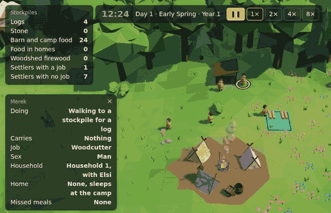

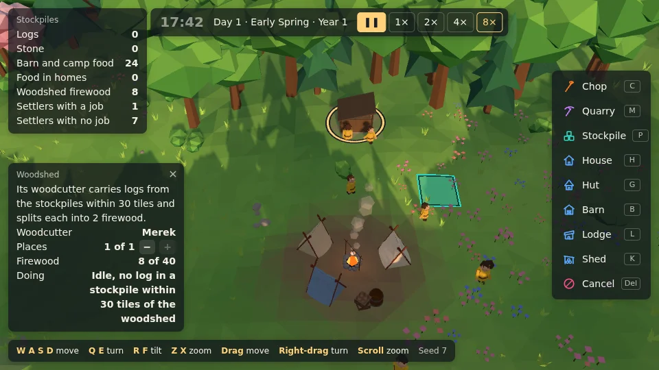

### During the stage: forage in 30 seconds and eat before work (#35)

Foraging one unit takes 30 seconds of work, not 20. A settler with a missed meal and empty hands gives up its task on its next think tick, once a second, if its store holds a unit nobody has reserved behind a door it can walk to. It walks to that store and eats on arrival, at any hour. Its panel reads `Walking to the camp to eat` or `Walking home to eat`. A settler cut off from its store keeps its task, works at half the rate, and searches no route. A settler that carries a unit delivers it first. (#35)

The clip runs on day 2 from 12:25 to 13:51 on a page whose camp starts with no food, by #35's scenario. At 12:25 Ulvar's panel reads `Idle` and `Missed meals 1, hungry`, and `Barn and camp food` reads 0. At 12:30 the camp holds 1 unit, and his panel reads `Walking to the camp to eat`. At 12:36 the total reads 0, and his panel reads `Idle` and `Missed meals None`. The pair shows Ulvar at day 2 15:30 on `main` before #35 and on #35's branch, with the same orders at the same minute. On `main` his panel reads `Missed meals 1, hungry` while `Barn and camp food` reads 4. On the branch it reads `None`, and the news reads "Day 2, 12:35. Ulvar ate again." and "Day 2, 14:08. Ysa ate again."

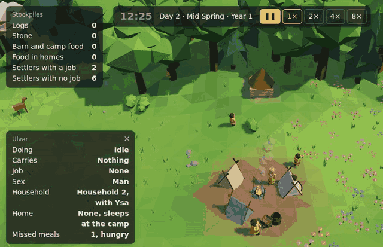

| `main` before #35, day 2 15:30 | #35, day 2 15:30 |
| --- | --- |
| 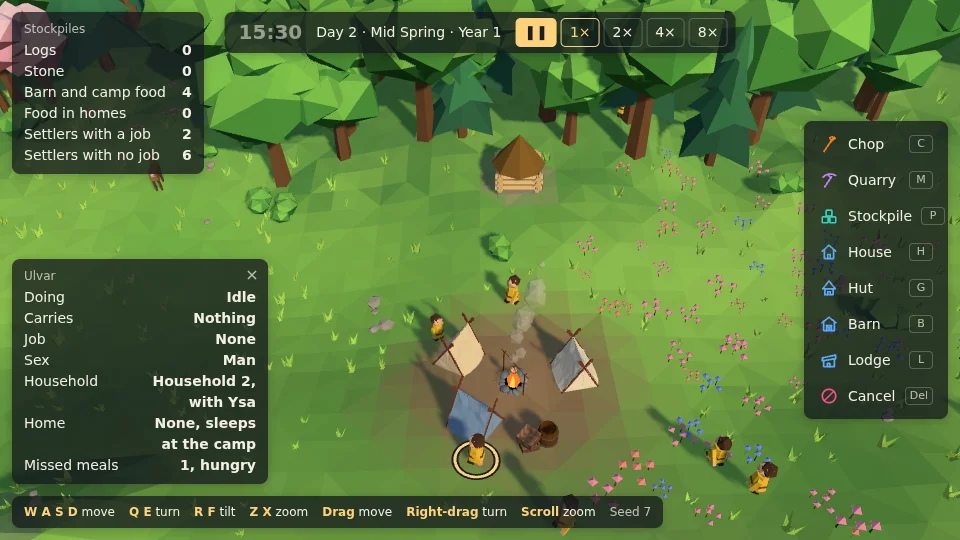 | 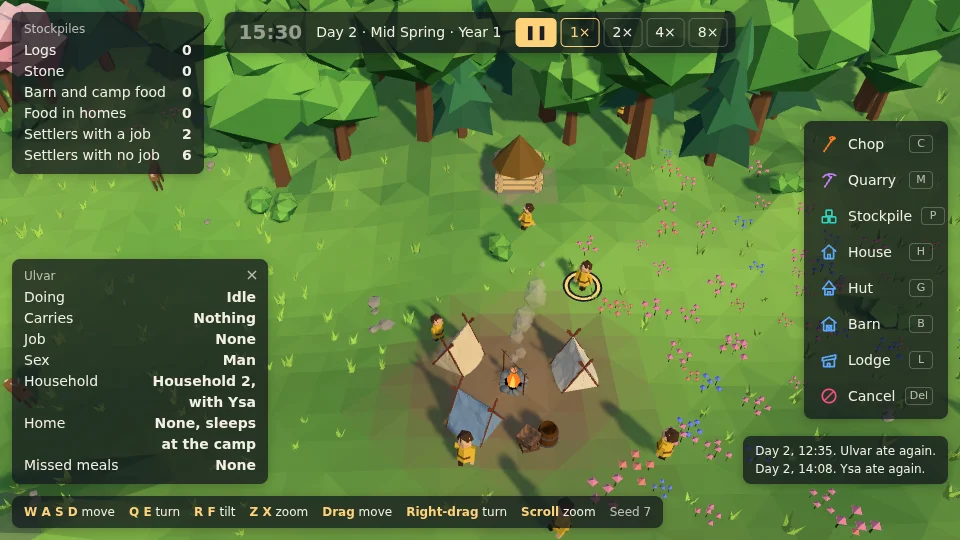 |

### 4.3 Make clothing from hides (#36)

A killed deer leaves 1 hide beside its 6 food, on the nearest tile with room. Settlers without a job carry hides to a stockpile, and `Hides` at the top left counts the hides on stockpiles. The `Tailor's hut` tool on `T` places a tailor's hut, which takes 8 logs, has 1 place, and holds 8 pieces of clothing. Its tailor carries 2 hides one at a time from the nearest stockpile within 30 tiles, works them for 60 seconds, and puts 1 piece into the hut. It stops when the hut is full or no stockpile in reach has a hide. The hut is the only round building, with pale hide walls under a dark cone roof. Nobody wears clothing until 4.4.

The clip keeps the tailor's hut's panel open from day 2 14:11 to day 3 09:15. Its tailor is Merek. At 14:11 `Hides` reads 1 and the panel reads `Walking to a stockpile for a hide`. By 14:54 `Hides` reads 0 and the panel reads `Idle, no hide in a stockpile within 30 tiles of the tailor's hut`. At 18:20 a hide lies on the stockpile again and Merek walks for it, and at 19:32 `Hides` reads 0 and he is `Resting at the camp`. From 05:30 on day 3 the panel reads `Making clothing`. At 09:15 it reads `Clothing 1 of 8` and `Looking for a hide`. The screenshot shows the same panel at day 3 09:38 with `Clothing 1 of 8` and `Idle, no hide in a stockpile within 30 tiles of the tailor's hut`.

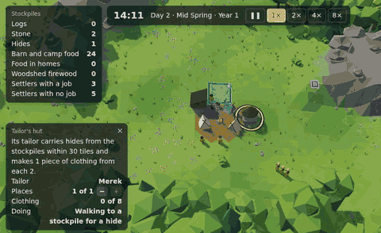

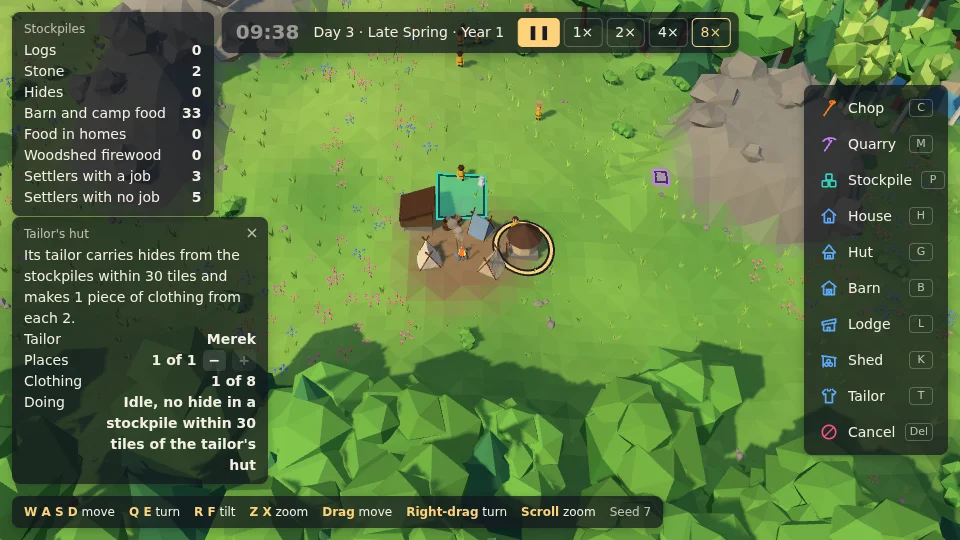

### 4.2 Winter nights are cold (#39)

Each night whose dusk falls in winter is cold. A settler is judged when it comes home at dusk, after its meal. A settler that never got home is judged at dawn, with no house and no fire. A house's fire burns 2 firewood and the camp's fire 4, when the first settler comes home to a store that holds that much. A house holds 6 firewood and the camp 12. A household stocks its home with food first and firewood second. A settler without a job then stocks the camp with food and then firewood, while a household sleeps there. A cold settler works at half the rate and dies at its third cold night in a row. A flame stands over the roof of a house whose fire burns. The top-left panel reads `Firewood in stores` and `Firewood in homes`, a settler's panel reads `Cold nights`, and the news names who had a cold night and who froze. Clothing counts for nothing until 4.4. (#39)

The clip runs on day 10 from 17:00 to 18:31, with two houses and two households at the camp. At 17:00 the woodshed's panel reads `Firewood 40 of 40` and `Idle, the woodshed is full`, and the top left reads `Firewood in stores 52` and `Firewood in homes 12`. At 17:33 `Firewood in stores` reads 48, after the camp's fire took its 4, and the news reads "Day 10, 17:28. Jorrin had a cold night." At 17:44 `Firewood in homes` reads 10 and a flame stands over one roof. By 17:54 it reads 8, a flame stands over each roof, and the news reads "Day 10, 17:28. Jorrin, Fenna, Dorran and Nella had a cold night." In the last frame the camp's panel reads `Settlers here 4` and `Firewood 8 of 12`. From 17:44 the news box covers the toolbar's `Cancel` button. The screenshot shows Dorran's panel at day 11 08:00, `Cold nights 1, cold`.

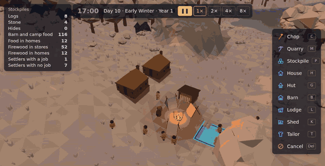

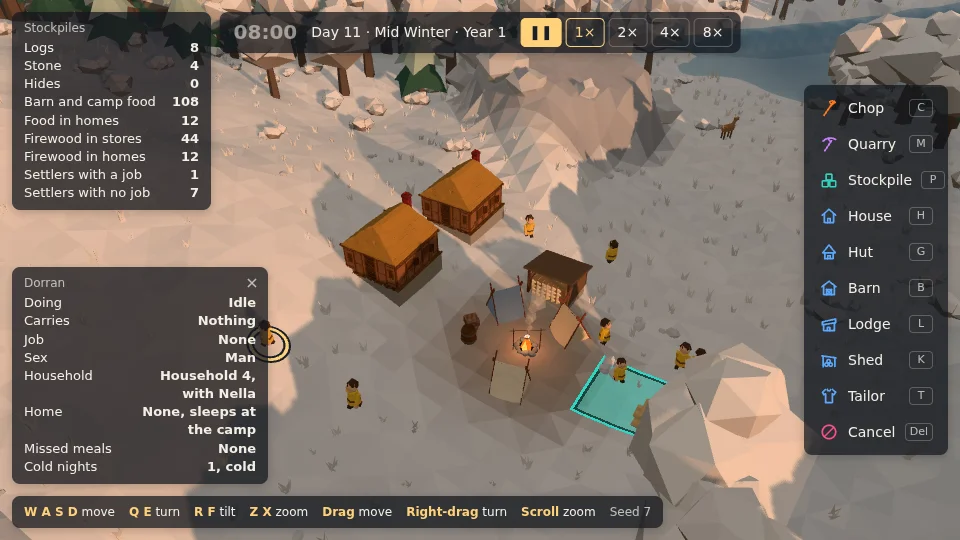

### 4.4 Settlers wear clothing (#37)

A settler that wears nothing and has empty hands walks to the nearest tailor's hut that holds a piece nobody has spoken for, puts it on at the door, and wears it from then on. A villager with a job does it too, after it has stocked its home. A clothed settler is warm in a house without a fire, and at the camp when the camp's fire burns. Its panel's `Cold nights` row ends in `, clothed`, and on the map it wears a rawhide hood and a short mantle. A settler's clothing is gone when it dies. (#37)

The clip runs on day 4 from 03:46 to 03:56 and follows Elsi, the woodcutter, on a page that starts with 200 food at the camp, by #37's scenario. Her panel reads `Walking to the tailor's hut for clothing`, `Carries Nothing`, and `Cold nights None`. At 03:55 it reads `Looking for a log` and `Cold nights None, clothed`, and at 03:56 `Walking to a stockpile for a log`. The first screenshot is the same game at day 10 18:30, with the camp's fire burning and the news "Day 10, 17:36. Ysa, Dorran and Nella had a cold night." The second is a 3× crop of the frame at noon on day 10, paused. On the left stands a settler with dark hair and a yellow tunic, whom #37 names as Ysa, without clothing. On the right stands a settler in a brown hood and mantle over the tunic, whom #37 names as Jorrin. The third is the whole frame.

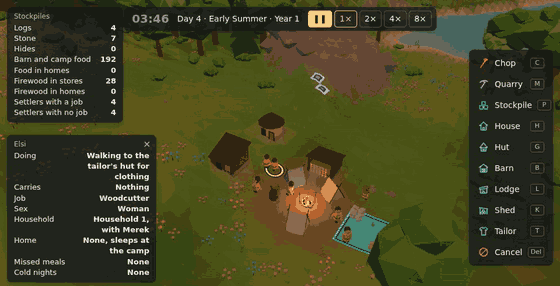

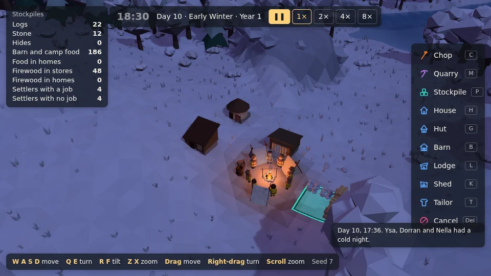

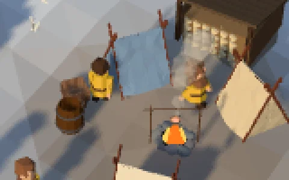

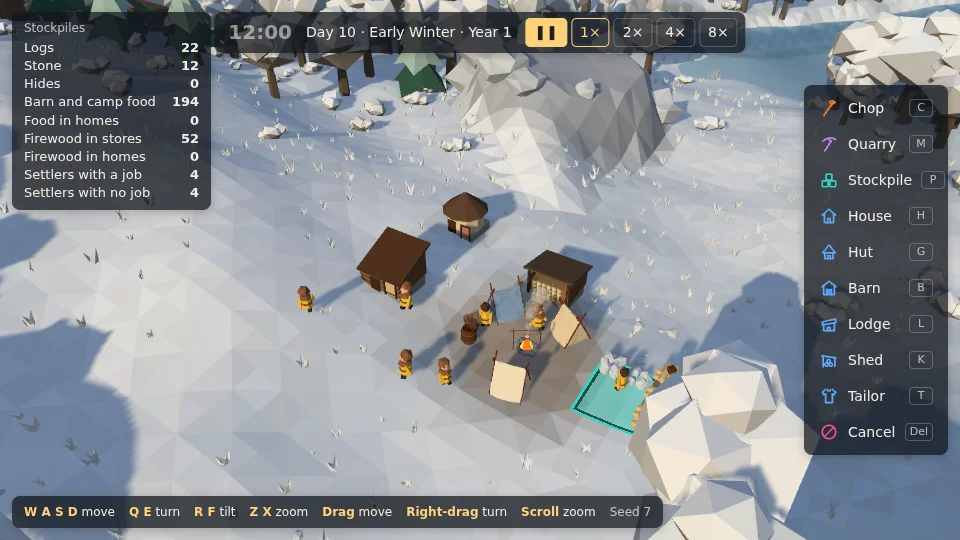

### 4.5 Read how ready the settlement is for winter (#40)

From the first tick of autumn to the last winter dusk, a panel left of the toolbar reads `Households in a house`, `Houses with firewood`, `Settlers in clothing`, and `Cold tonight`. While a household sleeps at the camp it also reads `Camp fire`, as `Lights, n firewood` or `Out, n of 4 firewood`. Its title names the cold nights to come. A house counts as having firewood when it holds 2 for each of those nights. `Cold tonight` asks the same rule that judges a night at dusk. In winter a house's panel reads `Fire last night`, as `No winter night yet`, `Burned`, or `Did not burn`. The pull request also holds the stage's measurement, under "What the stage measured". (#40)

The clip runs on day 7 from 13:00 to 16:59. The player placed a second house at 08:30, by #40. At 13:00 the panel reads `Winter readiness, 3 cold nights to come`, `Households in a house 1 of 4`, `Houses with firewood 1 of 1`, `Settlers in clothing 0 of 8`, `Cold tonight 6`, and `Camp fire Lights, 12 firewood`, and the second house's site reads 55%. At 14:26 the house stands, and the panel reads `2 of 4` and `1 of 2`. The house's panel names `Household 2: Ulvar and Ysa`. Its firewood reads `0 of 6` at 14:38 and `2 of 6` at 15:58, when `Cold tonight` falls to 4. At 16:34 it reads `6 of 6`, and `Houses with firewood` reads `2 of 2`.

The first screenshot is the reading at day 7 07:30 in the year "wood and hides": `0 of 4`, `0 of 0`, `Settlers in clothing 1 of 8`, `Cold tonight 8`, and `Camp fire Out, 0 of 4 firewood`, with `Firewood in stores 0`. The panel covers the labels of two sites behind it. The second shows a house's panel at day 11 08:00, `Firewood 6 of 6` and `Fire last night Burned`, beside the reading `2 cold nights to come`, `2 of 4`, `2 of 2`, `0 of 8`, and `Cold tonight 4`.

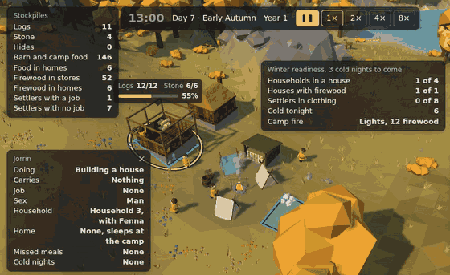

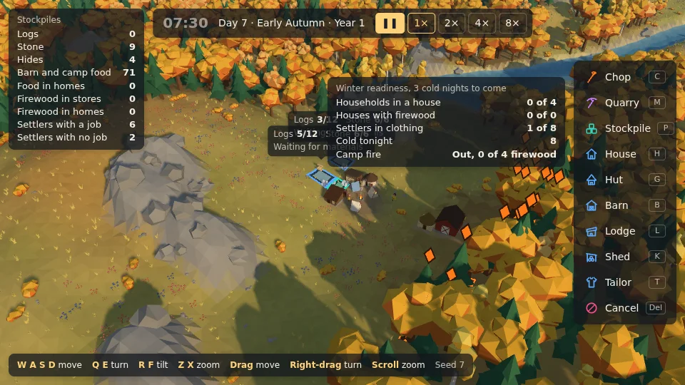

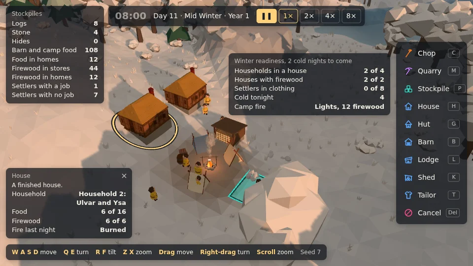

### Open during the stage: open scenario pages with the clock paused (#38)

#38 makes every scenario page but `clock`'s open with the clock paused at tick 0 and stop on exact ticks, so a scenario's orders land at a known tick and a scenario that passes once passes every time on the same build. It changes the worker so that a page opened with `?clock=paused` stands at 08:00 until the harness starts it. `clock` opens its page as a player would, so its checks of the opening minute and the speeds still guard what a player sees. A player who opens the game without the setting sees no change. (#38) #38 was open when this summary was written.

### Open during the stage: move the news box clear of the toolbar

At 960 by 540 the news box overlaps the bottom of the toolbar on `main`. One short line overlaps it by 1 px, and two lines or one long line of two rows cover the bottom button, as the clip of 4.2 shows. #39 found the overlap and left it for a fix of its own. (#39) That fix moves the news box clear of the toolbar. It was open, with no pull request number yet, when this summary was written.

## What the stage measured

Every number below is taken from the pull request named beside it. Nothing was measured again for this summary. Foraging took 20 seconds in the years of #34 and #36, and 30 seconds from #35 on, so their years moved, as each section says.

### The first year with a woodshed

A woodshed alone on seed 7, with a stockpile and Chop on the 13 trees nearest the camp, was finished at day 1 12:48, and Elsi became its woodcutter. It was full with 40 firewood at day 3 08:22. One woodcutter fills a shed in two days. (#34) The same run at 30 seconds of foraging is unchanged. (#35)

| Dusk | Logs split | Firewood in the shed |
| --- | --- | --- |
| Day 1 | 5 | 10 |
| Day 2 | 17 | 34 |
| Day 3 | 20 | 40 |
| Days 4 to 6 | 20 | 40 |

The first year of #30, with its hut, barn, and lodge, gains the stockpile and the woodshed. The woodshed was finished at day 1 18:51, before the lodge, and took Merek, who was a hunter in #30. Ulvar and Nella became the hunters. (#34) All 8 settlers eat every meal in the runs of #34 and #36. #35 does not give the meals of its run. The barn at autumn's end after hides, 98, is from #35's run of `main`. (#34, #35, #36)

| Run | Forage work | Barn finished | Shed full | Picked | Kills | Barn at autumn's end | Barn at the year's end |
| --- | --- | --- | --- | --- | --- | --- | --- |
| #30, no woodshed | 20 s | day 2 18:24 | none | 96 | 14 | 117 | 108 |
| With the woodshed (#34) | 20 s | day 4 06:26 | day 7 06:35 | 82 | 13 | 100 | 88 |
| The same after hides (#36) | 20 s | day 4 08:28 | day 7 09:10 | 81 | 13 | 98 | 86 |
| The same at 30 s (#35) | 30 s | not given | day 8 09:29 | 65 | 13 | 84 | 71 |

A woodshed costs this year 20 barn food at 20 seconds. The shed's site and its 13 trees compete for the settlers without a job, so the barn is finished about a day and a half later, and the lodge at day 2 14:41 instead of 10:01. All 13 trees lie in the hut's reach, and a felled tree bears no forage. #34 did not measure how much of the loss each cause takes. (#34) #36 moved the year, because with a stockpile the settlers without a job also carry hides. (#36) #35 moved it again with the 30 seconds, and #35's numbers are the later. (#35)

### Food at 30 seconds and eating first

#35 ran the first years of stage 3 at three builds: `main` at 20 seconds, `main` with only the 30 seconds, and #35. #35 equals the 30 second build in all four years, because no settler misses a meal there while a store holds food, so the eat-first rule never fires. (#35)

| Year | Reading | `main`, 20 s | 30 s alone | #35 |
| --- | --- | --- | --- | --- |
| #27's hut alone | Picked | 75 | 62 | 62 |
| #27's hut alone | Missed meals | none | 10 | 10 |
| #29's barn beside the hut | Picked | 102 | 78 | 78 |
| #29's barn beside the hut | Barn at the dusk of day 9, and of day 12 | 53, 30 | 30, 6 | 30, 6 |
| #30's hut, barn, and lodge | Picked, kills | 96, 14 | 73, 14 | 73, 14 |
| #30's hut, barn, and lodge | Barn at autumn's end, and at the year's end | 117, 108 | 97, 85 | 97, 85 |
| #30's barn and lodge, no hut | Kills, barn at the year's end | 12, 0 | 12, 0 | 12, 0 |

With the hut alone at 30 seconds, Jorrin misses a meal at day 11 17:41 and Merek at 17:54, and all 8 miss the meal of day 12, when the camp is empty. Nobody dies in any of the four years. (#35)

On the benchmark's 512 map, `main` had 54 deaths at a dawn, each a third meal missed away from home. With #35 there are none. The largest tick at a dawn went from 19.6 to 19.9 ms on `main` to 17.1 to 18.0 ms on the 512 map, and from 7.8 to 8.6 ms to 7.3 to 7.5 ms on the 256 map. On the 512 map, 604 walks to eat start in the 10 ticks after the dawns. (#35)

### Hides and clothing by each season's end

The brief expected 13 hides and 6 pieces of clothing by the end of autumn, from the 13 kills of #30's year. (#32) The table gives the hides, which equal the kills, and the pieces made, at the end of each season. In the years of #36 and #35 nobody wears clothing, and in the years of #37 the pieces are worn.

| End of day | #36, tailor's hut at the first tick, 20 s | #36's year at 30 s (#35) | #37, every order at the first tick | #37, tailor's hut ordered when the lodge is finished |
| --- | --- | --- | --- | --- |
| 3, spring | 4 hides, 1 piece | 4 hides, 0 pieces | 2 hides, 0 pieces | 4 hides, 0 pieces |
| 6, summer | 9 hides, 4 pieces | 9 hides, 4 pieces | 9 hides, 4 pieces | 10 hides, 4 pieces |
| 9, autumn | 10 hides, 5 pieces | 10 hides, 4 pieces | 12 hides, 5 pieces | 12 hides, 5 pieces |
| 12, winter | 11 hides, 5 pieces | 11 hides, 5 pieces | 13 hides, 6 pieces | 13 hides, 6 pieces |

- **#36's year.** The tailor's hut was finished at day 2 07:47 and took Merek, a hunter in #30, so the lodge was finished at day 2 14:19 instead of 10:01. That costs 3 kills by the end of autumn. The first piece came at day 3 15:10. No hide waits on a stockpile at any season's end, so the hunters set the clothing, not the tailor. The stockpile and the tailor's hut cost the year 21 barn food, 87 at the year's end against #30's 108. (#36) At 30 seconds the first piece comes at day 4 04:59, and the barn holds 82 at autumn's end and 65 at the year's end. (#35)
- **#37's two years.** Both add a woodshed and 13 trees to #36's orders, and no house. With every order at the first tick, the tailor's hut stands at day 2 07:57 with Merek, the lodge at day 3 05:04 with Elsi and Ulvar, and the woodshed at day 3 10:04 with Fenna. With the tailor's hut ordered when the lodge is finished, the lodge stands at day 2 11:17 with Ulvar and Dorran, who hold its places all year, the woodshed at 11:49 with Merek, and the tailor's hut at day 4 04:31 with Elsi. (#37)
- **#37 corrects the brief and #36.** By autumn's end both years have 12 hides and 5 pieces, and the 13th hide and the 6th piece come on day 10. #36's 10 kills and 4 pieces by autumn's end, at 30 seconds, are 12 and 5 in #37's year, where the lodge stands later. The lodge has 2 places, not 3, so it cannot keep three hunters. 6 of 8 settlers wear clothing by the first winter dusk in both years, not half. (#37) #37 calls that about two thirds, and 6 of 8 is three quarters. #37 is the later. The stage brief gives the lodge no number of hunters, and stage 3's brief gives it 2 places.
- **#37 moved #36's year.** Settlers now take the tailor's pieces, and each walk to the hut costs a little time. By the end of day 9 the year has 9 kills instead of 10 and 76 barn food instead of 82, and the hut holds 0 pieces instead of 4. (#37)

### Cold with nothing for warmth, and with two houses and a woodshed

With stage 3's hut, barn, and lodge and nothing for warmth, every settler has 1, 2, and 3 cold nights at the dusks of days 10, 11, and 12, and freezes at the dusk of day 12. The year has 24 cold nights and 8 deaths from cold, and nobody starves. The food is 73 picked, 14 kills, 97 in the barn at autumn's end, and 96 meals eaten with none missed. (#39)

| Settler | Sleeps | Job | Froze |
| --- | --- | --- | --- |
| Jorrin | camp | hut | day 12 17:28 |
| Elsi | camp | hut | day 12 17:31 |
| Dorran | camp | none | day 12 17:32 |
| Nella | camp | hut | day 12 17:36 |
| Ulvar | camp | lodge | day 12 17:39 |
| Fenna | camp | hut | day 12 17:43 |
| Merek | camp | lodge | day 12 17:49 |
| Ysa | camp | hut | day 12 17:56 |

With two houses on (121, 122) and (121, 127) and a woodshed on (126, 123), the houses stand on day 8 at 14:42 and 16:06. Both house fires and the camp's fire burn on all three winter nights. The four settlers in the houses live, and the four at the camp freeze at the dusk of day 12, between 17:36 and 18:35. The year lights 9 fires, burns 24 firewood, and carries 19 firewood home and 14 to the camp. Its food is 65 picked, 12 kills, and 69 in the barn at autumn's end. (#39) The `cold` scenario reads the news "Day 12, 17:35. Jorrin, Fenna, Dorran and Nella froze." (#39) #40 ran the same year again and found the houses finished on day 8 at the same minutes, and says that this is not day 7 as the brief says. (#40) The stage brief's text gives no day for these houses.

### The six cases of warmth, and two years in clothing without a house

`src/sim/wearing.test.ts` judges the first winter night for two settlers of one household, one clothed and one not. (#37)

| Where it sleeps | Clothed | Not clothed |
| --- | --- | --- |
| A house with a fire, 2 firewood | warm | warm |
| A house without a fire | warm | cold |
| The camp, its fire burning, 4 firewood | warm | cold |
| The camp, no fire, 3 firewood | cold | cold |
| Never got home | cold | cold |

#37 calls these the six cases of warmth, and its table has five places to sleep, each for a clothed and an unclothed settler. In #37's two years with clothing and no house, the camp held 12 firewood at each winter dusk before its fire took 4, and 6 of 8 settlers wore clothing. The clothed six were warm at the camp's fire on all three nights, and the two without clothing were cold on all three and froze on the last. All 8 ate every meal. (#37)

| Year | Who froze, day 12 | Barn at the year's end |
| --- | --- | --- |
| Every order at the first tick | Nella at 17:35 and Dorran at 17:46 | 72 |
| Tailor's hut ordered when the lodge is finished | Nella at 17:25 and Ysa at 17:27 | not given |

### The stage's target: three first years on seed 7

#40 measured three first years on seed 7. Every command is given at 08:00 on day 1, except the tailor's hut, which is given on the tick the lodge is finished, so that the lodge hires its hunters first. (#40)

- **Wood.** #30's hut, barn, and lodge with their chop and quarry orders, four houses, 4.2's stockpile and woodshed, and chop and quarry orders on 55 trees and 5 rock tiles in all.
- **Wood and hides.** The same with two houses, 4.4's stockpile and woodshed, 47 trees and 4 rock tiles, and the tailor's hut at day 3 07:58.
- **Nothing for warmth.** #30's commands alone, with 16 trees and 2 rock tiles.

| | Wood | Wood and hides | Nothing for warmth |
| --- | --- | --- | --- |
| Finished | hut d1 13:03, woodshed d2 15:37, lodge d3 17:43, barn d5 17:35, houses d7 09:31, d8 13:03, d10 17:14, 4th never | hut d1 13:03, woodshed d2 14:52, lodge d3 07:58, barn d3 15:37, tailor's hut d7 08:07, houses d9 14:43 and d12 14:39 | hut d1 13:08, lodge d2 10:01, barn d2 18:24 |
| Who works where | foragers Merek and Elsi, woodcutter Ulvar from d2, hunters Ysa and Jorrin from d3 | foragers Merek and Elsi, woodcutter Ysa from d2, hunters Ulvar and Fenna from d3, tailor Jorrin from d7 | foragers Ysa and Jorrin, hunters Merek and Ulvar |
| Reading at noon, day 9 | 2 of 4 housed, 0 of 2 with firewood, 0 of 8 clothed, 8 cold, camp fire out | 0 of 4, 0 of 0, 4 of 8, 8, out | 0 of 4, 0 of 0, 0 of 8, 8, out |
| Winter nights | all 8 cold on each night | nights 10 and 11 all 8 cold; night 12 Ulvar and Ysa warm, the other 6 cold | all 8 cold on each night |
| Living at the year's end | 0 of 8, all froze at the dusk of day 12, 17:27 to 18:28 | 2 of 8, 6 froze at the dusk of day 12, 17:31 to 17:54 | 0 of 8, all froze at the dusk of day 12, 17:28 to 17:56 |
| Meals eaten of meals due | 96 of 96, 2 missed on day 10 and eaten at the next dawn | 92 of 96, 6 missed | 96 of 96, 0 missed |
| Barn at the end of spring, summer, autumn, winter | 0, 19, 59, 37 | 0, 40, 72, 56 | 20, 65, 97, 85 |
| Firewood split, burnt | 0, 0 | 0, 0 | 0, 0 |
| Hides, pieces made, pieces worn | 11, 0, 0 | 11, 4 from 8 hides, 4 | 14, 0, 0 |
| Logs | 44 of 55 trees felled, 88 logs: 74 in finished buildings, 11 on the unfinished 4th house, 3 on the ground | 35 of 47 felled, 70 logs, all in finished buildings | 16 of 16 felled, 32 logs, all in buildings |

(#40)

The barn ends the year at 85 with nothing for warmth, which equals the 85 that stage 3's three buildings give at 30 seconds. (#35, #40) Stage 3 measured 108 for that year at 20 seconds. (#30, as the stage 3 summary records it)

#40 traced each miss in the simulation. (#40)

- **No log lay on a stockpile.** In both years with warmth, carriers took every felled log straight to a building site. The woodcutter takes logs only from a stockpile, and only while the sites have all they lack. So the woodshed had no input for 17,987 of its 17,995 daylight ticks in the year with wood, and for 18,086 of 18,089 in the year with wood and hides.
- **Felling ran short.** In the year with wood, the woodshed hired Ulvar on day 2, so 3 settlers without a job did all the chopping, carrying, and building. 38 trees were felled by the end of autumn and 44 by the year's end, and the 4th house never stood. The year needs 86 logs for its sites and 12 more for 24 firewood, which is 49 trees by the end of autumn. #40 infers from these counts that felling would have to be about 30% faster. In the year with wood and hides it is about 17% short, 34 trees felled by the end of autumn against 41 needed.
- **Hides limit the clothing.** The tailor made 4 pieces by day 8 and then had no hide for 6,055 of its 9,033 daylight ticks. The 4 pieces went to Ulvar, Ysa, Jorrin, and Fenna, who slept at the camp, where the fire never lit, so their clothing gave them one source of the two they needed. Ulvar and Ysa lived because their house was finished on the last day.
- **Households took the camp's food.** The 6 missed meals of the year with wood and hides came when households moving into new houses carried food out of the camp. The delegate that built #40's script traced this, and #40 did not repeat the trace.

One probe, which #40 says is neither a search nor part of the measurement, gave the woodshed's order last, once every house, the lodge, and the barn stood. That is day 9 in the year with wood and day 8 in the other. The year with wood then froze 2 of 8, and the year with wood and hides 4 of 8. #40 found no order of these commands that reaches either target on seed 7. (#40)

#40 answered the stage's four questions on the first year. (#40)

- **Can 8 settlers prepare a winter's warmth beside its food?** They cannot with these commands. The two years with warmth split 0 firewood, and 8 and 6 of 8 settlers froze.
- **Does warmth make the first year tight?** Yes. The barn ends the year at 37 and 56 against 85 with nothing for warmth, and the years with warmth miss 2 and 6 meals against 0. The houses delay the barn to day 5 and the lodge to day 3, and foraging falls from 73 units to 55 and 66.
- **Do one woodcutter and one tailor keep up with 8 settlers?** The woodcutter never had a log to split and was idle for 99.9% of daylight. The tailor waited for hides for 67% of its daylight. Logs and hides were the limit, not the two workers.
- **What does a household's walk to the woodshed cost?** In 4.2's year with two houses, the one measured year whose households carried firewood, households spent 9.2 game hours walking to carry 19 firewood home. That is about 29 game minutes for each unit, and about 3 game hours a winter for each house's 6. In #40's three years the walk cost nothing, because there was no firewood.

### The tick time against the 4 ms limit

These are pylon numbers from `bun run bench` or `bun scripts/bench.ts`, with 1,500 villagers and 3,000 monsters on seed 7. The 4 ms limit is defined on the owner's machine, and no pull request of the stage measured there. #34, #35, #36, and #37 ran on rj-firebat with 6 CPUs. #39 and #40 ran on infra-testbench with 6 CPUs. (#34, #35, #36, #37, #40) #39 names no node, and #40 says that 4.2's pylon ran on the same node as its own. (#40) For the same code, infra-testbench read 4.36 ms and 6.6 ms where rj-firebat read 1.2 and 1.9 ms, a ratio of 3.6 and 3.5. (#39) So each row is judged against its own base, not against the other node's rows.

| Pull request | Node | Runs | p99, 256 map | p99, 512 map | Base on the same node, 256 and 512 |
| --- | --- | --- | --- | --- | --- |
| 4.1 (#34), woodsheds | rj-firebat | 3, alternated with `main` | 1.425 to 1.489 ms | 2.070 to 2.127 ms | 1.333 to 1.366, 1.982 to 2.042 ms |
| #35, food | rj-firebat | 5, alternated with `main` | 1.228 to 1.269 ms | 1.840 to 1.899 ms | 1.233 to 1.274, 2.008 to 2.039 ms |
| 4.3 (#36), tailors | rj-firebat | 2, alternated with `main` | 1.294 and 1.444 ms | 2.071 and 2.161 ms | 1.200 and 1.300, 1.855 and 1.898 ms |
| 4.2 (#39), cold | infra-testbench | 3, alternated with its base | 4.751 to 4.893 ms | 6.546 to 6.800 ms | 4.795 to 5.327, 6.830 to 6.977 ms |
| 4.4 (#37), clothing | rj-firebat | 2, alternated with its base | 1.472 and 1.530 ms | 2.026 and 2.083 ms | 1.510 and 1.532, 2.127 and 2.393 ms |
| 4.5 (#40), readiness | infra-testbench | 5, alternated with its base, median and range | 5.383 ms, 5.265 to 5.545 | 7.868 ms, 7.399 to 8.496 | 5.506 and 7.217 ms |
| 4.5 (#40), measured again | infra-testbench | 5, alternated with its base, median and range | 4.812 ms, 4.759 to 4.944 | 6.710 ms, 6.650 to 6.873 | 4.808 and 6.621 ms |

- **rj-firebat.** Every p99 passes. The highest, 2.161 ms on the 512 map after 4.3, is about 54% of the limit. (#36) #34 found that its pylon ran slower that day than #30's, so its rows compare with its own `main` column only. Its 256 p99 rose by 0.06 to 0.16 ms, and #34 could not say how much of that the sheds cause. (#34)
- **infra-testbench.** The spring p99 is over 4 ms on both sides, on the base as on the branch. (#39, #40) #40 first read the 512 map at 7.868 ms against 7.217 ms and called it inconclusive. Measured again in a comment after the merge, on a quiet node, the gap was 0.09 ms, inside the base's own spread of 0.38 ms. #40 concludes that the first gap came from 4.2's pylon running scenarios on the same node. (#40)

#### The winter run

#39 added a run of the benchmark that reaches a winter. Its p99 on the 256 map read 6.6 to 6.7 ms at first, 40% over spring. #39 timed each part of the tick and found the cause. The slowest 1% of winter ticks on the 256 map averaged 10.0 ms, and 4.3 ms of it was foragers looking for forage. In winter no tile bears, but each forager without a task still scanned its whole reach, about 61 by 61 tiles, on every think tick. The cause was stage 3's forage search, which no benchmark had run in winter, and not the deaths, the fires, or the carrying of firewood. `perf(sim): skip the forage search in winter` returns before the scan, and every count of the benchmark's output stayed the same. (#39)

| Pull request | Node | p99, 256 winter | p99, 512 winter | Largest tick at a winter dusk, 256 | The same, 512 |
| --- | --- | --- | --- | --- | --- |
| 4.2 (#39), before the forage fix | infra-testbench | 6.576 to 7.253 ms | 3.217 to 4.009 ms | not given | not given |
| 4.2 (#39), after the forage fix | infra-testbench | 2.364 to 2.440 ms | 2.377 to 2.539 ms | 2.611, 1.969, 2.417 ms | 1.957, 1.718, 1.883 ms |
| 4.4 (#37) | rj-firebat | 0.683 and 0.695 ms | 0.727 and 0.701 ms | 1.111 and 1.201 ms | 1.169 and 1.110 ms |
| 4.5 (#40), without the forage fix | infra-testbench | 7.348 ms, 6.918 to 7.516 | 3.581 ms, 3.381 to 4.098 | 4.353 ms | 3.087 ms |

#39's dusk ticks are the largest after each of the three winter dusks of one run. #39 infers that its winter p99 of 2.4 ms would be about 0.7 ms on rj-firebat, and did not measure it. (#39) #40 measured its branch before it merged 4.2's later commits, so its winter run lacks the forage fix. (#40)

The largest tick in the 10 ticks after a dusk and after a dawn in the spring run, in ms:

| Pull request | Node | Dusk, 256 | Dawn, 256 | Dusk, 512 | Dawn, 512 |
| --- | --- | --- | --- | --- | --- |
| 4.1 (#34) | rj-firebat | 1.619 to 2.007 | 9.722 to 10.366 | 1.875 to 2.127 | 20.509 to 21.893 |
| #35 | rj-firebat | 1.894 to 2.108 | 7.294 to 7.536 | 1.308 to 1.347 | 17.085 to 17.997 |
| 4.3 (#36) | rj-firebat | 1.017 and 1.303 | 7.878 and 8.746 | 2.534 and 2.725 | 20.091 and 20.826 |
| 4.2 (#39) | infra-testbench | not given | 30 to 68, both maps | not given | 30 to 68, both maps |
| 4.4 (#37) | rj-firebat | 1.671 and 1.716 | 10.280 and 10.376 | 1.325 and 1.336 | 18.999 and 21.385 |
| 4.5 (#40) | infra-testbench | 5.951 | 43.697 | 5.294 | 103.089 |

The largest dawn tick on the 512 map is over the 12.5 ms tick at 8× after every pull request that reports it. Only the p99 has a limit. #37 says that its 21.385 ms dawn is one tick that its second run does not repeat. (#37)

Deaths in the benchmark's measured ticks on the 512 map:

| Pull request | Spring run | Winter run |
| --- | --- | --- |
| 4.1 (#34) | 22: 20 at a dawn, 2 at a dusk, against `main`'s 37 | no winter run |
| 4.3 (#36) | 54, all at a dawn | no winter run |
| #35 | 0, against `main`'s 54 | no winter run |
| 4.2 (#39) | not given | 1,398 froze, 47 starved |
| 4.4 (#37) | 0 | 1,396 froze, 42 starved at a dusk and 5 at a dawn |
| 4.5 (#40) | 0 | 1,396 froze, 42 starved at a dusk and 5 at a dawn |

#34 did not trace why 15 fewer villagers die with woodsheds, and with `--no-woodsheds` the deaths match `main`'s 37. #36 traced its rise from 22 to 54 to its 9 extra building sites far from the camp, because `--no-tailors` gives 21 at a dawn and 2 at a dusk. (#34, #36) On the 256 map the winter run has 1,314 deaths from cold after #39, #37, and #40, and 26 starved after #39 and 21 after #37 and #40. (#37, #39, #40) #37 guesses that walks to the tailor's hut changed which villagers get home to food, and did not trace it. (#37) The benchmark's tailor's huts make few pieces, so few of its villagers wear clothing: 5 on the 256 winter map and 2 on the 512. (#37)

### Where the tick allocates

The tick allocates nothing new in any pull request of the stage that reports it. A heap census of 3,000 ticks of the 512 load grew by engine metadata only after 4.3. (#36) After 4.4, no `Array`, typed array, or `Object` count grew with the ticks over two windows of 10,000 ticks. (#37) The winter readiness reading is computed once for each published frame, outside the tick. A read takes a median of 94.4 µs on the 256 map and 21.6 µs on the 512 map, and #40 did not measure why the 256 map takes four times as long. (#40)

### Checks that moved in existing scenarios

No limit was loosened in any pull request of the stage. #34, #36, and #40 say that no limit changed, #35 says that its limits are unchanged, #37 says that no check was loosened, and #39 kept the `selecting` limit and raised the `storing` one. `storing`'s ground food now needs 70 sack pixels, not 40. (#39) Five checks changed what or when they measure: `daylight`, `storing`, `selecting`, `cold`, and `look`, as the table says.

| Scenario and reading | Readings | Why it moved |
| --- | --- | --- |
| `daylight`, the day more than twice as bright as the night | The mean of the whole frame read 107.43 for the dimmest day stop against twice the brightest night stop, 106.84, on `main`, and 106.27 against 106.48 on #34, a fail. The mean outside the interface reads 122 to 129 for the day stops and 53 to 56 for the night stops on both sides | The woodshed's toolbar button and row add 9,426 px of panel in colors the clock does not light, which pull a day frame down more than a night frame. The check now leaves out every element over the canvas that paints a background. The limit stays at more than twice. (#34) |
| `terrain`, water on seed 7 | 23.2% on `main` before #34, 22.5% after #34, 21.7% after #36; seed 2026 27.1% before #36, 26.2% after | The taller toolbar and Stockpiles panel cover more water. #34 notes that `main` read 23.2% where #30 had read 34.6%. (#34, #36) |
| `window`, plants | At 1280 by 720, 72.1% before #34, 71.2% after #34, 70.0% after #36; at 960 by 600, 63.9% before #36, 62.9% after | The same panels. (#34, #36) |
| `orders`, chop pixels at the near view and the quarry outline | Chop 3,283 before #34 and 2,963 after. The quarry outline 462 before #36 and 455 after, and 439 and 432 after Cancel | The count leaves out the toolbar's box, which grew. (#34, #36) |
| `firewood`, the toolbar's names | 9 names, then 10 with `Tailor's hut` before `Cancel` | The new tool. (#36) |
| `storing`, food that nobody carried lies on the ground | Before #35, day 3 12:00 and day 4 12:00, at least 40 and at most 10. After #35, day 4 09:00 and day 5 09:00 with the same limits, read 40, 48, and 40. After #39, day 4 10:20 and day 5 10:20 with a limit of 70, read 115 and then 4 in three runs | The 30 seconds move the food on the ground a day later, and #35 made the counting box reach the tiles beside the northern hut. With pages paused at 08:00 the check read 35 at day 4 09:00, so #39 moved it to 10:20, when the sun lights 3 of the 4 sacks, set the box to 350,190 350x230, and set the limit to two sacks' worth. (#35, #39) |
| `selecting`, a click 10 px beside a settler at the nearest turned view | At 08:00 it read "tunic of 19 px at 754,76" and the click opened the camp's panel in every run. Moved to 09:00, it reads "tunic of 17 px at 650,60" and selects Elsi in three runs | At 08:00 all 8 settlers stand within the camp's 2 m, so the click lands on the camp. At 09:00 every settler has walked out. The 10 px limit is unchanged. (#39) It had failed on `main` too before 4.2, as the page paused at varying ticks. (#34, #37) |
| `selecting`, the settler's panel at its longest readings | A new check of #39 read 256x271 from y 213 against the Stockpiles panel's bottom at y 210. #37's `SETTLER_LONGEST` reads `Cold nights` at `2, cold, clothed`, where it read `2, cold` | The stage's new rows. The check is the same, and it measures one more word. (#37, #39) |
| `clothing`, the tailor's hut's panel after its first piece | `Clothing: 1 of 8`, then `Clothing: 0 of 8` | The tailor fetches clothing before a workshop's work, so it puts its first piece on at the door before it looks for a hide. (#37) |
| `cold`, the flame over each house at the dusk of day 10 | House 1 read 0 flame pixels, a fail against 40, and house 2 read 201. Now house 1 reads 157 and house 2 218 | The readiness panel covered the first house. The near view of `cold` and `readiness` now drags west by one drag after its zoom eases in. (#40) |
| `look`, the house's thatch, the villagers, and the camp's light, at noon and midnight in spring and winter | Thatch 3,968 and 140, a fail against 1,900, then 4,051 and 4,317. Villager pixels 439 and 1,135, then 345 and 874, against 150. The camp's flame 167 and 183, then 209 and 208, against 100. Firelit pixels 2,822 and 3,213, then 2,894 and 3,122, against 1,500 | The readiness panel covered the house's box, so the land is dragged west and the boxes moved with it. (#40) |

#39 also lists every reading that moved when paused pages began to stand at 08:00 instead of 08:11 to 08:18. Of them, four went from pass to fail. `camera`'s held Q key read a mean pixel difference of 22.38 and then 0.00 against more than 2, and its sky check read 6.8% and then 3.5% against at least 5%. #39 traces both to the node's slow frames, as the next section says. The other two are the `selecting` and `storing` readings above, and `storing` read 78 and then 35. (#39) After #40 merged 4.2's and 4.4's later commits, readings of `seasons`, `orders`, `selecting`, `clothing`, `look`, and `wearing` moved by small amounts and every check still passes. #40 could not tell which of the two merges moved each. (#40)

### The held keys of `camera` and `clock`

`camera` and `clock` fail on infra-testbench where a held key reads a mean pixel difference of 0.00, against more than 2. `main` fails the same way there. Since about 11:30 on #39's day, the first frames on that node took 2.2 to 3.8 s, and a key held for less than a frame moves nothing. (#39) #40's full run failed a held D key and a held Q key in `camera` and a held W key in `clock`. Run again, `clock` passed 24 of 24 and `camera` failed only the held D key, which its base failed in 2 runs of 2. (#40) On rj-firebat both scenarios passed in #34, #35, #36, and #37. (#34, #35, #36, #37)

### How the scenario pages open

#35 found why scenario runs varied. `session.open` loaded the page with the clock running and paused it only after the first frames, so the minute at which a scenario's orders landed depended on how fast the page loaded. (#35) #39 made a paused page pause as soon as its speed controls show, before its first frames, so every paused page stands at 08:00 instead of 08:11 to 08:18. (#39) Before that fix the first stop at 08:15 failed on infra-testbench in 7 of 8 tries of `cold`, `look`, and `wearing`, and with it none failed. (#40) #38 goes further. It opens every page but `clock`'s with the clock paused at tick 0 and stops on exact ticks. On `main`, `hunting` passed 0 of 5 runs and `selecting` 3 of 5, and on #38's branch both passed 5 of 5. (#38) #38 was open when this summary was written.

## What the stage decided

The brief asked the stage to settle six things.

- **Whether two of three is a rule a player can read and plan with.** The numbers do not settle it. Nobody has played the stage. #37's six cases show that the rule gives each sleeping place its own answer, and #40 found that the four numbers of the reading alone do not say why a settler at the camp is cold, so it added the `Camp fire` row. (#37, #40)
- **Whether death at the third cold night in a row is fear enough.** The numbers do not settle it. In every measured year a settler with no warm night freezes at the dusk of day 12, the last winter night, and no settler dies of cold before it. (#39, #40)
- **Whether 8 settlers can prepare a winter's warmth beside its food.** They cannot with the brief's commands on seed 7. In the year with wood all 8 freeze, where the target is all 8 warm. In the year with wood and hides 6 of 8 freeze, where the target is all 8 warm. With nothing for warmth all 8 are fed and all 8 freeze in the last night, which meets that year's target. (#40) A miss changes the proposals, not the measurement. Which proposal changes is the owner's decision.
- **Whether warmth makes the first year tight.** It does on these numbers. The barn ends the year at 37 with wood, 56 with wood and hides, and 85 with nothing for warmth, against stage 3's 108 at 20 seconds of foraging, and the two years with warmth miss 2 and 6 meals. (#35, #40)
- **Whether one woodcutter and one tailor keep up with 8 settlers, and what a household's walk to the woodshed costs.** The two workers were not the limit in #40's years. The woodcutter had no log for 99.9% of daylight and the tailor no hide for 67% of its daylight. Alone, one woodcutter fills a shed in two days. (#34, #40) A household's walk cost about 29 game minutes for each unit of firewood carried home, in 4.2's year with two houses. (#40)
- **The tick time.** The p99 stays within the 4 ms limit on rj-firebat after every pull request that ran there, at most 2.161 ms. (#36) On infra-testbench the spring p99 is over 4 ms on the base and the branch alike, and the winter p99 reads 2.4 ms after #39's forage fix. (#39, #40) The largest tick at a winter dusk is 1.110 to 1.201 ms on rj-firebat and 1.718 to 2.611 ms on infra-testbench after the forage fix. (#37, #39) No pull request measured on the owner's machine, where the limit is defined.

## Choices made along the way

No decision in `docs/design.md` changed. These choices filled gaps the brief left open.

- **One task kind for every workshop.** `WORKSHOP` serves the woodshed and the tailor's hut, and a new workshop needs no new task kind. #34 names the places a new good, workshop, or kind of building is added. (#34, #36)
- **The site-first rule.** The woodcutter takes a log only while the unreserved logs on all stockpiles outnumber the logs that every unfinished site a walk reaches still lacks. Its panel reads `Idle, the building sites need the logs` when this stops it, a third reason beyond the brief's two. (#34)
- **A workshop worker at dusk.** A woodcutter or a tailor puts down what it carries at dusk, and the work done on a batch stays in the workshop for the next morning. A hungry worker works at half the rate and walks at full speed. (#34, #36)
- **The tool keys.** `K` places the woodshed, with the face `Shed`, and `T` the tailor's hut. (#34, #36)
- **Where a hide lands.** A hide lands on the tile nearest the kill, counted in steps of a walk, that has room for it, which on open ground is the tile east of the kill. It lands even where the kill's food finds no room. (#36)
- **The benchmark's workshops.** Woodsheds go on a 4 by 4 grid, and a tailor's hut stands 3 tiles south of each lodge, because huts placed beside the barns lay out of reach of the hides and made 0 pieces. (#34, #36)
- **Eating first.** `EATING` is first in the order of tasks. A forager keeps its tile's progress, a hunter frees its deer, and a settler whose household gains a house on its walk turns to the house and leaves the camp its unit. (#35)
- **The night and the meal.** A settler eats its dusk meal before its night is judged, so a settler that freezes has eaten, and a settler that starves at that dusk is not judged. A cold and hungry settler eats first, and the meal ends its hunger but not its cold. (#39)
- **The stocking order.** A household stocks food for its home, then firewood for its home. A settler without a job then stocks food for the camp, then firewood for the camp, and carries loose firewood to the camp. (#39)
- **The words of 4.2.** The news names the cold settlers on every cold night. The top-left row is named `Firewood in stores`, and the camp's panel has a `Firewood n of 12` row. The camp's fire looks the same with or without its 4 firewood. The orchestrator accepted each. (#39)
- **The order of tasks with clothing.** `WEARING` comes after `STOCKING` and before every other kind of work, for a settler with a job too. The first settler to look for work after a piece lands takes it, which on seed 7 is the tailor itself every time. A settler on its way to the hut at dusk gives the walk up, and the piece goes back to the hut. (#37)
- **The hood and mantle.** They are rawhide brown, `0x8a5a3c`, a color none of the harness's pixel classes reads. At the 36 m view a clothed settler shows about half its yellow tunic pixels. (#37)
- **When the reading shows.** The reading shows from the first tick of autumn and is gone from the last winter dusk on, because no cold night is left to prepare for. "Firewood for the winter" is 2 firewood for each cold night to come: 6 before winter, 4 after the first winter dusk, and 2 after the second. (#40)
- **The camp's fire in the reading.** The orchestrator agreed to a fifth row, `Camp fire`, shown only while a household sleeps at the camp, so a player can tell an unlit fire from missing clothing. (#40)
- **One rule for the night.** `fireLights` is the one test of whether a store's fire lights, and `warmth` takes the fire as an argument, so the reading and the dusk ask the same rule. The orchestrator agreed to both changes before they were made. (#40)
- **The measured years.** Every command is given at 08:00 on day 1, except the tailor's hut, which is given on the tick the lodge is finished. The trees marked follow 4.2's count, about twice the firewood the winter burns, and marking only the burns changes neither year with warmth. (#40)
- **The year scripts.** `scripts/winter-year.ts` runs #40's three years and the years of 4.2 and 4.4, and replaces `scripts/cold-year.ts` and `scripts/wearing-year.ts`. `scripts/firewood-year.ts`, `scripts/food-year.ts`, and `scripts/clothing-year.ts` print the years of #34, #35, and #36. (#34, #35, #36, #40)
- **The tests' time limit.** Each test gets 30 s, where vitest's default is 5 s, because the review loop's check machine runs every test file at once on 2 CPUs and one test passed the default there. No assertion changed. (#34)
- **The model.** Every pull request of the stage ran on `claude-opus-5-5` in a pylon, the shapes of the woodshed, the tailor's hut, firewood, hides, clothing, and the hood and mantle too, because Fable is not available in a pylon. (#34, #36, #37, #39, #40)

## Left open for the owner

The orchestrator has made no recommendation on these. A recommendation written in a pull request is marked as its author's, and the owner has not agreed to it.

- **Firewood in the first year.** No firewood is split in #40's two years with warmth, and 8 and 6 of 8 settlers freeze. (#40) #40 names three proposals of the brief that could move, and none was run on changed numbers. The first is the woodshed's rule for logs: the woodcutter takes logs only from a stockpile and only after the sites have theirs, so no firewood exists until every site is built, and the woodshed had no input for all but 8 and 3 of its daylight ticks. The second is the hands each workshop takes from general work: the woodshed took Ulvar on day 2, leaving 3 settlers without a job to chop, carry, and build, and felling ran about 30% and 17% short of what the two years need. The third is the house's cost, 12 logs, 6 stone, and 90 s of work. With the woodshed ordered last, 2 of 8 and 4 of 8 still froze. (#40) #40 says "The owner decides."
- **The panels' type size.** #39 set the two left panels in 13 px, from 14 px, and the selection panel's note in 12 px, because with the stage's new rows they overlapped at 960 by 540. It changed the look under the look freeze, and it changes no text and moves no check. A panel 400 px wide fixed the overlap too but covered the selected settler's ring and failed three `selecting` checks. (#39)
- **Where the winter readiness reading sits.** The panel covers the upper middle of the map, from x 464 to 792 and y 108 to 234 at 960 by 540, from the first tick of autumn to the last winter dusk. #40 found no other place that fits. The views of `cold` and `look` were moved because it covered what their checks count. (#40) The autumn screenshot of 4.5 shows it over the labels of two sites.
- **Clothing in the settler's panel.** A settler's panel reads its clothing inside the `Cold nights` row, as `None, clothed` or `1, cold, clothed`. A row of its own made the panel overlap the Stockpiles panel at 960 by 540. (#37)
- **A settler finishes its task before it fetches clothing.** Unlike a missed meal, wanting clothing does not stop a task in progress, so a settler fetches its piece on its next look for work, within a second for most tasks. (#37)
- **The hood's color is close to hair.** In the close-up of 4.4 the brown hood and the dark hair of the unclothed settler are of similar shades. #37 checked the difference at 36 m and 27 m only. (#37)
- **A dead member in a household line.** A settler whose household names a member who died, with ` (died)`, gets a third `Household` line, and with a 4-line `Doing` that panel reaches y 195 at 960 by 540, above the Stockpiles panel's bottom at y 210. On `main` before #39 the same panel reached y 154. #39 says it needs a layout decision or new wording that existing checks read. (#39)
- **Hunting's numbers.** They stay as they are until a year has been played, by the owner's decision. (#33) #40's three years leave 11, 11, and 14 hides, and the hides, not the tailor, limit the clothing. (#40)
- **The barn-to-camp rule of #29.** Settlers without a job carry food from the nearest barn to the camp. The owner has not decided whether it stays, and it stays as built. (#33) #39 extends the same rule to firewood for the camp. (#39)
- **The tick time on the owner's machine.** Every tick time of the stage is a pylon number. The largest tick at dawn on the 512 map is 17.085 to 21.893 ms on rj-firebat and up to 103.089 ms on infra-testbench, over the 12.5 ms tick at 8×. (#34, #35, #36, #37, #40)
- **The frame rate.** The `frames` scenario ran in no pull request of the stage, because it needs a real GPU. The woodshed, the tailor's hut, the fires, the hood and mantle, and the readiness panel have not been measured on real hardware. (#34, #35, #36, #37, #39, #40)
- **The held keys of `camera` and `clock`.** They fail on a slow node on `main` too. On infra-testbench `camera`'s held D key failed in every run of #39 and #40, and `clock`'s held W key failed in #39 and once in #40, then passed when #40 ran it again. (#39, #40)
- **Who gets clothing.** On seed 7 the tailor takes the first piece every time, and in #40's year with wood and hides the 4 pieces went to settlers at the camp, where the fire never lit. The brief leaves the choice out of this stage. (#37, #40)
- **Households carry the camp's food into new houses.** In #40's year with wood and hides, the 6 missed meals came when households moving into new houses carried food out of the camp. (#40)
- **The benchmark's deaths.** The 512 map's spring deaths fell from 37 to 22 with woodsheds, which #34 did not trace. (#34) The 256 winter map's starved fell from 26 to 21 with clothing, which #37 did not trace. (#37)

## Known gaps

- No pull request measured anything on the owner's machine. (#34, #35, #36, #37, #39, #40)
- Every capture comes from SwiftShader. The look of the woodshed, the tailor's hut, the fires, the hood and mantle, and the readiness panel on a real GPU was not checked. (#34, #36, #40)
- The kill clip of 4.3 shows the hunter's panel over tree crowns, not the kill in the open. #36 says that the crowns hide the hunter for most of the clip, and in every frame they hide the hunter and the kill. (#36) The demo set leaves the clip out.
- The clip of 4.4 does not show the tailor's hut's panel counting down when Elsi takes the piece. #37 reads it in the scenario's checks. (#37)
- A full woodshed and logs kept for a site were not checked in the browser. Unit tests cover both panels. (#34)
- How much of the 14 units of forage that the woodshed costs come from the late barn and how much from the felled trees was not measured. (#34)
- `.nexus/check` was not run in the shared checkout of #35 after its rebase onto #36. GitHub's check was green, and the typecheck and 570 tests passed. (#35)
- The scenarios that passed on #35 were not run on `main` at the same base, except `clothing`. #35's benchmark ran right after two browser runs. (#35)
- The news of the morning after the winter dusk of 4.4 is not in a screenshot. A news line shows for 30 s of wall time, so the screenshot is taken at 18:30 on day 10 and the morning is read in the settlers' panels. Elsi was not found that morning. (#37)
- The hood and mantle at the opening view of 120 m were not checked. (#37)
- The rj-firebat figure for #39's winter p99 is inferred from a ratio. (#39)
- The news box over the toolbar's bottom row, and the panel of a settler whose household names a dead member, were left open by #39. (#39)
- The settlers the reading counts cold were not compared by name against the news in the browser. The scenario compares the count, and the unit test compares the ids. (#40)
- The year "wood and hides" was given through the page at 08:30 with its tailor's hut at 08:30 on day 4, not at the script's 08:00 and the lodge's tick. Its first autumn reading matched the script's on every row but clothing, which read 1 of 8 against the script's 0 of 8. (#40) The autumn screenshot of 4.5 reads `Settlers in clothing 1 of 8`.
- Who carried the camp's food into new houses on the missed-meal days of the year with wood and hides was traced only by the delegate that built #40's script. (#40)
- No failure rate on each side was measured for `selecting`, `storing`, and `hunting` in #40's run. They failed 1, 1, and 0 times and passed again. (#40)
- Why the reading takes four times as long on the 256 map as on the 512 map was not measured. #40 guesses that the 256 run's code is still warming up. (#40)
