# Stage 5 demo: the life cycle

The five pull requests of stage 5 are merged, with the measurement of 20 years that closes it, and so are three fixes that the owner decided after stage 4. Every settler now has an age that rises 5 years in a game year, and its panel reads it beside its sex, as `Woman, 25`. A settler dies of old age at the first dawn at which it has reached its life span of 60 to 80 years, and its panel says what it died of and at what age. A household with a house, whose members are fed and had no cold night, has a child at a dawn with a chance of 1 in 4. The child plays by its house's door, eats from the household's store, needs a house with a fire on a winter night, and starts to work at the dawn on which it is 10. Two single settlers of 16 or older who are not parent and child and share no parent form a household at a dawn, and move into an empty house or live at the camp until one stands. The news names who was born, who started to work, who formed a household, and who died of old age. The top-left panel counts the children, and the camp's panel reads the children, the workers, the settlers of 50 or older, and the births and deaths of the year so far. A woodshed or a tailor's hut whose worker stands idle now says why, and households take firewood from the camp once nobody sleeps there. The brief is `docs/design/stage-5-life-cycle.md`.

The stage's main result is that the settlement grows slowly and not for long. #53 played 20 years on seed 7 in `src/sim`. Year 1 gives the orders of the first year that #45 found to survive, and from year 2 one ordering rule gives every order. The four starting couples have 11 children by the end of year 3, the first new households form in year 5, and the settlement holds at 12 to 19 living until year 12. With the rule's orders at 08:00 it reaches 30 living by year 16 and ends year 20 with 12. With the same rule at 14:00 it ends year 20 with 40. The design asks for a city of 1,500 in a first playthrough of 15 to 20 hours, which is 120 to 160 game years at 8×. #53 guesses that at its best rate 1,500 is about 70 years away. The first brake on births is the gap of 6 dawns between births, then the cap of 5 people in a house, then the founding women passing 40. The first brake on the living is food: the barns and the camp are empty from the end of year 2 to the end of year 4, and 3 to 6 settlers starve there at every hour tried. Later the woodshed, which splits nothing while any building site lacks a log, made every freeze of the 20 years. The result moves with the minute of an order. The four hours end year 20 with 12, 23, 28, and 40 living, and a one-tile move of one marked tree had turned them from 42, 11, 36, and 13. (#53) The settlement without births from year 3 never runs short of workers, because from year 4 everyone alive works. It ages into extinction in year 17. (#53)

Every clip below was captured by the verification skill from a production build in headless Chromium with SwiftShader, which renders on the CPU, so the clips are choppy and their frame rate says nothing about real hardware. The clips and screenshots of #44, #47, #48, #49, #50, #51, and #52 come from a pylon on rj-firebat with 6 CPUs and 7 GiB, and those of #45 from a pylon on infra-testbench with 6 CPUs and 8 GiB. (#44, #45, #47, #48, #49, #50, #51, #52) Each clip shows the game at its own pull request's commit, so an early clip lacks rows that later pull requests added or changed. The clips of #49, #51, and #52 are crops of the page that leave the clock out, so their only times are the dates at the head of the news lines in them.

The clips and screenshots below are the stage's demo set, on the `pr-media` branch under `stage-5/`. The media in the stage's pull requests is pruned from `pr-media` when the stage closes. The demo set is 18 files and 11.81 MB (11,808,876 bytes, the sum of `ls -l` over the files): seven clips, two of them of 5.1, and eleven screenshots. Every file is copied unchanged from its pull request's folder, and none was re-encoded. Each file's name starts with its pull request's number, as in `stage-3/` and `stage-4/`. The set leaves out the other files of the stage's pull requests, which the last section of this page lists.

## The owner's decisions during the stage

- **The look is frozen.** On 2026-11-15 the owner decided that the look is frozen until the mechanics can be playtested. The decision still holds, so children and the old are plain shapes. A child is drawn at 0.6 of an adult's size, and nothing else of a settler's look changed. (#49)
- **Stage 4 is closed.** On 2026-11-23 the owner accepted the stage 4 summary, and its pull request media was pruned from `pr-media`.
- **The woodcutter gets no quota.** On 2026-11-23 the owner decided that firewood is the player's resource management, and that the first years are measured before any rule changes.
- **The rules stay, and the game says why.** On 2026-11-23, after that measurement, the owner decided that the rules stay and the interface says why no firewood is split. Houses also take firewood from the camp when nobody sleeps there. (#45)
- **The selection panel is 300 px wide.** On 2026-11-23 the owner chose to widen the selection panel to 300 px. (#44)
- **The news's four lines stand.** On 2026-11-23 the owner let two calls of the orchestrator in #42 stand: the news shows four lines, and it may sit under the dialog of a settlement that died out.
- **The stage 5 brief is accepted.** On 2026-11-24 the owner accepted the stage 5 brief as written, with its seven proposals. (#43)

The owner made no decision while #48 to #53 were built. The calls made in that time are the orchestrator's and the workers', and they are under "Choices made along the way".

## The pull requests

### Between the stages: the brief (#43)

#43 added the stage brief, `docs/design/stage-5-life-cycle.md`. It marks every new number as a proposal and names seven calls for the owner: a house as the condition for a child with 5 people as the brake, no second pairing for a widowed settler, no clothing for a child, pairing by the game, a villagers table of 4,096 rows for everyone who ever lives on a map, growth that looks slow against the design, and whether 8× is fast enough. (#43) It changed no code.

### Between the stages: widen the selection panel so every row shows (#44)

At 960 by 540 a settler's panel whose household line named a dead member, with a four-line `Doing`, ran 14 px under the Stockpiles panel and clipped a row. The selection panel is now 300 px wide instead of 256 px, and its reserve under the Stockpiles panel is 210 px instead of 184 px. A new check in the `readiness` scenario fills a copy of every kind of panel with the longest reading of each row and measures it at 960 by 540, 960 by 600, and 1280 by 720. It read 25 of 28 on `main` and 28 of 28 after. The panel covers 44 px more of the map on its right side, so `hunting` now keeps the followed hunter 44 px further right. (#44)

Both screenshots are the filled copy that the check measures, at 08:00 on day 11, mid winter, in the same view. #44 says that no played year gave a four-line `Doing` beside a dead member, so the scene is not a real one. (#44) Before, Mareth's panel reads `Idle, no hide in a stockpile within 30 tiles of the tailor's hut` over four lines and `Household 750, with Mareth (died)` over three, and its title row runs under the Stockpiles panel's last row. After, the same rows take three and two lines, and the panel starts below the Stockpiles panel.

| Before, `main` | After, #44 |
| --- | --- |
| 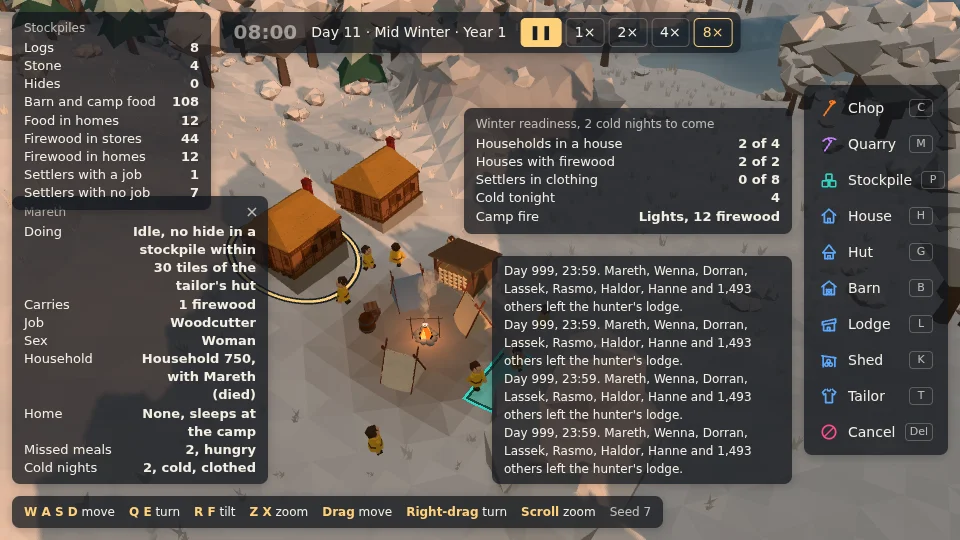 | 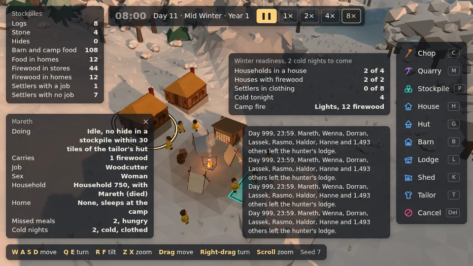 |

### Between the stages: tell the player why no firewood is split (#45)

When no stockpile in reach holds a log and a building site that a walk reaches still lacks logs, the woodshed and its woodcutter read `Idle, the building sites need the logs`. That is the reason that already existed for logs kept on a stockpile for the sites, now also used when carriers take every felled log straight to a site. In #40's year "wood" the panel read `Idle, no log in a stockpile within 30 tiles of the woodshed` for 17,987 of the woodshed's 17,995 daylight ticks, and now reads the sites' reason for all 17,987. At dusk the news names a worker whose workshop took no input that day, with the reason, as `Day 2, 19:11. Ulvar split no firewood: sites need the logs.` It comes once a day at most, and not on a day of work, when the shed is full, or when its places are set to 0. While no household sleeps at the camp, a household also takes firewood for its home from the camp, from the nearer of the camp and the nearest woodshed. The woodcutter's rule for taking a log did not change. (#45)

The pair is #40's year "wood" given through the toolbar, at 12:00 on day 3 in the same view. Before, on `main`, the woodshed's panel names Ulvar as woodcutter, reads `Firewood 0 of 40`, and reads `Doing Idle, no log in a stockpile within 30 tiles of the woodshed`. After, the same panel reads `Doing Idle, the building sites need the logs`. #45's third picture, not in the set, shows the news at the paused stop of 19:12 on day 2 with the line above. (#45)

| Before, `main` | After, #45 |
| --- | --- |
| 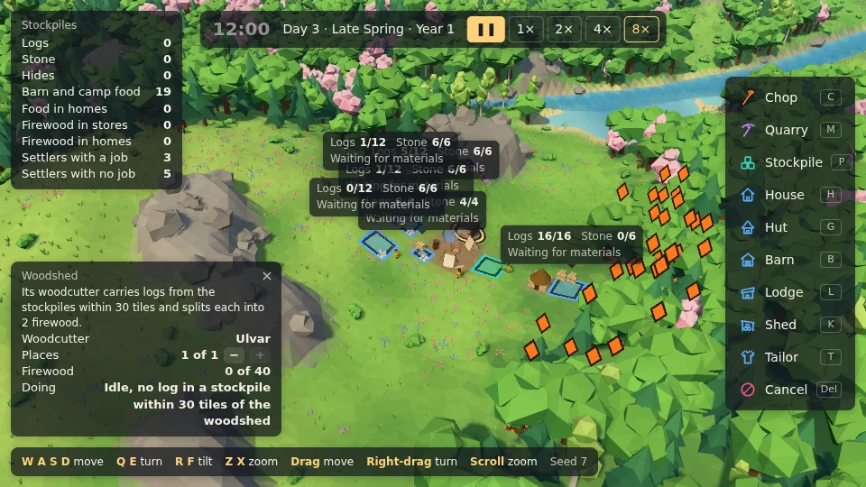 | 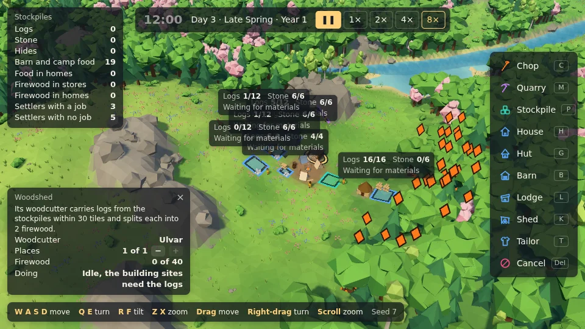 |

#45 also holds the measurement of first years on seed 7 that the owner asked for. It is under "What the stage measured".

### Between the stages: tell the player why no clothing is made (#47)

A workshop whose worker finds no input on a stockpile now has a third reason, after the sites' reason. When a unit of its input lies off every stockpile and the stockpile place a carrier would take it to lies within the workshop's 30 tiles, the tailor's hut reads `Idle, no hide carried to a stockpile yet`, and the woodshed `Idle, no log carried to a stockpile yet`. The news at dusk gains `… made no clothing: no hide carried yet.` and `… split no firewood: no log carried yet.` In #40's year "wood and hides" the tailor's panel read the old reason for 6,055 daylight ticks, and now reads it for 1,160 and the new one for 4,895. No rule changed. (#47)

The pair is #40's year "wood and hides" through the toolbar, at 12:00 on day 9, late autumn, in the same view. Before, on `main`, the tailor's hut names Jorrin as tailor, reads `Clothing 0 of 8`, and reads `Doing Idle, no hide in a stockpile within 30 tiles of the tailor's hut`. After, the same panel reads `Doing Idle, no hide carried to a stockpile yet`. #47's third picture, not in the set, shows the news at 19:12 on day 9 with `Day 9, 19:11. Ysa split no firewood: sites need the logs.` above `Day 9, 19:11. Jorrin made no clothing: no hide carried yet.` (#47)

| Before, `main` | After, #47 |
| --- | --- |
| 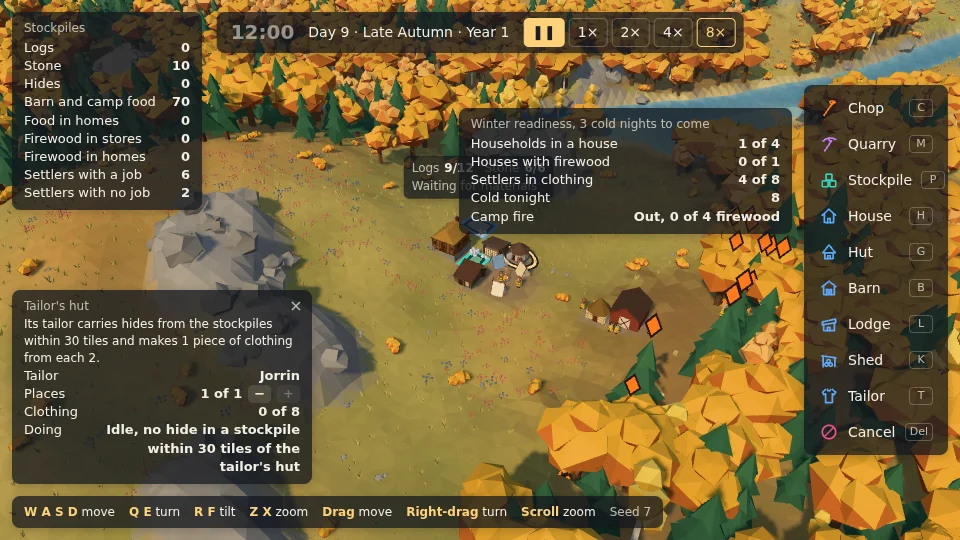 | 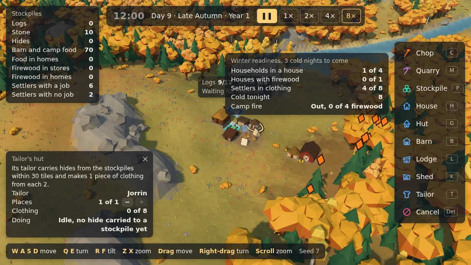 |

### 5.1 Settlers age and die of old age (#48)

A villager has a birth tick, and its age is the whole years since then, at 7,200 ticks a year of age. A starting settler is 18 to 30 on day 1 and has a life span of 60 to 80, both drawn from the seed without touching any existing draw. At a dawn, every villager that has reached its span dies of old age where it slept. A death now stores its cause, hunger, cold, or old age, and the panel, the news, and the benchmark read it. The settler's `Sex` row became `Sex and age`, as `Woman, 24`, and a dead settler's `Doing` reads `Died of old age at 70`. The villagers table has 4,096 rows and a count of the rows in use, a row is never used twice, and one function adds a villager. A verification page can state each settler's age and span with `?settlers=`, and a player's page ignores it. (#48)

The first clip runs on day 3, late spring, from 17:31 to 17:40, with Ysa's panel open at the camp. Her panel reads `Idle`, `Job None`, and `Household 2, with Ulvar`, the household line before 5.2 changed it. `Sex and age` reads `Woman, 25` through the stop of 17:35, and `Woman, 26` from 17:36 to the last frame at 17:40. That is tick 7,200, where every starting settler turns a year older at once. (#48)

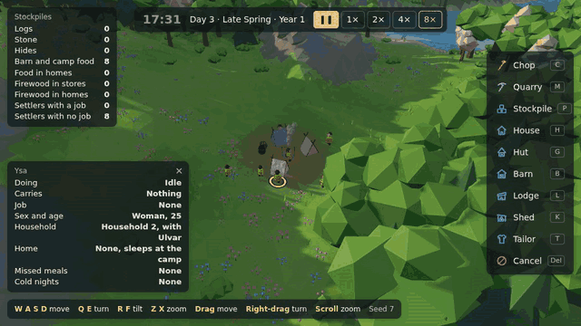

The second clip is a page of old settlers in which Merek is 70 with a span of 70. It runs on day 2, mid spring, from 04:41 to 04:52, with Merek's panel open at the camp. His panel reads `Resting at the camp` and `Man, 70` through the stop of 04:48, and the top left reads `Settlers with no job 8`. From 04:49 it reads `Died of old age at 70`, the top left reads 7, and the news reads `Day 2, 04:48. Merek died of old age.` The panel keeps `Man, 70`, his age at death. (#48)

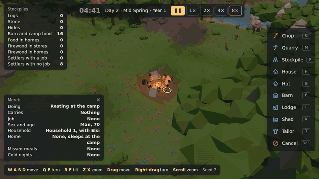

### 5.2 Children are born into households (#49)

A household now stores its couple, and its members are the villagers whose household column names it. At step 5 of a dawn, a household that has a house with fewer than 5 living in it, both of its couple alive, a woman of 16 to 39, nobody wanting a meal or with a cold night after the dawn's meals, and more than 6 dawns since it formed and since its last birth draws a child with a chance of 1 in 4. The draw is the household's own, from the seed, the household, and the dawn. The child stands at the door nearest its mother, plays within 3 tiles of a door by day, goes in at dusk, eats as an adult, wears no clothing, and does no work. Its panel title names its parents, as `Wend, son of Merek and Elsi`, and its `Job` reads `Child, works at 10`. A household line reads its living couple by name and the rest by count, as `Merek and Elsi, 1 child` or `Elsi, 1 died`. The top-left panel has a `Children` row, and the news names who was born to whom. When nobody in a household can carry, the settlers without a job stock its home before the camp. (#49)

The clip is a crop of the map over three building sites and a finished house, with no clock and no panel in its frames. #49 says that it runs a minute a stop from 03:27 to 04:07 on day 4 on the `births` page, with the household's draw falling under 1 in 4 at the dawn after their house stands. (#49) In the frames the dawn light rises over the sites. Midway through, the news reads `Day 4, 03:36. Wend was born to Merek and Elsi.`, and it stays to the end. In the last frames settlers walk out of the houses, and the nearest site's bar goes from 3% to 19%. #49 says the boy stands by the door. At this crop and in the dawn light the frames do not show which figure is the child, and #49 says the clip's dawn is dim. (#49)

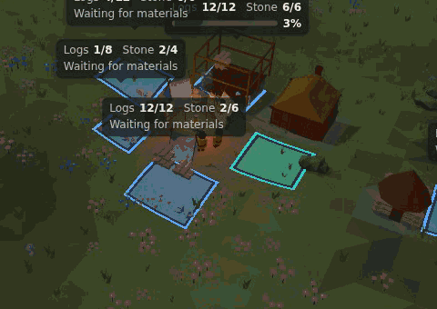

The first screenshot is Wend's panel at 09:00 on day 4: `Wend, son of Merek and Elsi`, `Playing by the house`, `Child, works at 10`, `Boy, 0`, `Merek and Elsi, 1 child`, and `A house`, with `Children 4` at the top left. The second is their house's panel at 09:00 on day 6: `Merek and Elsi, 1 child`, `Food 9 of 16`, `Firewood 0 of 6`, with `Children 5` at the top left.

| The child, day 4 09:00 | The house, day 6 09:00 |
| --- | --- |
| 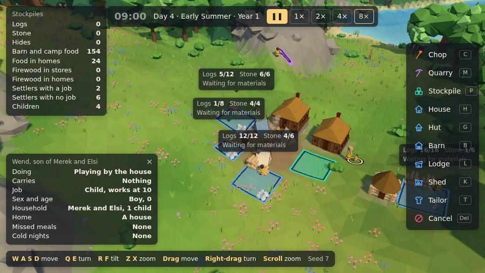 | 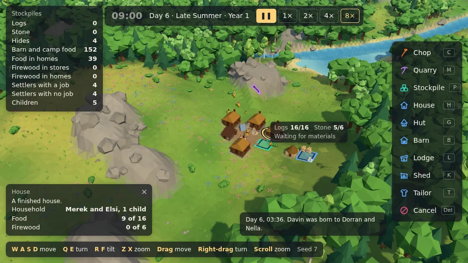 |

### 5.3 Children grow up and start to work (#50)

At step 3 of the dawn on which a child is 10, it starts to work. The step clears the child's mark, counts it among its household's workers, and gives open places at workplaces to the nearest settlers without a job by the existing rule. From then on it takes orders to the land, fills places, stocks its home, and fetches clothing, and it is drawn at an adult's size. A child that turns 10 by day plays until the next dawn. `Sex and age` reads `Girl` or `Boy` until 16 and `Woman` or `Man` from 16. The news names those who started to work. (#50)

The clip opens a page of four 9-year-olds and follows Sten, son of Merek and Elsi, whose house stands on day 3. It runs from 15:07 on day 3, late spring, to 05:10 on day 4, early summer, with repeated frames dropped. His panel reads `Playing by the house`, `Child, works at 10`, and `Boy, 9` through the stop of 17:35, and `Boy, 10` from 17:50. It reads `Walking home` at 19:16 and `At home` from 19:32 to 03:27. At the stop of 03:37 the news reads `Day 4, 03:36. Sten, Tilde, Tobin and Penna started to work.`, his `Job` reads `None`, and his `Doing` reads `Walking to the camp for food`. The top left goes from `Settlers with no job 6` and `Children 4` to 10 and 0, with `Settlers with a job 2` throughout. He reads `Carrying food home` at 04:01 and 04:07, and `Walking to a tree` from 04:12 to the last frame at 05:10, when his ring stands among the chop marks. #50 says the clip runs from 15:00 to 05:13. Its frames run from 15:07 to 05:10, and its screenshots are taken at 15:00 and 05:13. (#50)

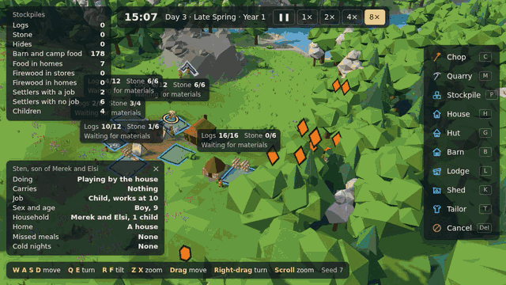

The screenshot is his panel at 05:13 on day 4, which the clip does not reach: `Chopping a tree`, `Job None`, `Boy, 10`, with `Settlers with no job 10` and `Children 0` at the top left.

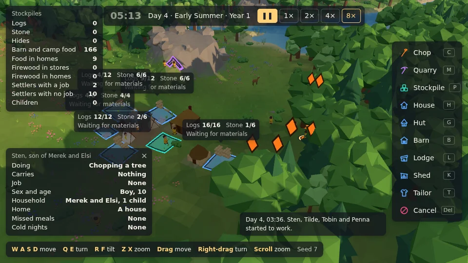

### 5.4 Grown children form new households (#51)

A settler is single when it is alive, 16 or older, and has never had a partner. At step 4 of each dawn the women who are single go from the oldest down, and each takes the single man nearest her in whole years of age who is not her parent and shares no parent with her, the older when two are as near, then the lower id. The two leave their parents' households and form a new one, which takes the empty house finished first or lives at the camp until a house is finished or freed. A settler keeps its place at a workplace, its clothing, and its task when it changes household. The news reads `Day 6, 03:36. Sten and Tilde formed a household.`, and names two couples and counts the rest. (#51)

The clip joins two cuts of one recording, with no clock in its frames. In the first cut the third house is selected and reads `Household Nobody`, `Food 0 of 16`, and `Firewood 0 of 6`. Then it reads `Household Sten and Tilde`, and the news reads `Day 6, 03:36. Sten and Tilde formed a household.` In the second cut the light is late in the day, the news reads `Day 6, 12:21. Ulvar and Tilde became hunters.`, and Sten's panel reads `Sten, son of Merek and Elsi`, `Man, 16`, `Household Sten and Tilde`, `Home A house`, and `Carrying food to the camp` with `Carries 1 food`. His ring walks across the map, his panel reads `Walking home` and then `At home` with `Carries Nothing`, and the light dims toward night. #51 gives the second cut's times as 20:10 to 20:29. (#51)

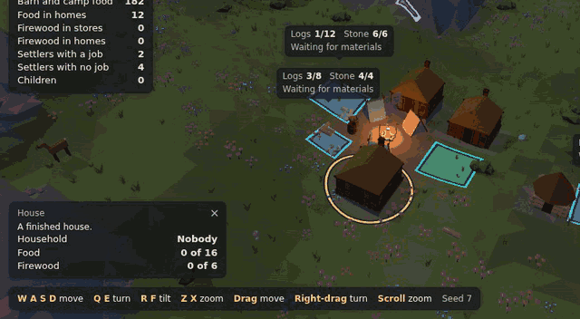

The screenshots show Sten's parents' house, which the clip does not. At 22:00 on day 5 it reads `Merek and Elsi, 1 child`. At 03:57 on day 6, after the pairing, it reads `Merek and Elsi`.

| Day 5 22:00 | Day 6 03:57 |
| --- | --- |
| 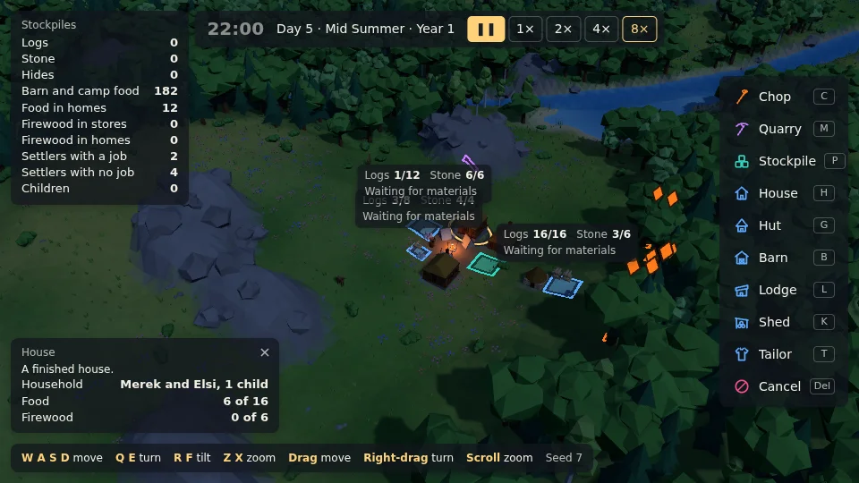 | 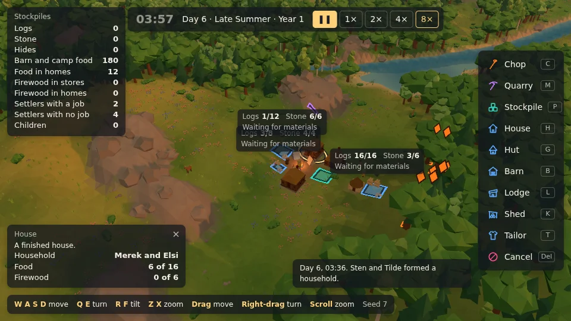 |

### 5.5 Read the settlement's people (#52)

The camp's panel gains four rows after `Settlers here`, `Food`, and `Firewood`: `Children`, `Workers`, `50 or older`, and `This year`, as `1 born, 1 died`. The year's births and deaths live in the simulation and go back to 0 on the first tick of a calendar year. The three counts of people are made from the frame only while the camp is selected. No rule changed. (#52)

The clip is the camp's panel and the news, stepped a minute at a time on a page with a man of 60 who died of old age at the dawn of day 2, with no clock in its frames. #52 says it runs from 03:32 to 03:40 on day 4. (#52) At first the panel reads `Settlers here 3`, `Food 165 of 200`, `Firewood 0 of 12`, `Children 3`, `Workers 9`, `50 or older 1`, and `This year 0 born, 1 died`, and the news reads `Day 3, 20:14. Fenna went hungry.` In one frame, the panel reads `Children 4` and `1 born, 1 died`, and the news adds `Day 4, 03:36. Brina was born to Merek and Elsi.` `Settlers here` reads 6 in that frame and 7 a few frames later. `Workers` and `50 or older` stay at 9 and 1.

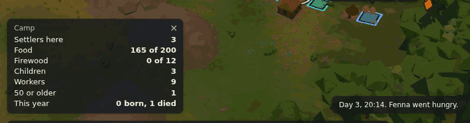

The screenshot is the copy of the panel that the checks fill with each row's longest reading, at 960 by 540: `Settlers here 1500`, `Food 65535 of 65535`, `Firewood 12 of 12`, `Children 1500`, `Workers 1500`, `50 or older 1500`, and `This year 4095 born, 4096 died`, each on one line. The panel is 162 px tall against the settler's 253 px at every size. (#52)

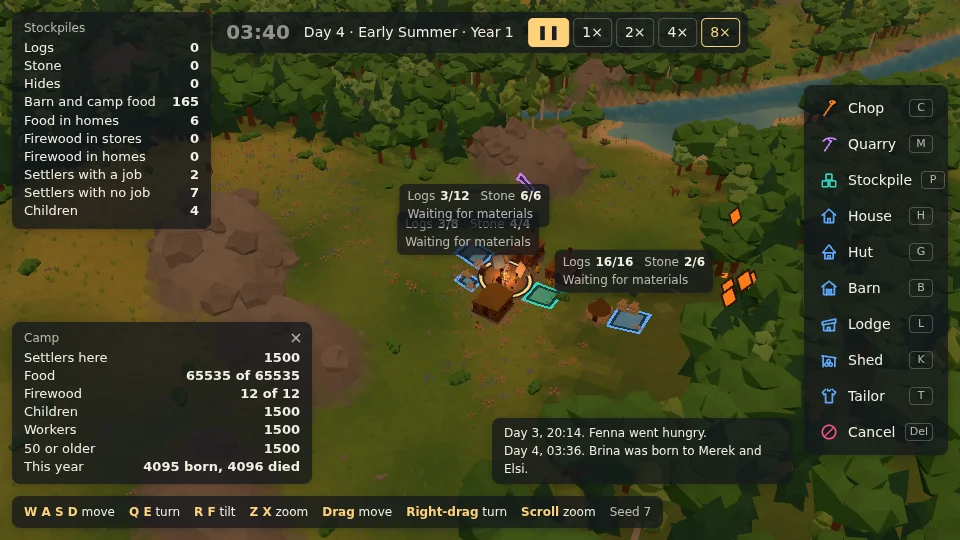

### 5.5b Measure twenty years of the settlement (#53)

`scripts/settlement-years.ts` plays 20 years on seed 7 in `src/sim`, once with births and once with births off from year 3, and prints the tables under "What the stage measured". `--hours` plays the same rule with its orders at 08:00, 10:00, 12:00, and 14:00. No file under `src/` changed. The switch for births and the count of what stops them live in the script only, so a player's game cannot reach them. #53 has no clip. Its proof is its tables. (#53) For this summary, `bun scripts/settlement-years.ts` and `bun scripts/settlement-years.ts --hours` were run at `a628e92`, the merge of #53. Every row of #53's tables 1 and 2, its table of the brakes on births, and its table of four hours matches a row they print. They took 42 s and 108 s in this pylon.

## What the stage measured

Every number below is taken from the pull request named beside it, except where a command is named. The only commands run for this summary are #53's two, to check its tables.

### The first years on seed 7 under today's rules (#45)

On 2026-11-23 the owner decided to measure first whether a player's own order of commands survives the first winter under the rules of stage 4, as the stage 5 brief records. #45 measured first years on seed 7, each a script that gives its orders at game times. Every year has #30's hut, barn, and lodge with their 16 trees and 2 rock tiles, and 4.2's stockpile, at 08:00 on day 1. "Near" houses stand on the 4 places nearest the camp, and "west" houses are #40's. (#45)

| Year | Other orders | Houses by day 10 | Died | Meals | Barn at the end |
| --- | --- | --- | --- | --- | --- |
| `near-houses-late-shed` | 4 near houses at d1 08:00; woodshed and 9 trees at d5 06:16, when no site lacks a log | 4 | nobody | 96 of 96 | 33 |
| `near-houses-shed-places` | 4 near houses and the woodshed at d1 08:00; woodshed places 0 at d2 17:08, 1 at d6 13:23 | 4 | nobody | 96 of 96 | 33 |
| `near-houses-shed-at-start` | 4 near houses and the woodshed at d1 08:00 | 4 | 2 froze | 96 of 96 | 30 |
| `west-houses-late-shed` | 4 west houses at d1 08:00; woodshed at d9 09:07 | 4 | 4 froze | 96 of 96 | 24 |
| `west-houses-shed-at-start`, #40's "wood" | 4 west houses and the woodshed at d1 08:00 | 3 | 8 froze | 96 of 96 | 37 |
| `no-house-clothing` | woodshed at d1 08:00; tailor's hut at d2 16:31 | 0 | 2 froze | 96 of 96 | 69 |
| `firewood-first-4-houses` | woodshed at d1 08:00; 4 near houses at d6 13:43, at 24 split | 1 | 6 froze | 96 of 96 | 66 |
| `near-3-houses-tailor` | 3 near houses at d1 08:00; woodshed at d4 18:29; tailor's hut at d4 19:33 | 3 | 1 froze | 96 of 96 | 36 |

The first two years live. A settler freezes only at its third cold night in a row, so one fire in each house over the three winter nights saves its household, and every run that killed had one house whose fire never burned. The year is not monotone in its delays: putting the houses of `near-houses-late-shed` off by 8 hours loses 2 settlers, by 10 to 20 hours none, and by 22 hours 2 again. The search found surviving years and did not prove a cheapest one. On seed 2, before the camp became a source for houses, 12 firewood stayed at the camp once every household had a house, two houses never lit a fire, and 4 of 8 froze. After it, all 8 live. (#45) Stage 5 starts from `near-houses-late-shed`. (#49, #53)

### The first deaths of old age on seed 7, and the dead rows (#48)

`bun scripts/ages.ts --seed 7` gives each starting settler's age, span, and the dawn its span gives. A game year is 12 days, so day 95 is in year 8. (#48)

| Name | Age on day 1 | Life span | Dies at the dawn of |
| --- | --- | --- | --- |
| Merek | 26 | 77 | day 124, year 11, 03:36 |
| Elsi | 29 | 68 | day 95, year 8, 06:36 |
| Ulvar | 23 | 68 | day 110, year 10, 04:48 |
| Ysa | 25 | 64 | day 95, year 8, 06:36 |
| Jorrin | 27 | 74 | day 114, year 10, 03:36 |
| Fenna | 27 | 79 | day 126, year 11, 03:36 |
| Dorran | 23 | 77 | day 131, year 11, 06:36 |
| Nella | 18 | 67 | day 119, year 10, 06:36 |

No starting settler on seed 7 dies of old age before day 95, about an hour of play at 8×. (#48) In #53's 20 years the first deaths of old age come in year 8, two of them. (#53)

`bun scripts/bench.ts --dead-rows` adds 1,500 dead rows after the 1,500 living ones, with the same living ids and the same work. The dead rows add 0.002 to 0.004 ms to the median tick, about 3%, and their p99 differences lie inside the spread of repeated runs. The table takes 4.30 MiB with or without them, because it is allocated at 4,096 rows, and 4.00 MiB of that is the route column. The readiness reading rose from about 21 µs to 23.6 µs on the 256 map. A settlement that grows toward 1,500 living fills the 4,096 rows after about 2,600 deaths, and from then on no child is born. #48 proposes a way out that keeps the id equal to the row, and built nothing of it. That proposal is under "Left open for the owner". (#48)

### Births in two surviving years, and with one household hungry (#49)

`bun scripts/birth-years.ts` plays #45's year that lives and a second year with nothing ordered after the first. (#49)

| Birth | Household | Child |
| --- | --- | --- |
| d10 06:36 | 2, Ulvar and Ysa | Oda, a girl |
| d11 06:36 | 4, Dorran and Nella | Kaili, a girl |
| d13 04:48 | 1, Merek and Elsi | Mira, a girl |
| d13 04:48 | 3, Jorrin and Fenna | Wend, a boy |
| d18 03:36 | 2, Ulvar and Ysa | Davin, a boy |
| d20 04:48 | 3, Jorrin and Fenna | Brina, a girl |
| d20 04:48 | 4, Dorran and Nella | Esker, a boy |

At the end of year 1, 12 live, 4 of them children. In year 2 nothing more is ordered for firewood or food, and all 15 die at the dusks of days 23 and 24, most of cold and the rest of hunger. The two years miss 35 meals. With household 1 kept hungry, by a script that sets its food aside at each dusk and puts it back after the dawn, household 1 has no child in either year, the others have 6, and all 14 die in the same second winter. That run misses 72 meals. #49 says the deaths of year 2 come from the orders, not from a rule. (#49)

The two counts of year 1 differ between #49 and #53. #49 counts 12 living and 4 children at the end of year 1, and #53's table counts 10 rows and 2 born. The births of Mira and Wend come at 04:48 on day 13, and #53 reads each year at its last tick, the minute before midnight that opens day 13. #45's page check reads the year at 05:00 on day 13, which is inferred to be where #49's count stands. Both give 101 meals eaten of 102 and 24 food in the barns and the camp with 20 in homes. (#49, #53)

#49's `births` scenario also shows a draw under 1 in 4 that each rule stops. Dorran and Nella at the camp at the dawn of day 4, Ulvar and Ysa with 5 in their house at the dawn of day 5, and Jorrin and Fenna with Fenna at 40 at the dawn of day 5 have no child. Dorran and Nella, hungry in a new house at the dawn of day 6, have none, and on a fed page they have Davin at that dawn. (#49)

### The start of work (#50)

None of the existing years reaches a start of work. Their first child is born on day 10 and would be 10 on day 34. (#50) In #53's run the first children born are 10 to 15 at the end of year 3, 2 of them. (#53) A child of 9 stated on day 1 turns 10 at 17:36 on day 3 and starts at the dawn of day 4, and the step that starts it takes 0.024 ms median on 1,500 villagers with 63 starts. (#50)

### Pairing, and the cold of the newly paired (#51)

On a page of six single settlers of stated ages whose parents are three couples, the rule pairs Mira, 18, with Arvel, 19, the older of the two men as near her age as each other, because Davin, 18, is her brother. Bera, 18, takes Davin. Mira, 16, is left single, because only her brother Wend is left. The page's news reads `Day 2, 04:48. Arvel and Mira formed a household, and so did Davin and Bera.`, and `scripts/pairing.ts` gives the same pairs in `src/sim`. (#51)

The benchmark's winter start freezes almost everyone with or without pairing, 1,193 of 1,438 living on the 256 map on `main`. Against a control build without the pairing step, pairing adds 27 deaths of cold and 92 cold nights on the 256 map and 7 deaths and 25 cold nights on the 512 map, because a settler whose parents have a house moves to the camp when no house stands empty. The output does not count the cold nights of the newly paired by name. (#51) Over #53's 20 years, 14 settlers paired into a household with no house, 12 of them had a cold night before their household got a house, and 10 of them froze, 3 before a house. (#53)

### The camp's counts (#52)

#52's "Play it" gives the camp's readings at the end of years 1, 3, and 5 from #53's script, at the orders of 08:00. They match #53's table 1, with the children those under 10 and the workers those of 10 or older. (#52, #53)

| End of year | Children | Workers | 50 or older | This year |
| --- | --- | --- | --- | --- |
| 1 | 2 | 8 | 0 | 2 born, 0 died |
| 3 | 9 | 10 | 0 | 3 born, 0 died |
| 5 | 0 | 12 | 4 | 0 born, 4 died |

Reading the whole camp's panel with 1,500 living took 16.4 µs median and 69.9 µs at most over 1,000 reads in the pylon. It runs once a frame and only while the camp is selected. (#52)

### Twenty years on seed 7 (#53)

**The ordering rule.** Year 1 gives #45's orders for `near-houses-late-shed` unchanged. From year 2 the rule reads the screen once each morning and gives these orders, in this order. (#53)

1. A house on the place nearest the camp, when more households sleep at the camp than house sites stand.
2. Trees, when the logs on the stockpiles plus 2 for each marked tree fall short of what the sites lack plus 1 log for every 2 firewood that the homes and the camp lack.
3. One rock tile, when the sites lack more stone than the stockpiles hold and no rock is marked.
4. The lodge's places set to 0.
5. When nobody is without a job, a place taken from the first hut with one. Otherwise, below 4 days of meals for the living in the barns and at the camp, with 2 or more settlers without a job, a place given back to a hut or a new hut ordered. Above 8 days, a place taken from the first hut with one.
6. A barn on the place nearest the camp, when the barns and the camp hold within 20 food of all they can and no barn site stands.

Marked trees are the nearest to the camp that a settler can walk to, outside the reach of every hut. The rule orders no lodge, no second woodshed, and no tailor's hut. #53 tried eleven rules before this one, and each died out between year 2 and year 16. A hunter brings in a third of what a forager does, so setting the lodge's places to 0 was the largest single gain. (#53)

**Table 1. Births on, the rule at 08:00.** Each row is the last tick of a calendar year. The calendar year turns at midnight, which falls inside the last winter night, so the cold of that night counts in the next year. "Housed" and "at camp" are households with a living member. "Singles" are the living of 16 or older who never paired. Food and firewood are in the barns, woodsheds, and camp, then in homes. The buildings are houses, huts, barns, lodges, woodsheds, and tailor's huts. "Rows" are the rows of the villagers table in use. (#53)

| year | <10 | 10-15 | 16-49 | 50+ | born | starved | froze | old age | housed | at camp | formed | singles 16+ | meals/due | food barns+camp/homes | firewood stores/homes | house/hut/barn/lodge/shed/tailor | rows |
| --- | --- | --- | --- | --- | --- | --- | --- | --- | --- | --- | --- | --- | --- | --- | --- | --- | --- |
| 1 | 2 | 0 | 8 | 0 | 2 | 0 | 0 | 0 | 4 | 0 | 0 | 0 | 101/102 | 24/20 | 0/0 | 4/1/1/1/1/0 | 10 |
| 2 | 8 | 0 | 8 | 0 | 6 | 0 | 0 | 0 | 4 | 0 | 0 | 0 | 163/163 | 0/30 | 0/10 | 4/3/1/1/1/0 | 16 |
| 3 | 9 | 2 | 8 | 0 | 3 | 0 | 0 | 0 | 4 | 0 | 0 | 0 | 190/209 | 0/0 | 0/8 | 4/4/1/1/1/0 | 19 |
| 4 | 2 | 6 | 8 | 0 | 0 | 3 | 0 | 0 | 4 | 0 | 0 | 1 | 198/248 | 0/8 | 0/10 | 4/6/1/1/1/0 | 19 |
| 5 | 0 | 3 | 5 | 4 | 0 | 0 | 4 | 0 | 5 | 0 | 3 | 0 | 192/192 | 107/24 | 0/2 | 5/7/1/1/1/0 | 19 |
| 6 | 1 | 0 | 6 | 6 | 1 | 0 | 0 | 0 | 6 | 0 | 1 | 1 | 151/151 | 92/26 | 0/20 | 7/7/1/1/1/0 | 20 |
| 7 | 4 | 0 | 5 | 7 | 3 | 0 | 0 | 0 | 6 | 0 | 0 | 1 | 180/180 | 0/27 | 0/22 | 7/7/1/1/1/0 | 23 |
| 8 | 4 | 1 | 5 | 5 | 1 | 0 | 0 | 2 | 6 | 0 | 0 | 1 | 195/195 | 73/30 | 0/8 | 7/7/1/1/1/0 | 24 |
| 9 | 2 | 3 | 6 | 5 | 1 | 0 | 0 | 0 | 6 | 0 | 0 | 2 | 191/191 | 110/32 | 4/24 | 7/7/2/1/1/0 | 25 |
| 10 | 3 | 2 | 8 | 2 | 2 | 0 | 0 | 3 | 6 | 0 | 1 | 2 | 185/185 | 88/32 | 0/19 | 7/7/2/1/1/0 | 27 |
| 11 | 5 | 1 | 10 | 0 | 3 | 0 | 0 | 2 | 5 | 0 | 2 | 0 | 184/184 | 78/36 | 1/26 | 7/7/2/1/1/0 | 30 |
| 12 | 6 | 2 | 8 | 3 | 3 | 0 | 0 | 0 | 5 | 0 | 0 | 1 | 213/213 | 54/42 | 0/24 | 7/7/2/1/1/0 | 33 |
| 13 | 5 | 3 | 8 | 5 | 2 | 0 | 0 | 0 | 6 | 0 | 1 | 1 | 250/250 | 80/44 | 2/18 | 7/7/2/1/1/0 | 35 |
| 14 | 8 | 3 | 11 | 5 | 6 | 0 | 0 | 0 | 7 | 1 | 2 | 0 | 281/281 | 112/50 | 1/7 | 7/7/2/1/1/0 | 41 |
| 15 | 9 | 2 | 14 | 4 | 3 | 0 | 0 | 1 | 8 | 0 | 0 | 3 | 333/333 | 108/58 | 0/16 | 8/8/2/1/1/0 | 44 |
| 16 | 7 | 6 | 13 | 4 | 4 | 0 | 2 | 1 | 8 | 0 | 2 | 1 | 375/375 | 132/60 | 0/2 | 8/10/2/1/1/0 | 48 |
| 17 | 4 | 5 | 6 | 2 | 2 | 0 | 12 | 3 | 4 | 0 | 2 | 0 | 359/359 | 180/58 | 0/2 | 9/11/2/1/1/0 | 50 |
| 18 | 1 | 2 | 6 | 0 | 0 | 0 | 8 | 0 | 3 | 0 | 2 | 0 | 204/204 | 233/48 | 0/2 | 10/11/3/1/1/0 | 50 |
| 19 | 1 | 1 | 7 | 1 | 1 | 0 | 0 | 0 | 4 | 0 | 1 | 0 | 115/115 | 199/46 | 34/16 | 10/11/3/1/1/0 | 51 |
| 20 | 3 | 0 | 7 | 2 | 2 | 0 | 0 | 0 | 4 | 0 | 0 | 1 | 136/136 | 59/50 | 30/16 | 10/11/3/1/1/0 | 53 |

Over the 20 years the run has 32 living at most, and 3 die of hunger, 26 of cold, and 12 of old age (`bun scripts/settlement-years.ts`, its summary line).

**Table 2. Births off from year 3.** The same run, with the cap on the living set to 0 from the first tick of year 3. Workers are the living who work, and mouths are the living. (#53)

| year | workers | mouths | meals/due | starved | froze | old age |
| --- | --- | --- | --- | --- | --- | --- |
| 1 | 8 | 10 | 101/102 | 0 | 0 | 0 |
| 2 | 8 | 16 | 163/163 | 0 | 0 | 0 |
| 3 | 10 | 16 | 192/192 | 0 | 0 | 0 |
| 4 | 16 | 16 | 192/201 | 0 | 0 | 0 |
| 5 | 12 | 12 | 192/192 | 0 | 4 | 0 |
| 6 | 12 | 12 | 144/144 | 0 | 0 | 0 |
| 7 | 12 | 12 | 144/144 | 0 | 0 | 0 |
| 8 | 10 | 10 | 140/140 | 0 | 0 | 2 |
| 9 | 10 | 10 | 120/120 | 0 | 0 | 0 |
| 10 | 7 | 7 | 100/100 | 0 | 0 | 3 |
| 11 | 4 | 4 | 66/66 | 0 | 0 | 3 |
| 12 | 4 | 4 | 48/48 | 0 | 0 | 0 |
| 13 | 4 | 4 | 48/48 | 0 | 0 | 0 |
| 14 | 4 | 4 | 48/48 | 0 | 0 | 0 |
| 15 | 3 | 3 | 36/36 | 0 | 0 | 1 |
| 16 | 1 | 1 | 25/25 | 0 | 0 | 2 |
| 17 | 0 | 0 | 4/7 | 1 | 0 | 0 |

The first missed meal from year 3 on comes in year 4, 192 of 201 meals. The first starvation comes in year 17. The last settler, Imke, 73, holds the woodshed's one place, which the rule never takes back, and the rule had taken every hut's places so that one settler would be free. Nobody foraged after year 16, and the barns and the camp held no food from day 2 of year 17. Her home ran dry on day 5, and she starved at 19:26 on day 7, while 8 food lay in the homes of four dead households. A settler eats only from its own household's house, or from the camp while it has none. (#53)

**The same rule at four hours.** Births on, with the rule's orders given at 08:00, 10:00, 12:00, or 14:00. The table gives the living at each year's end, and the deaths of hunger, cold, and old age in that year. (#53)

| year | 08:00 living | starved/froze/old age | 10:00 living | starved/froze/old age | 12:00 living | starved/froze/old age | 14:00 living | starved/froze/old age |
| --- | --- | --- | --- | --- | --- | --- | --- | --- |
| 1 | 10 | 0/0/0 | 10 | 0/0/0 | 10 | 0/0/0 | 10 | 0/0/0 |
| 2 | 16 | 0/0/0 | 16 | 0/0/0 | 16 | 0/0/0 | 16 | 0/0/0 |
| 3 | 19 | 0/0/0 | 19 | 0/0/0 | 19 | 0/0/0 | 14 | 4/0/0 |
| 4 | 16 | 3/0/0 | 13 | 6/0/0 | 13 | 6/0/0 | 14 | 0/0/0 |
| 5 | 12 | 0/4/0 | 13 | 0/0/0 | 13 | 0/0/0 | 12 | 0/2/0 |
| 6 | 13 | 0/0/0 | 14 | 0/0/0 | 14 | 0/0/0 | 12 | 0/0/0 |
| 7 | 16 | 0/0/0 | 20 | 0/0/0 | 19 | 0/0/0 | 17 | 0/0/0 |
| 8 | 15 | 0/0/2 | 23 | 0/0/1 | 20 | 0/0/2 | 18 | 0/0/2 |
| 9 | 16 | 0/0/0 | 19 | 0/5/0 | 20 | 0/0/0 | 19 | 0/0/0 |
| 10 | 15 | 0/0/3 | 13 | 0/5/2 | 19 | 0/0/2 | 17 | 0/0/2 |
| 11 | 16 | 0/0/2 | 12 | 0/0/1 | 21 | 0/0/2 | 17 | 0/0/2 |
| 12 | 19 | 0/0/0 | 14 | 0/0/0 | 27 | 0/0/0 | 21 | 0/0/0 |
| 13 | 21 | 0/0/0 | 16 | 0/0/0 | 23 | 0/8/0 | 24 | 0/0/0 |
| 14 | 27 | 0/0/0 | 18 | 0/0/0 | 24 | 0/0/0 | 29 | 0/0/0 |
| 15 | 29 | 0/0/1 | 17 | 0/0/1 | 22 | 0/2/1 | 29 | 0/0/1 |
| 16 | 30 | 0/2/1 | 18 | 0/0/2 | 23 | 0/0/2 | 31 | 0/0/1 |
| 17 | 17 | 0/12/3 | 18 | 0/0/3 | 25 | 0/0/2 | 33 | 0/0/4 |
| 18 | 9 | 0/8/0 | 21 | 0/0/0 | 29 | 0/0/0 | 38 | 0/0/0 |
| 19 | 10 | 0/0/0 | 22 | 0/0/0 | 32 | 0/0/0 | 42 | 0/0/1 |
| 20 | 12 | 0/0/0 | 23 | 0/0/2 | 28 | 0/5/3 | 40 | 0/7/1 |

The runs have 32, 24, 34, and 48 living at most (`bun scripts/settlement-years.ts --hours`, its summary lines). The first two years are the same at every hour, and the paths part on the second morning of year 2 over one hut. At 08:00 the first hut of year 2 stands at 18:47 on its day. At 14:00 it stands at 14:29 the next day, 29 minutes after that day's reading, so the reading still sees a hut site and the second hut comes a day later. From year 6 to year 16 the 08:00 and 14:00 runs are about as large, 30 and 29 living at the start of year 16. The 08:00 run has more children and falls under 4 days of food more often, so the rule orders 4 huts in years 15 to 17 against 2. Its huts take 22 places, and 1.3 to 1.8 settlers are without a job on a mean day of years 16 and 17, against 4.2 to 4.4 at 14:00. The woodshed was stopped for the sites in 93% of the ticks of year 16 at 08:00, and split 2, 12, and 8 firewood in years 16 to 18, against 64, 66, and 62 at 14:00. Ten houses needed 60 firewood on the first winter day of year 18, and the homes held 4, so the 08:00 run froze 20 settlers in years 17 and 18. Trees and the woodshed's room were not short. The hands to fell and carry were. The 14:00 run meets the same limit in year 20, with 16 huts and nobody without a job, and 7 froze. (#53)

A reviewer of #53 found that a new hut's own chop orders could mark trees inside its reach. The fix moved one marked tree by one tile at each of the first two huts, which made one hut stand 2 h 47 min sooner at 08:00. Before the fix the four hours ended year 20 with 42, 11, 36, and 13 living, and after it with 12, 23, 28, and 40. The tables use 08:00 because it is the hour a new game opens and the hour of year 1's orders. 14:00 ends largest, and #53 did not choose it, because choosing the hour that ends largest would tune the rule. (#53)

**The brakes on births.** Each household dawn counts the first reason that held, in the order the birth rule tests them. "Drawn" is a household that qualified and drew no child. "Cap" is the cap on the living or a full villager table. (#53)

| year | no house | full | couple | age | wanting | gap | drawn | cap | born |
| --- | --- | --- | --- | --- | --- | --- | --- | --- | --- |
| 1 | 13 | 0 | 0 | 0 | 0 | 14 | 15 | 0 | 2 |
| 2 | 0 | 0 | 0 | 0 | 0 | 36 | 6 | 0 | 6 |
| 3 | 0 | 14 | 0 | 9 | 0 | 7 | 15 | 0 | 3 |
| 4 | 0 | 25 | 10 | 12 | 1 | 0 | 0 | 0 | 0 |
| 5 | 15 | 6 | 12 | 30 | 0 | 0 | 0 | 0 | 0 |
| 6 | 0 | 0 | 12 | 36 | 1 | 17 | 0 | 0 | 1 |
| 7 | 0 | 1 | 12 | 36 | 0 | 12 | 8 | 0 | 3 |
| 8 | 0 | 12 | 16 | 32 | 0 | 6 | 5 | 0 | 1 |
| 9 | 0 | 22 | 36 | 12 | 0 | 0 | 1 | 0 | 1 |
| 10 | 0 | 21 | 41 | 5 | 0 | 7 | 1 | 0 | 2 |
| 11 | 0 | 9 | 9 | 15 | 0 | 23 | 1 | 0 | 3 |
| 12 | 0 | 5 | 0 | 24 | 0 | 21 | 7 | 0 | 3 |
| 13 | 0 | 23 | 0 | 24 | 0 | 9 | 5 | 0 | 2 |
| 14 | 1 | 30 | 0 | 24 | 0 | 17 | 4 | 0 | 6 |
| 15 | 2 | 36 | 12 | 12 | 0 | 24 | 7 | 0 | 3 |
| 16 | 9 | 34 | 5 | 28 | 2 | 15 | 8 | 0 | 4 |
| 17 | 2 | 34 | 16 | 30 | 8 | 11 | 3 | 0 | 2 |
| 18 | 0 | 20 | 0 | 24 | 8 | 6 | 0 | 0 | 0 |
| 19 | 0 | 0 | 0 | 16 | 0 | 16 | 8 | 0 | 1 |
| 20 | 0 | 0 | 0 | 24 | 0 | 14 | 8 | 0 | 2 |

The gap between births holds 36 of the 48 household dawns of year 2. The cap of 5 in a house holds 14 and 25 dawns in years 3 and 4, and 20 to 36 a year in years 13 to 18. The founding women pass 40 in years 2 to 5, and a widow does not pair again, so no child is born in years 4 and 5. Pairings come only in year 5, because the first children are 16 then and siblings cannot pair. The lack of a house holds 13 dawns in year 1, 15 in year 5 for the new households, and 0 to 9 a year after that. 53 rows of the villagers table are in use at the end of year 20 at 08:00, 2 to 3 a year, so at that rate the 4,096 rows would last over 1,500 years. (#53)

### The tick time against the 4 ms limit

These are pylon numbers from `bun scripts/bench.ts`, with 1,500 living villagers and 3,000 monsters on seed 7. The 4 ms limit is defined on the owner's machine, and no pull request of the stage measured there. Each pull request ran its head and its base alternately on the same node, and the table gives the p99 of each run, head first and base in brackets. #44 ran no benchmark, because it changed only the panel's width, and #53 ran none, because it changed no file under `src/`. (#44, #53)

| Pull request | Node | p99, spring 256 | p99, spring 512 | p99, winter 256 | p99, winter 512 |
| --- | --- | --- | --- | --- | --- |
| #45, firewood reasons | infra-testbench | 5.086 (5.245) ms | 7.758 (7.103) ms | 2.456 (2.379) ms | 2.523 (2.512) ms |
| #47, clothing reasons | rj-firebat | 1.249, 1.259 (1.234, 1.248) ms | 1.857, 1.852 (1.824, 1.822) ms | 0.611, 0.627 (0.607, 0.733) ms | 0.635, 0.626 (0.607, 0.610) ms |
| 5.1 (#48), age | rj-firebat | 1.281, 1.306 (1.250, 1.253) ms | 1.872, 1.855 (1.870, 1.830) ms | 0.677, 0.671 (0.620, 0.607) ms | 0.665, 0.656 (0.623, 0.605) ms |
| 5.2 (#49), births | rj-firebat | 1.060, 1.050 (1.271, 1.258) ms | 1.349, 1.308 (1.903, 1.836) ms | 0.594, 0.573 (0.677, 0.667) ms | 0.769, 0.755 (0.659, 0.651) ms |
| 5.3 (#50), work at 10 | rj-firebat | 1.066, 1.026 (1.090, 1.097) ms | 1.341, 1.315 (1.425, 1.333) ms | 0.721, 0.729 (0.605, 0.597) ms | 0.777, 0.681 (0.818, 0.774) ms |
| 5.4 (#51), pairing | rj-firebat | 0.998, 1.000 (1.040, 1.012) ms | 1.498, 1.517 (1.327, 1.282) ms | 0.670, 0.711 (0.696, 0.716) ms | 0.619, 0.606 (0.678, 0.686) ms |
| 5.5 (#52), the camp's panel | rj-firebat | 0.985, 0.991 (1.029, 0.984) ms | 1.457, 1.474 (1.488, 1.465) ms | 0.658, 0.661 (0.661, 0.653) ms | 0.600, 0.603 (0.608, 0.603) ms |

- **rj-firebat.** Every p99 passes. The highest at a head is 1.872 ms on the spring 512 map after 5.1, and the highest of any run is 1.903 ms, on `main` before 5.2. (#48, #49)
- **infra-testbench.** The spring p99 is over 4 ms on this node on the base too. #45 reads the spread between its two runs as the node's noise, a guess, and did not run them again. (#45) Stage 4's summary records a ratio of about 3.5 between the two nodes for the same code. (#39, as the stage 4 summary records it)

**The largest tick at a dawn.** The dawn ticks were already the largest on `main`, from the dawn's meals and the tasks that open again. At the dawns with births, the largest tick read 6.627 and 6.588 ms on spring 256, 14.978 and 14.014 ms on spring 512, 4.180 and 4.112 ms on winter 256, and 0.261 and 0.246 ms on winter 512. On spring 256 the dawn of 2 births took 5.195 ms at head against 5.977 ms for the same dawn on `main`. (#49) At the dawn of the starts of work the largest tick read 5.059 and 5.042 ms on spring 256 against 5.179 and 5.165 ms on `main`, and 5.197 and 5.345 ms on winter 256 against 4.258 and 4.223 ms. #50 traces the winter gap to a larger load, not to the step, whose cost is about 0.02 ms. (#50) At the pairing dawn of spring 512 the largest tick in its 10 ticks read 17.694 and 18.284 ms against 14.305 and 14.435 ms on `main`, and 17.584 and 17.567 ms on a control build without the pairing step, so the start caused it, not the pairing. `pairSettlers` itself took 0.05 to 0.09 ms at the dawns of 24 to 35 pairings. (#51) Only the p99 has a limit.

**The benchmark's start changed with each pull request, so its counts move between rows.** The brief asks the benchmark to start as a settlement in its later years and to hold each pull request's event in its measured ticks. (#43)

- 5.1 starts with 750 couples aged 16 to 75, and one in 8 of those 60 or older dies of old age inside the measured ticks: 50 in each spring run and 49 and 48 in the winter runs. (#48)
- 5.2 keeps 1,500 living as 582 households with 336 children under 10, and steps the man's age by 37 years modulo 60 so that housed households include women of bearing age. Deaths of old age fall to 40 in the spring runs and 32 and 31 in the winter runs. (#49)
- 5.3 makes every child a year older, so 62 children start to work at the dawn of day 4 in each spring run, and 45 and 42 in the winter runs. (#50)
- 5.4 gives each household whose woman is 46 to 60 one single grown child, which leaves 530 households and 308 young children. Starts of work fall to 58, 58, 41, and 39. Pairings are 35, 35, 25, and 24, births 5, 2, 5, and 1. (#51)
- After 5.5 the measured ticks hold 5, 2, 5, and 1 births, 58, 58, 41, and 39 starts of work, 35, 35, 25, and 24 households formed, and 39, 39, 33, and 30 deaths of old age. (#52)

**The check that 90% are at work.** It counted every row in 5.1, the dead included, by the orchestrator's instruction, and read 95.7% on spring 256 after the deaths of old age. (#48) From 5.2 it counts the daytime ticks of the living of 10 or older, which read 97.2%, 98.4%, 81.9%, and 86.1%, while the old count fell to 74.3%, 75.2%, 59.4%, and 60.9% because children hold no task but eating. (#49) The winter runs failed the check until 5.3, because children who turned 10 in the warm-up were counted and could not work. With 5.3 they work, and the winter runs pass at 93.0% and 97.4%. (#50) All four pass after 5.4 at 97.0%, 98.3%, 93.1%, and 97.6%. (#51)

**Allocation.** No test measures whether a tick allocates. Each pull request read its code for it and compared the benchmark's heap growth across the measured ticks with `main`'s. (#48, #49, #50, #51) The review of 5.2 found one allocation at each birth, which was fixed. (#49) The spring 256 run keeps 20 to 40 KB more heap after 5.2, about 30 KB more after 5.3, and about 42 KB more with pairing than without after 5.4. None of the three found where it stays, and #51 measured that the pairing step itself keeps 0 to 2 KB. (#49, #50, #51)

### Checks that moved in existing scenarios

No limit was loosened in any pull request of the stage. #44, #47, and #51 say that no limit changed, and #48 that no assertion was weakened. These are the checks whose readings or fixtures moved.

- **`readiness` measures every panel.** #44 added a check that fills a copy of each of the 14 kinds of selection panel with the longest reading of each row, and the tallest panel the page allows, at the three sizes. Each later pull request that added a reading added it to `panelReadings`: `Walking to the camp for firewood` (#45), the two "not carried" sentences (#47), `Woman, 80` and `Died of old age at 80` (#48), the child's title, `Child, works at 10`, and the household line by count (#49), `Girl, 15` and `Boy, 15` (#50), and the camp's four rows (#52). #45 removed the tailor's sites sentence, which the game cannot show. (#44, #45, #47, #48, #49, #50, #52)
- **The longest news line.** It became #45's woodshed line at 54 px, then #47's tailor line, 771 px wide on one row and 54 px tall. The lines of 5.1 to 5.4 were measured in Chromium with the widest names before their words were chosen, and each is 54 px tall. (#45, #47, #48, #49, #50, #51)
- **`selecting`'s settler check.** Its fixture now names a member who died. `main`'s game failed it at 256 by 288 from y 196, and #44 passes at 300 by 253 from y 231. (#44)
- **`hunting`'s follow.** The 300 px panel hid the hunter at 15:35 on day 2, so `HUNT_AIM_AT` moved from x 500 to x 544. The ring then shows at 21 of 21 stops, against 20 of 21 on `main`. (#44)
- **`clothing`'s stop for lack of hides.** It stepped until the panel read the old sentence, and with #47 it stepped past 07:58 on day 3 to 04:03 on day 4 and failed. It now stops at the first reading for lack of hides, either sentence, at 07:58 again. (#47)
- **Rows read by `Sex and age`.** Checks in `hunger`, `eating`, `selecting`, `foraging`, `storing`, `hunting`, `firewood`, `clothing`, `cold`, and `wearing` read `Sex and age: Woman, 27` where they read `Sex: Woman`, and a dead settler's `Doing` adds `at <age>`. Every verdict holds. (#48)
- **The household line.** `settlerPanel` recognised a panel by `Household <n>`, and now by the couple or a count of children, and by `Girl` and `Boy`. `cold` checks that households 1 and 2 moved in by their couples' names. (#49)
- **`firewood-year`'s food at the year's end.** It read 33 food in the barns and the camp and 16 in homes at 05:00 on day 13, and now reads 24 and 20 with 4 children, because children were born. (#49)

### The scenario runs

Every pull request but #43, #46, and #53 ran every scenario but `frames` once, one at a time.

- **#44**, on rj-firebat: every check passed. (#44)
- **#45**, on infra-testbench: 27 scenarios, every check but two. `selecting`'s GIF read 9.8 MB against 8 MB, and `camera`'s held D key a mean pixel difference of 0.00. Both fail the same way on `main` on that node. (#45)
- **#47**, on rj-firebat: every check passed, with `clothing` at 22 of 22 after its moved check. (#47)
- **5.1 (#48)**, on rj-firebat: 28 of 29 passed. `eating` failed its check that the orders place the hut site once, and passed on a rerun and on `main`. (#48)
- **5.2 (#49)**, on rj-firebat: every check passed, with `births` at 19 of 19. (#49)
- **5.3 (#50)**, on rj-firebat with the 5.4 worker on the same node: 30 of 31 passed every check. `clock`'s held W key read 0.00 at a load average near 6, and passed on `main` and again at the head at a load of 2.3. (#50) #50's check counts are 7 higher than other pull requests' for the same scenario, for example `selecting` at 47 where #51 and #52 read 40. #44 says its counts leave out the verification doctor's 7 checks, so #50's counts are inferred to include them. (#44, #50)
- **5.4 (#51)**, on rj-firebat: every check passed before the merge of 5.3, and the six scenarios the merge touches passed again after it. (#51)
- **5.5 (#52)**, on rj-firebat: 33 scenarios, every check passed, in 3 h 29 min. (#52)

## What the stage decided

The brief asked the stage to settle eight things. Nobody has played the stage. Each answer below comes from the scripts and the scenarios, and the owner decides each.

- **Whether a house is the right condition for a child, and 5 people in a house the right brake.** Not settled. In #53's 20 years the lack of a house holds 13 household dawns in year 1, 15 in year 5, and 0 to 9 a year after that. The cap of 5 holds 14 and 25 dawns in years 3 and 4 and 20 to 36 a year in years 13 to 18. (#53) #49 shows that a household at the camp has no child. (#49)
- **Whether a child that eats as an adult for two game years before it works is a cost a player feels.** Not settled by play. In #53's run the barns and the camp are empty from the end of year 2 to the end of year 4, when the first children eat and do not yet work, and 3 to 6 settlers starve there at every hour. (#53)
- **How fast a settlement grows.** Slowly. 11 children are born to the four couples by the end of year 3, against the brief's estimate of about 12. The first new households form in year 5, after the brief's earliest of year 3.2. The settlement holds at 12 to 19 living until year 12 and ends year 20 with 12 to 40 living by the hour of the orders. (#53) The brief's question of what to move is under "Left open for the owner".
- **Whether a settlement ages into a shortage of workers.** Not into one that starves it. With births off from year 3, from year 4 every one of the living works, and meals are eaten in full from year 5 to year 16. The 16 of year 4 fall to 4 by year 11 and to none in year 17, 11 of them of old age. The first missed meal from year 3 on comes in year 4, and the first starvation in year 17. (#53)
- **Whether a widowed settler should pair again, and whether pairing by the game is enough.** Not settled. 5.4 built the brief's rule, under which a widowed settler is not single. (#51) In #53's run a widow does not pair again, and the brake "couple", a household whose couple is not both alive, holds up to 41 dawns a year. (#53)
- **Whether the dead can stay in the villagers table.** #48 measured about 3% of the median tick per 1,500 dead rows and no memory beyond the table's, and proposed a way out without building it. (#48) In #53's run 53 rows are in use after 20 years. (#53)
- **Whether 8× is fast enough to play through generations.** Not measured by play. A year takes 7.5 minutes at 8×, so 20 years take 2.5 hours, and the first death of old age on seed 7 comes about an hour in. (#48, #53)
- **The tick time with villagers that are born, grow up, and die, and the largest tick at a dawn with births.** The p99 stays under the 4 ms limit on rj-firebat after every pull request that ran there, at most 1.872 ms at a head. (#48) The largest tick at a dawn with births read up to 14.978 ms on the spring 512 map, no larger than the same dawn on `main`. (#49) No pull request measured on the owner's machine, where the limit is defined.

## Choices made along the way

No decision in `docs/design.md` changed. These are the calls of the orchestrator and the workers, which the owner may overrule.

- **The clothing fix without asking.** The orchestrator started #47 without asking the owner, as the same kind of fix the owner chose for firewood, and the woodshed got the same new reason. (#47)
- **5.5 in two pull requests.** The orchestrator cut 5.5 into #52 and #53, so that each takes about fifteen minutes to review. (#52, #53)
- **The panel's reserve.** With the panel at 300 px the reserve under the Stockpiles panel rose to 210 px, so a panel taller than 262 px at 960 by 540 now clips instead of overlapping. (#44)
- **One sentence for two causes.** The woodshed's sites reason covers both logs kept on a stockpile for the sites and logs carried straight to a site, because the sentence is true of both. (#45)
- **Short news words.** The idle lines read `sites need the logs` and `no hide carried yet`, without "today", so a line naming 8 settlers and 1,493 more takes 3 rows, not 4. (#45, #47)
- **The nearer source of firewood.** A household takes its firewood from the nearer of the camp and the nearest woodshed, the woodshed when they are as near. The orchestrator took the rule from the one that food follows. (#45, #46)
- **One loose unit for the new reason.** #47's check looks at the loose unit nearest the workshop, to avoid a scan. When another unit would come into reach instead, the panel keeps the old sentence. #47 calls that incomplete but not false. (#47)
- **Age in whole years.** Age is `floor((tick - born) / 7200)`, and pairing compares whole years, the years the panel shows, because with birth ticks two settlers are almost never of the same age. (#48, #51)
- **The age in an existing row.** The `Sex` row became `Sex and age`, and no row was added. A child's parents went to the panel's title, because `Girl, 9, of Dorran and Lassek` would wrap. (#48, #49)
- **The benchmark's 90% check in 5.1.** By the orchestrator's instruction 5.1 kept counting every row, the dead included, and its reviewer's request to leave out the dead was rejected. 5.2 changed the check. (#48, #49)
- **The household line names only the living.** A household reads as its living couple by name and the rest by count, as `Elsi, 1 died`. The brief says a household reads as its couple by name, and #49 says this is a reading the owner can change. (#49)
- **The news counts the rest.** A birth line names two children and counts the rest, and a pairing line names two couples, because a third name made the line 72 px tall. A start-of-work line names up to eight. (#49, #50, #51)
- **A child turning 10 by day plays until the dawn,** because the step runs only at a dawn. A worker under 16 reads `Girl` or `Boy`. (#50)
- **A widowed settler is not single,** because it held a place in its household's couple, and it does not pair again. (#51)
- **A new household at the camp eats from the camp.** A settler with a missed meal who pairs eats from its new household's store, the camp, and no longer from its parents' house. (#51)
- **What a settler keeps when it pairs.** Its place at a workplace, its clothing, and its task stay. Each pair leaves through the same call a death makes, the man first. (#51)
- **Two rows for the camp's people.** `Children` and `Workers` are two rows, because one row wraps at `12 children, 140 workers`. (#52)
- **Counts that reset.** The year's births and deaths go back to 0 on the first tick of a calendar year. A count made from birth ticks would take a stated child of age 0 for a birth. (#52)
- **The 20 years at 08:00, untuned.** #53's tables use the orders of 08:00, which is not the hour that ends largest, and its rule was not tuned to the result. (#53)
- **The switches of #53.** Births go off when the script sets the cap on the living to 0, and the count of brakes is a read-only step the script puts into the dawn and takes out after each run. (#53)
- **The model.** Every pull request of the stage ran on `claude-opus-5-5` in a pylon, the child's smaller shape too, because Fable is not available in a pylon. (#44, #45, #47, #48, #49, #50, #51, #52, #53)

## Left open for the owner

The orchestrator has made no recommendation on these. A recommendation written in a pull request is marked as its author's.

- **#46 waits for your merge.** It records your firewood decisions of 2026-11-23 in `docs/design/stage-4-warmth.md`, as three added paragraphs and no changed line. Do you accept its text? (#46)
- **Can the dead stay in the villagers table?** 1,500 dead rows cost about 3% of the median tick and no memory beyond the table's 4.30 MiB. A settlement that grows toward 1,500 living fills the 4,096 rows after about 2,600 deaths, and from then on no child is born. At #53's rate, 2 to 3 rows a year, the rows last over 1,500 years. #48 proposes, as its author's recommendation, that the dead stay and that a full table doubles every villager column at the birth that finds it full, with the route column moved to a pool for the living. It recommends against taking the dead out, which would end "a row is never used twice". Nothing of it is built. (#48, #53)
- **Should a new household with no empty house leave its parents' house for the camp, in winter too?** In the benchmark's winter run, pairing adds 27 deaths of cold and 92 cold nights on the 256 map, and 7 deaths and 25 cold nights on the 512 map. (#51) Over #53's 20 years, 14 settlers paired into a household with no house, 12 had a cold night before it got one, and 10 of them froze, 3 before a house. (#53)
- **How fast should a settlement grow?** The design's 1,500 in a first playthrough of 15 to 20 hours means 120 to 160 game years at 8×. The best of #53's runs ends year 20 with 40 living. #53 names the numbers you could move and proposes no change. The gap of 6 dawns holds 36 of 48 household dawns in year 2. The cap of 5 in a house brakes in years 3 and 4 and in years 13 to 18. The bearing ages of 16 to 40 and the starting ages of 18 to 30 stop the founding couples within 2 to 5 years. Aging at 5 years a game year makes a generation 12 to 16 game years long. A forager brings in 18 to 29 food a year, about 2 people's meals, and a child eats for 2 years before it works. (#53) The brief adds that the design counts on refugees, which the first milestone leaves out. (#43)
- **Is a settlement whose fate moves with the minute of an order the game you want?** The same rule ends year 20 with 12, 23, 28, and 40 living at 08:00, 10:00, 12:00, and 14:00. The 08:00 and 14:00 runs part on the second morning of year 2, when a hut stands 29 minutes after a morning's reading. Moving one marked tree by one tile had given 42, 11, 36, and 13. #53 says to read the year-20 numbers as one sample of a fragile process, not as a growth rate. (#53)
- **Is the woodshed's wait for the sites what you meant by firewood as the player's management?** The woodcutter takes a log only while no building site lacks one, and in #53's runs that made every freeze. At 08:00 the woodshed was stopped for the sites in 93% of the ticks of year 16, split 2, 12, and 8 firewood in years 16 to 18 against 64, 66, and 62 at 14:00, and the run froze 20 settlers in years 17 and 18. (#53) You decided on 2026-11-23 that firewood stays the player's management with no new rule for who takes a log, and #45 and #47 made the game say why no firewood or clothing is made. (#45, #47) #53's rule is a script, not a player, and it never gives the woodshed priority.
- **Should food in a dead household's house stay out of reach?** In #53's run without births the last settler starved on day 7 of year 17 while 8 food lay in the homes of four dead households, because a settler eats only from its own household's house, or from the camp while it has none. (#53)
- **Should a widowed settler pair again?** The brief leaves it out, and the brake "couple" holds up to 41 household dawns a year in #53's run. (#43, #53)
- **The tick time on the owner's machine.** Every tick time of the stage is a pylon number. The p99 is at most 1.872 ms on rj-firebat and over 4 ms on infra-testbench's spring runs, on the base as on the head. The largest tick at a dawn reaches 17.694 to 18.284 ms on the spring 512 map after 5.4, over the 12.5 ms tick at 8×. (#45, #48, #51)
- **The frame rate.** `frames` ran in no pull request of the stage, because it needs a real GPU. The child's smaller shape and the new panels have not been measured on real hardware. (#44, #45, #47, #48, #49, #50, #51, #52)
- **Where the heap grows.** The spring 256 run keeps 20 to 42 KB more heap after 5.2, 5.3, and 5.4, and none of them found where. No test measures whether a tick allocates. (#48, #49, #50, #51)
- **The panel's readings by hand.** `panelReadings` lists the longest reading of each row by hand, so a new reading of an existing row must be added there, or the overlap checks do not see it. (#44)

## Known gaps

- No pull request measured anything on the owner's machine. (#44, #45, #47, #48, #49, #50, #51, #52, #53)
- Every capture comes from SwiftShader, and `frames` did not run. (#44, #45, #47, #48, #49, #50, #51, #52)
- #53 ran one seed. No page plays its 20 years, and the script is the proof. Its second review noted that no test exercises the reach boundary of the rule or a full villager table. (#53)
- Nobody played the "Play it" steps by hand. 5.2 ran them in `src/sim` with #45's orders, 5.3 used the page of 9-year-olds because a child born in play starts work 15 minutes in at 8×, 5.4 drove its page through the scenario, and 5.5 took the readings of years 1, 3, and 5 from #53's script. (#49, #50, #51, #52)
- #44's before and after pictures are a filled copy of the panel, not a real scene. No played year gave a four-line `Doing` beside a dead member. (#44)
- The before pictures of #45 and #47 come from `main` with the new scenario copied in, so their reason checks fail there by design. (#45, #47)
- The news lines of #45 and #47 were not captured at 960 by 600 or 1280 by 720. `readiness` measures their longest forms at all three sizes. (#45, #47)
- #47's new sentence speaks of the workshop's reach. With a hide on a stockpile beyond reach and loose hides bound for one in reach, it reads wider than it means, and #47 kept the words. (#47)
- A death of old age exactly at a dawn was not shown in the browser. A start of whole years reaches its span at a multiple of 7,200 ticks, and no dawn tick is one, so only a unit test covers it. (#48)
- The clips of #49 and #50 are dark at the dawn. The child is plain only in the panel screenshots, and the clip of #49 does not show which figure is the child. (#49, #50)
- The clips of #49, #51, and #52 show no clock, so their times rest on the news lines in them and on their pull requests' text. The clip of #50 runs from 15:07 to 05:10 where #50 says 15:00 to 05:13. #49 says its clip shows the top-left panel going from 3 children to 4, and the clip's frames show no top-left panel. (#49, #50, #51, #52)
- #51's reviewers did not run the browser scenarios. (#51)

## What the demo set leaves out

The set holds the files embedded above. It leaves out these files of the stage's pull requests, which `pr-media` prunes when the stage closes. Sizes are from `git ls-tree -l origin/pr-media`.

- **#44.** The settler's panel at its longest readings at 960 by 600, 87,834 bytes, and at 1280 by 720, 109,146 bytes. Both show the 300 px panel clear of the Stockpiles panel.
- **#45.** The news at the dusk of day 2, 82,700 bytes, which the text above quotes. The readiness reading at noon on day 10 of the surviving year, 109,576 bytes, and the Stockpiles panel at 05:00 on day 13 with 8 settlers alive, 73,716 bytes.
- **#47.** The news at the dusk of day 9, 79,548 bytes, which the text above quotes.
- **#48.** The dead settler's panel at 960 by 540 at 04:52 on day 2, 60,006 bytes, which the second clip of 5.1 shows. The settler's panel at its longest readings at 960 by 540, 960 by 600, and 1280 by 720, 86,600, 90,298, and 111,874 bytes.
- **#49.** The child's panel at 960 by 600 and at 1280 by 720, 88,078 and 118,918 bytes.
- **#50.** Sten's panel at 15:00 on day 3, 89,328 bytes, whose readings the clip shows. His panel at 05:13 at 960 by 600 and at 1280 by 720, 84,884 and 115,006 bytes.
- **#51.** Ulvar and Ysa's house before and after the pairing, 70,686 and 81,338 bytes, and the third house before and after, 70,308 and 81,536 bytes, which the clip shows. The pair at the camp moving into the third house at 17:40 on day 5, 98,846 bytes. The six singles' news, 72,020 bytes, which the text above quotes. The new household's settler panel at the three sizes, 109,266, 113,742, and 163,358 bytes.
- **#52.** The camp's panel on the page at the three sizes, 77,362, 80,382, and 106,224 bytes, whose readings the clip shows, and its longest readings at 960 by 600 and 1280 by 720, 82,674 and 107,958 bytes.
