# Stage 6 demo: farming

The four pull requests of stage 6 are merged, with the measurement of 20 years that closes it, and so are three fixes to stage 5's rules, one fix to the toolbar, and two passes over the verification skill. A player can now mark a field on grass with the `Field` tool and order a farm beside it with the `Farm` tool. A farm costs 8 logs and has 2 places, and its two farmers sow the field tiles within 20 tiles of it in spring, one tile in 150 ticks. A sown tile grows at each dawn, in a color of its own for each of its five stages, and is ripe and gold at the fifth dawn after sowing. A farmer cuts a ripe tile in 200 ticks into 4 food, and the farmer and the settlers without a job carry that food to a barn or the camp. The news says when the first crop of the year is ripe. Each year has one frost, at the dusk of day 9, or of day 8 in about 1 year in 4. The news warns at the dawn of that day, and at its dusk every crop still standing dies, turns dark, and is counted in the news. The ground stays frozen until the first dawn of spring, and then the killed tiles are bare and are sown again. A farmer with nothing to do says why. The farm's panel counts the field tiles in its reach by state, as `14 sown, 10 ripe`, and reads the food its farmers cut and the tiles the frost took this year and last year. The brief is `docs/design/stage-6-farming.md`.

The stage's main result is that farms end hunger, and then the cold ends the settlement. #67 played #53's 20 years on seed 7 with #53's ordering rule extended by a farm rule from year 2, beside the same run without farms at today's `main`. With the orders at 08:00, nobody starved with farms, against 3 without. The run with farms held 53 living at most, against 40, and from year 5 the barns and the camp held 177 to 602 food at each year's end. Then 48 settlers froze, and nobody lived from day 12 of year 18. Without farms nobody lived from day 12 of year 15, and 40 froze. (#67) The result moves with the hour of the orders. With farms, the rule at 08:00, 10:00, 12:00, and 14:00 held 53, 66, 41, and 53 living at most and died out in years 18, 19, 13, and 18. Without farms it held 40, 25, 38, and 36 at most, died out in years 15 and 11 at 08:00 and 10:00, and ended year 20 with 16 and 35 living at 12:00 and 14:00. Every run with farms died out, and #67 reads the result as farms taking hunger away and firewood then limiting the settlement. #67, like #53, calls one run on seed 7 one sample of a fragile process. (#67)

Every clip below was captured by the verification skill from a production build in headless Chromium, which draws on the CPU, so the clips are choppy and their frame rate says nothing about real hardware. Every clip and screenshot of the stage, and of the fixes beside it, comes from a pylon on rj-firebat with 6 CPUs and 6 to 8 GB of memory, as each body gives it. (#58, #59, #61, #62, #63, #65, #66) #60 names no node, and gives the pylon's processor as an AMD Ryzen 7 255 with 6 cores. (#60) That is the processor of rj-firebat, so its node is inferred to be rj-firebat (`lscpu` in this pylon on rj-firebat). Each clip shows the game at its own pull request's commit, so an early clip lacks rows that later pull requests added.

The clips and screenshots below are the stage's demo set, on the `pr-media` branch under `stage-6/`. The media in the pull requests of the stage and of the fixes beside it is pruned from `pr-media` when the stage closes. The demo set is 19 files and 13.82 MB (13,824,777 bytes, the sum of `stat -c %s` over the files): five clips, one for each of #60, #63, #65, and #66 and the after clip of #62, and fourteen screenshots. Every file is copied unchanged from its pull request's folder, and none was re-encoded. Each file's name starts with its pull request's number, as in `stage-4/` and `stage-5/`. The set leaves out the other files of these pull requests, which the last section of this page lists. The largest of them is #62's before clip, 5,951,671 bytes, which would take the set over 15 MB.

## The owner's decisions during the stage

- **The look stays frozen.** On 2026-11-15 the owner decided that the look is frozen until the mechanics can be playtested. It still holds, so fields and crops are plain colors built in code.
- **Stage 5 is closed.** On 2026-11-25 the owner accepted the stage 5 summary (#54), and its pull request media was pruned from `pr-media`.
- **#46 merged.** On 2026-11-25 #46 was merged on the owner's word.
- **The stage 6 brief comes next, with three fixes.** On 2026-11-25 the owner decided that the next step is the stage 6 brief, with three fixes to stage 5's rules beside it: a newly paired household stays under its parents' roofs until a house is free (#59), a widowed settler can pair again (#61), and the food in a house nobody lives in comes back into reach (#58). "Woodshed before sites" was not chosen, so the decision of 2026-11-23 stands.
- **The tick time on the owner's machine stays open.** On 2026-11-25 the owner decided that pull requests report pylon numbers, and that the gap stays in the summaries.
- **The stage 6 brief is accepted.** On 2026-11-26 the owner accepted the stage 6 brief as written (#57), and let the orchestrator merge the fix pull requests.
- **The maintenance pass's findings are fixed.** On 2026-11-26 the owner decided that the findings of the maintenance pass (#56) are fixed. While the toolbar has focus, every arrow key moves between the tools (#62). `frames` leaves the sweep and runs only on the owner's Mac (#64).

The owner made no decision while #60 to #67 were built. The calls made in that time are the orchestrator's and the workers', and they are under "Choices made along the way".

## The pull requests

### Between the stages: the brief (#57)

#57 added the stage brief, `docs/design/stage-6-farming.md`. It marks every new number as a proposal and names five choices that shape the stage: farming is a job at a building with places, not an order to the land; a farmer is idle outside sowing and harvest and does no common work; the frost can come a day early with a warning that morning; sowing costs no seed; and sowing is in spring only. It changed no code. Its author ran on `claude-fable-5-2` on the owner's machine. (#57)

### 6.1 Mark a field and sow it (#60)

A field is a claim on grass that stays until the player cancels it. Only grass with no claim, no goods, and not under the camp takes the mark, nothing can be built on a field, and Cancel removes it with what grows on it. The farm is a building of 2 by 2 tiles for 8 logs and 300 ticks of work, with 2 places and a reach of 20 tiles. In spring a farmer takes the nearest bare field tile in its reach and sows it in 150 ticks. A field tile is drawn as soil inside a yellow outline, and a sown tile adds three rows of shoots, drawn after the light so that they read the same at midnight. A farmer's `Doing` reads `Walking to a field to sow`, `Sowing a field`, `Looking for a field to sow`, `Idle, the fields are sown`, `Idle, nothing is sown until spring`, or `Idle, no field within 20 tiles of the farm`. The toolbar grows from 10 to 12 tools. The field's state lives in arrays by tile, and an idle farmer looks for a tile once every 10 ticks, outside spring at no cost. (#60)

The clip runs on day 1, early spring, from 12:16 to 16:00, on `firstSpringCommands` with seed 7. At 12:16 and 12:17 the farm's site reads `Logs 8/8` at 94% to 97%, and the top left reads `Settlers with a job 0` and `Settlers with no job 8`. At 12:32 the farm stands, its panel reads `Farmers Ysa and Jorrin`, `Places 2 of 2`, and `Doing Sowing a field; Walking to a field to sow`, the news reads `Day 1, 12:18. Ysa and…`, cut off at the frame's edge, and the top left reads 2 and 6. From 13:00 Ysa's panel reads `Job Farmer` and `Sowing a field`, and at 14:59 `Looking for a field to sow`. From 14:27 rows of shoots stand on the field's corner nearest the farm, and at 16:00 they cover a few tiles of that corner. #60 gives the clip's times as 12:15 to 16:00, and says that its scenario checks shoots on exactly the 4 tiles the sim sowed by the clip's end. (#60)

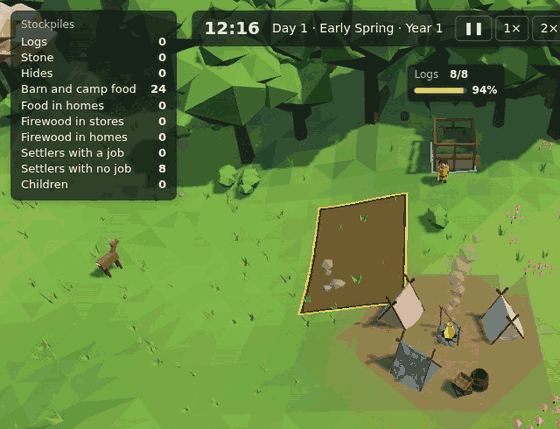

The first screenshot is the toolbar at 960 by 540, at 12:20 on day 1, with its 12 tools from `Chop` to `Cancel`, `Field` and `Farm` among them. The farm's panel reads `Ysa and Jorrin`, `2 of 2`, and `Looking for a field to sow`, and the news reads `Day 1, 12:18. Ysa and Jorrin became farmers.` The second is the field at 12:00 on day 3, late spring, with rows of shoots on every tile.

| The toolbar, day 1 12:20 | The field sown, day 3 12:00 |
| --- | --- |
| 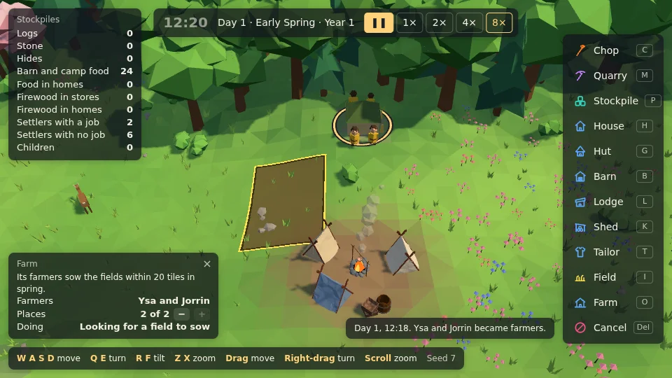 | 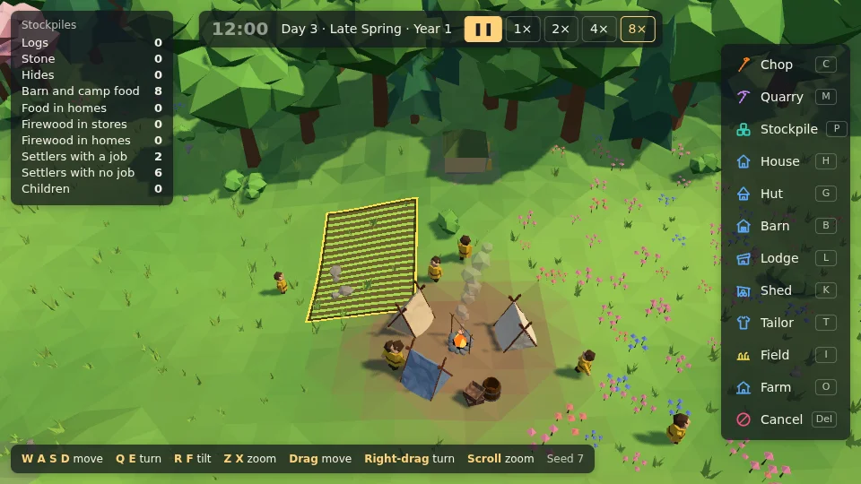 |

### 6.2 The crop ripens and is cut (#63)

A tile is read as bare, sown, ripe, or cut against the clock from the tick it was sown and the tick it was cut, so no tick walks the field tiles. A sown tile is ripe when 5 dawns have passed since its sowing, and a cut tile is bare again from the first dawn of spring. A farmer carries in the food that lies cut on the fields in its reach before it cuts another tile, and cuts only while a common store has room. A cut under way stops when the stores fill. The settlers without a job carry cut food in too. The crop's rows take five colors for the five stages, from pale to deep green, then gold when ripe and pale stubble when cut. The news reads `The first crop of the year is ripe.` once a year. `scripts/farm-year.ts` measures the first year on seed 7, and the benchmark gains a harvest run. (#63)

The clip runs on day 6, late summer, from 03:33 to 06:40, with the barn's panel open and the field beside it. At 03:33 and 03:36 the field's rows are deep green and the barn reads `Food 0 of 120`, with `Barn and camp food 16` at the top left. At 03:37 the news reads `Day 6, 03:36. The first crop of the year is ripe.`, and the rows of part of the field are gold. The farmers walk out and cut, and the cut rows turn pale. The barn reads `0 of 120` through 05:49, `1 of 120` at 06:06, `4 of 120` at 06:13, and `8 of 120` from 06:36 to the last frame at 06:40, while `Barn and camp food` goes to 24. #63 gives the clip's start as 03:30. (#63)

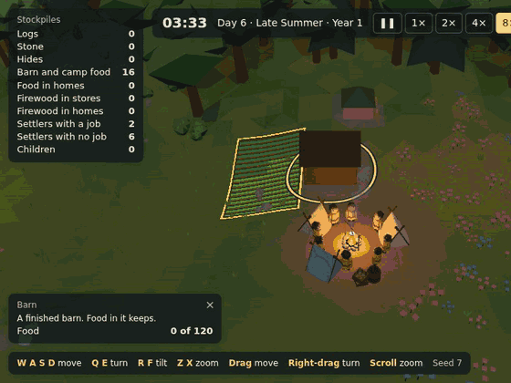

The first screenshot shows the field in every state, cropped from the scenario's screenshots. Its first row is days 1 to 5 at noon, with the tiles sown on day 1 one stage ahead of those sown on day 2. Its second row is the same stages at midnight, and its third one tile at stages 0 to 4 at midnight, from pale yellow-green to deep green. Its last row is the field bare on day 1, ripe, cut, and at stage 4 on day 6, ripe and cut on day 7, ripe at midnight on day 8, and all cut at midnight on day 9. #63 says that the scenario took the farmers' places at 21:00 on day 6 so that ripe tiles would stand through a midnight. (#63) The second is Merek's panel at 07:50 on day 6: `Cutting the crop`, `Job Farmer`, with ripe and cut rows on the field.

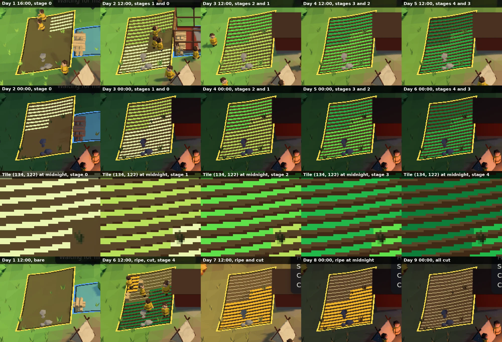

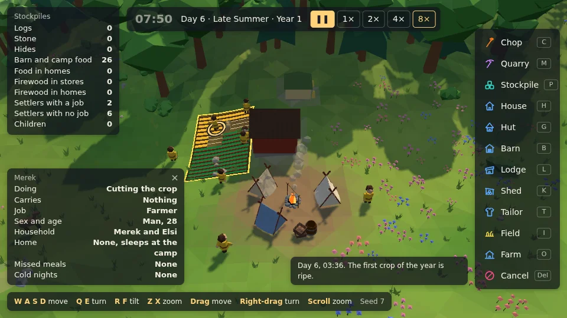

### 6.3 The frost kills what stands (#65)

A year's draw now has its own stream from the seed and the year, so no other draw moves, and a later forecast of weather or the horde adds a member to it. The frost falls on the first night tick of day 9, or of day 8 when the draw is below 1/4. At the dawn of that day, on a map with a field, the news reads `Day 9, 04:48. A frost comes tonight.` At its dusk every sown or ripe tile that is not cut reads killed, and the news reads `Day 9, 19:12. The frost killed the crop on 14 tiles.` when a tile was lost. The frost walks no tile. It is four writes to counts, and each tile reads its own state against the tick of the frost. Until the first dawn of spring a farmer reads `Idle, the ground is frozen`, and still carries in cut food. A killed tile shows dark withered rows until spring, and then it is bare and is sown again in the full 150 ticks. (#65)

The clip runs on day 9, late autumn, from 18:40 to 19:20, on the `frost` scenario's field, with `Fewer places` pressed twice at 21:00 on day 6 and `More places` twice at 20:00 on day 9, so that 10 tiles are cut and 14 stand ripe. (#65) Its first frames show the paused clock at 8×, and the rest run at 1×. At 18:40 and 18:51 the news still reads `Day 9, 04:48. A frost comes tonight.`, and most of the field's rows are gold. At 19:11 they are gold. At 19:12 the news reads `Day 9, 19:12. The frost killed the crop on 14 tiles.`, and in that frame the rows are still gold. From 19:13 to the last frame at 19:20 they are dark beside the pale stubble of the cut tiles. #65 says the ripe rows turn at 19:12, and its frames show them dark from the next minute. (#65)

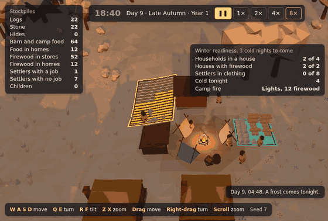

The first screenshot is Fenna's panel at 12:00 on day 11, mid winter: `Idle, the ground is frozen`, `Job Farmer`, and `Cold nights 1, cold`, with the field's withered rows beside it. The second is the same field at 12:00 on day 14, mid spring of year 2, sown again, with shoots on every tile. #65 gives the field as all 24 tiles sown again. (#65)

| The frozen ground, day 11 12:00 | Sown again, day 14 12:00 |
| --- | --- |
| 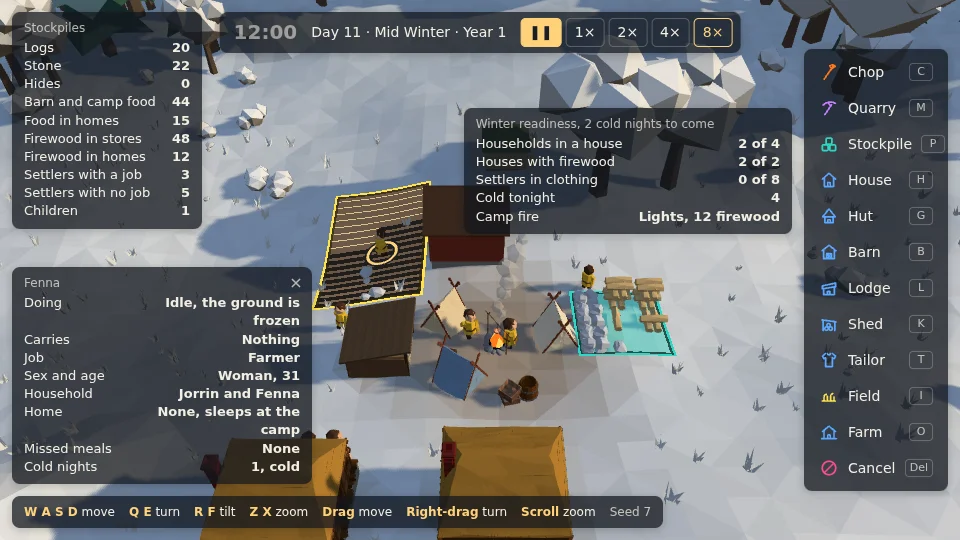 | 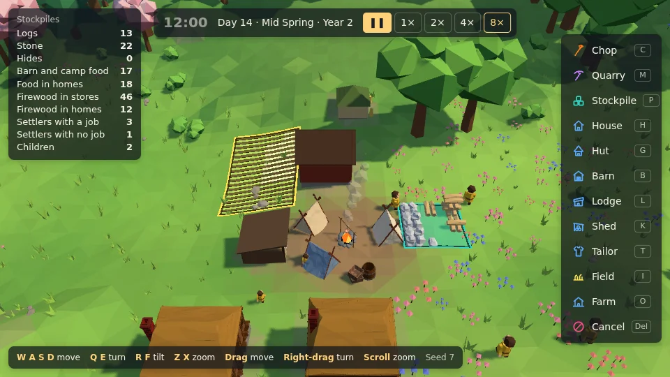 |

### 6.4 Read the fields (#66)

The farm's panel has three new rows under `Doing`. `Fields` counts the field tiles in the farm's reach by state, in the order bare, sown, ripe, cut, killed, and names only the states that hold a tile, or reads `None`. `This year` reads the food the farm's farmers cut this calendar year and the tiles of their sowing that the frost killed, as `40 food cut, 14 tiles lost`. `Last year` reads the year before in the same form from the first tick of year 2. The note now reads `Its farmers sow the fields within 20 tiles in spring and cut the crop once it is ripe.` The counts of a year live in fixed tables by site slot, the brief's count of a year for a workplace. The panel walks the farm's reach while the farm is selected, and one read with 1,260 field tiles in reach took 24 µs in `bun` in the pylon. (#66)

The clip is year 2's harvest on the `farm-counts` scenario, from 03:13 on day 18, late summer, to 11:51 on day 20, mid autumn, with the farm's panel open. Its farmers are Merek and Elsi, and `Last year` reads `40 food cut, 14 tiles lost` in every frame, the year in which the scenario took the farmers away from the night of day 6 to the frost. At 03:13 the panel reads `Fields 24 sown` and `This year 0 food cut, 0 tiles lost`. At 10:17 it reads `7 sown, 13 ripe, 4 cut` and `16 food cut`, at 17:13 `7 sown, 7 ripe, 10 cut` and `40 food cut`, and at 23:57 `7 sown, 5 ripe, 12 cut` and `48 food cut`. On day 19, early autumn, it reads `12 ripe, 12 cut` at 07:07, `4 ripe, 20 cut` and `80 food cut` at 14:33, and `1 ripe, 23 cut` and `92 food cut` at 22:02. At 11:51 on day 20 it reads `24 cut`, `96 food cut, 0 tiles lost`, and `Doing Idle, nothing is sown until spring`. #66 gives the clip's times as 03:00 on day 18 to 12:00 on day 20. (#66)

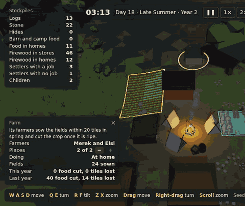

The first screenshot is the farm's panel at 12:00 on day 2 of year 1, at 960 by 540: `Farmers Elsi and Ysa`, `Fields 4 bare, 20 sown`, and `This year 0 food cut, 0 tiles lost`. A building site's label, `Logs 5/6 Waiting for materials`, draws over the panel's `Places` and `Doing` rows, which "Left open for the owner" takes up. The second is the morning after the frost, at 08:00 on day 10, with the farmers `Fenna and Dorran`: `Idle, the ground is frozen`, `Fields 10 cut, 14 killed`, and `This year 40 food cut, 14 tiles lost`.

| Spring, day 2 12:00 | After the frost, day 10 08:00 |
| --- | --- |
| 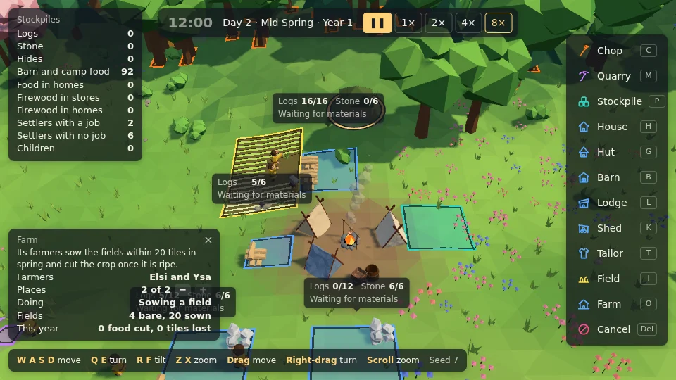 | 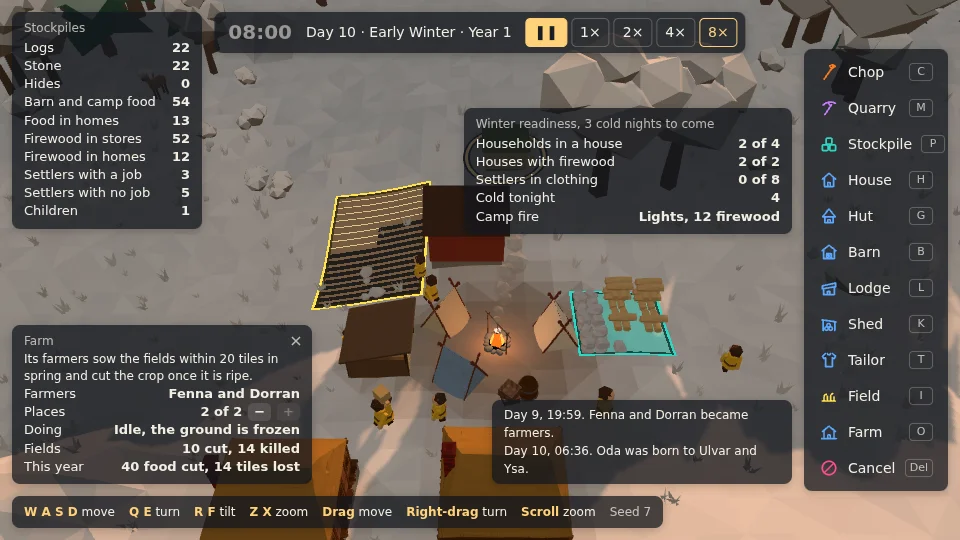 |

### 6.4b Measure twenty years with farms (#67)

`scripts/farm-years.ts` plays #53's 20 years on seed 7 with farms and without, and prints the tables under "What the stage measured". `--hours` plays the rule at its four hours, and `--farms-from 1` plays the first farm at the start. `scripts/settlement-years.ts` gains two options and prints the same output as on `main` without them. No game code changed, so #67 ran no scenario and no benchmark. It has no clip, and its proof is its tables. (#67)

## The fixes and the skill between the stages

### Record the owner's firewood decisions in the stage 4 brief (#46)

#46 added three paragraphs to `docs/design/stage-4-warmth.md` and changed no line. They record the owner's decisions of 2026-11-23: houses take firewood from the camp too, from the nearer of the camp and the nearest woodshed, and firewood stays the player's management, with no quota for the woodcutter and no rule that changes who takes a log. (#46)

### Take the food out of a house nobody lives in (#58)

A finished house that no household lives in is now a source, as a barn is, for a household stocking its home, for the settlers without a job stocking a home in which nobody can carry, and for the camp. The nearest source wins, and an equally near camp, barn, or woodshed comes first. Firewood leaves such a house the same way. Nothing is carried into it, nobody eats there, and a household that takes the house keeps what is left in it. (#58)

The pair is the `empty-house` scenario's house, whose household of two 70-year-olds died at the dawn of day 6, at 05:20 on day 7, early autumn, in the same view. Before, on `main`, the house's panel reads `Household Nobody` and `Food 4 of 16`. After, it reads `Nobody` and `Food 0 of 16`. #58 says that the neighbors took a unit each at 03:49 and 03:56 on day 6 and the last two at 05:08 on day 7. (#58)

| Before, `main` | After, #58 |
| --- | --- |
| 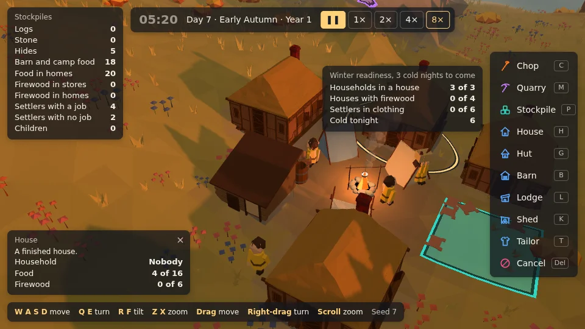 | 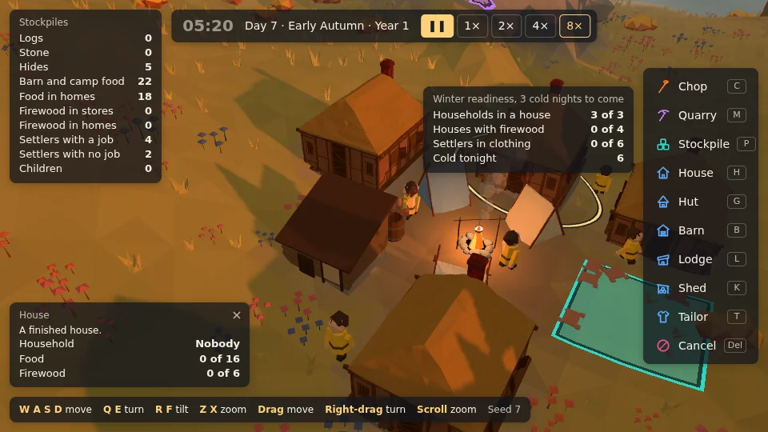 |

In #53's run without births, the last settler, Imke, starved at 19:26 on day 7 of year 17 on `main` while 8 food lay in four empty houses. With #58 that food was carried into a neighbor's home within one to three days, she ate 6 meals in year 17 against 4, and she starved at 19:34 on day 9, when no food lay anywhere. With births on, the 08:00 run first differs in year 10, and it ends year 20 with 3 living against 12, with 32 deaths of cold against 26. At 10:00, 12:00, and 14:00 it ends year 20 with 28, 28, and 41 living against 23, 28, and 40. #58 traces the 08:00 run's difference to the ordering rule, which reads the stores and moves when the empty houses empty, not to a death in an empty house's winter. (#58)

### Keep a new pair housed until a house is free (#59)

A household that forms while no house stands empty has no house. Each of its two goes on living where it lived the day before. One from its parents' house lodges there: it sleeps there, is warm by that house's fire, eats from its store, counts among its people for the 3 days of food and the limit of 5, and carries for it. One from the camp stays at the camp. A house is never freed under a lodger. When the last of its household dies or leaves, the lodger's household takes it at once, ahead of the order by number. The settler's `Home` row reads `Parents' house`, and a house counts a lodger among the couple's children, or as kin in an inherited house, as `Sten and Bera, 1 kin`. (#59)

The pair is Tilde's panel at 09:00 on day 6, late summer, on the `pairing` scenario's roof page, after she paired with Sten at the dawn. Before, on `main`, it reads `Household Sten and Tilde` and `Home None, sleeps at the camp`. After, it reads `Home Parents' house`. Both read `Quarrying stone` and `Woman, 16`. #59's clips, left out of the set, show her walking to the camp at 21:13 on `main` and at home from the 21:00 stop after. (#59)

| Before, `main` | After, #59 |
| --- | --- |
| 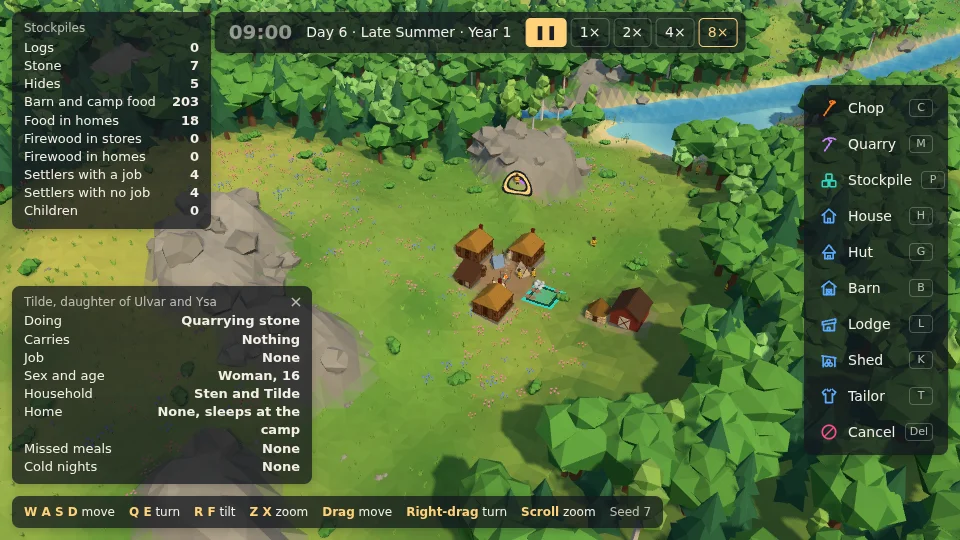 | 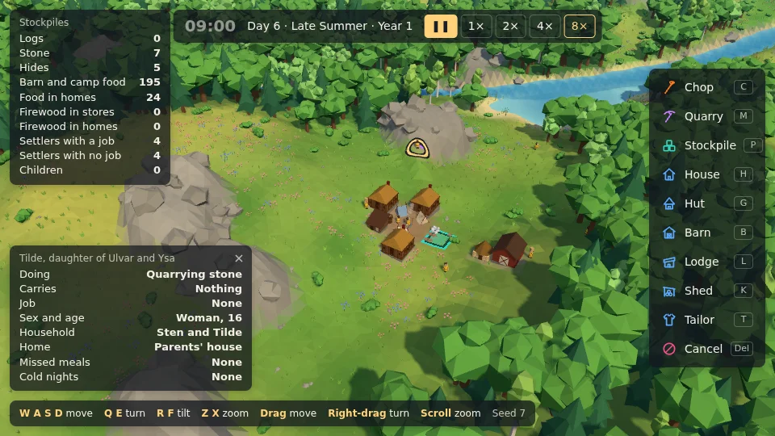 |

Over the 20 years at 08:00, measured at `main` with #58 against #59 after its merge, 22 settlers paired into a household with no house against 14. 9 had a cold night before their household had a house against 12, 18 froze against 12, and 0 froze before a house against 3. Every cold night before a house fell in a parents' house with too little firewood for its fire, and none at the camp. With #59, nobody lives at 08:00 from 18:26 on day 12 of year 16, against 3 living at year 20 on `main`. At year 20 the 10:00 run has 23 living against 28 on `main`, and the 12:00 run 35 against 28. At 14:00 nobody lives from 19:42 on day 12 of year 18, against 41 on `main`. #59 traces the two runs that die out to the firewood limit #53 described, met sooner because the settlement grows larger without the deaths at the camp in year 5. At 08:00, year 16's winter opens with 29 living, 12 houses, and 2 firewood in homes, and all 29 freeze. (#59)

| Settlers who paired into a household with no house, rule at 08:00 | `main` with #58 | #59 |
| --- | --- | --- |
| Paired | 14 | 22 |
| A cold night before their household had a house | 12 | 9 |
| Froze | 12 | 18 |
| Froze before a house | 3 | 0 |

### Let a widowed settler pair again (#61)

A settler is single when it is 16 or older and has no living partner. One who never had a partner and pairs with a widowed settler joins the widowed settler's household, which keeps its number, its house, and its children. Two widowed settlers who pair make one household of the lower number. A household whose couple is whole again waits more than 6 dawns from the pairing before a birth. The news reads `Pell and Elsi formed a couple.` for a pairing into an existing household. (#61)

The pair is Elsi's house at 09:00 on day 6, late summer, on the `pairing` scenario's widow page, after Merek died of old age at the dawn. Before, on `main`, its panel reads `Household Elsi, 2 children, 1 died` and `Food 9 of 16`, and the news reads `Day 6, 03:36. Merek died of old age.`, `Mira started to work.`, and `Ysa became a forager.` After, it reads `Pell and Elsi, 2 children, 1 died` and `Food 12 of 16`, and the news adds `Day 6, 03:36. Pell and Elsi formed a couple.` (#61)

| Before, `main` | After, #61 |
| --- | --- |
| 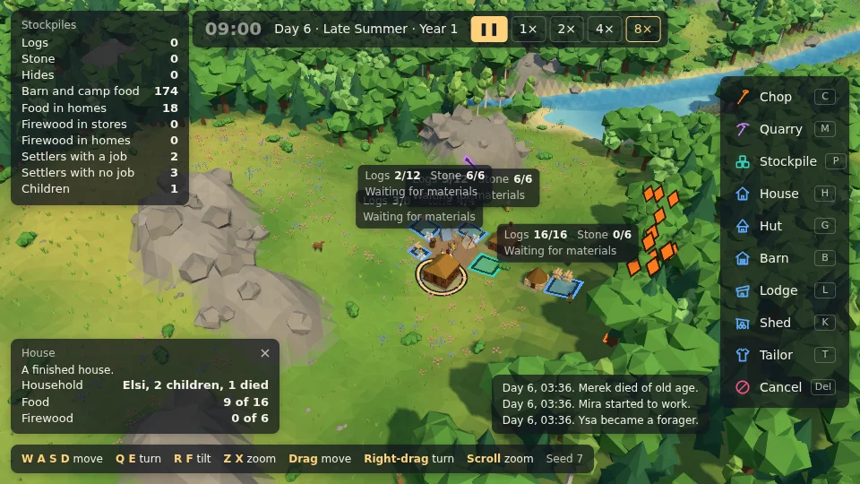 | 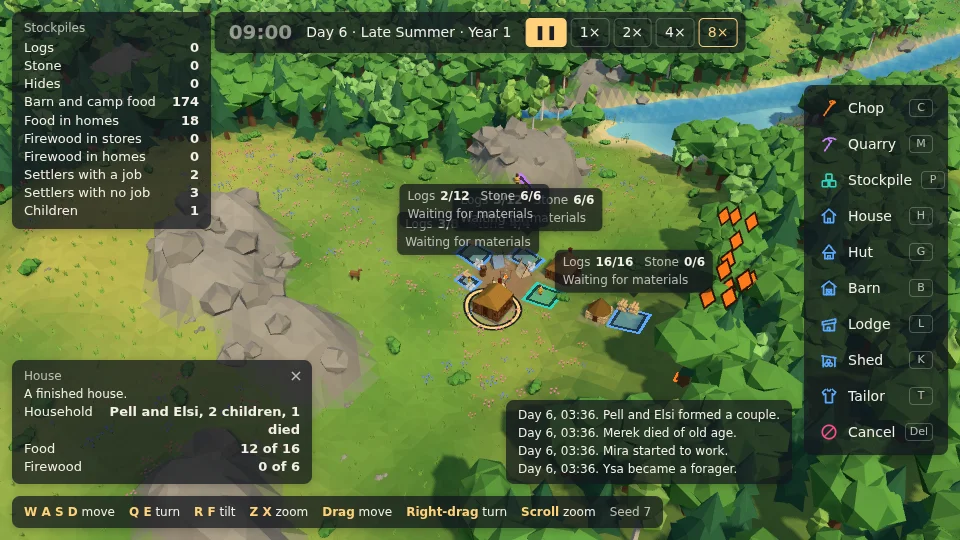 |

Over the 20 years, measured at `main` with #58 and #59 against #61, the brake "couple", a household dawn at which the couple is not both alive, held 161 household dawns at 08:00 against 60 after, 173 against 40 at 10:00, 156 against 67 at 12:00, and 134 against 53 at 14:00. Widowed settlers paired again 7, 4, 12, and 11 times. Births went from 44 to 42, 44 to 27, 58 to 54, and 40 to 54. With #61, the 08:00 run dies out in year 15, against year 16 on `main`. The 10:00 run dies out in year 11, against 23 living at year 20 on `main`. The 12:00 run ends year 20 with 16 living against 35, and the 14:00 run with 35 against dying out in year 18 on `main`. Each run plays as on `main` until its first widowed pairing, and from there every number differs. #61 did not trace the deaths of cold that end the runs further. (#61)

### Move between the tools with every arrow key (#62)

While the toolbar has keyboard focus, Left moves to the tool above, as Up does, and Right to the tool below, as Down does, and both wrap at the ends. The toolbar stops the event before the camera's listener sees it. With the focus anywhere else the arrows pan the camera as before. (#62)

Both clips come from the same page at 12:00 on day 1, paused, at 960 by 540, with Tab and Down putting the focus on `Quarry` and then Left held for 1.5 s. (#62) The set holds the after clip. In its frames the focus ring moves from `Quarry` to `Chop`, and the map does not move. The before clip, on `main`, is left out of the set for its size. In its frames the focus stays on `Quarry` while the map pans. #62 measured a mean pixel difference of 28.69 between the frames before and after the hold on `main`, and 0.36 after, the focus ring included. (#62)

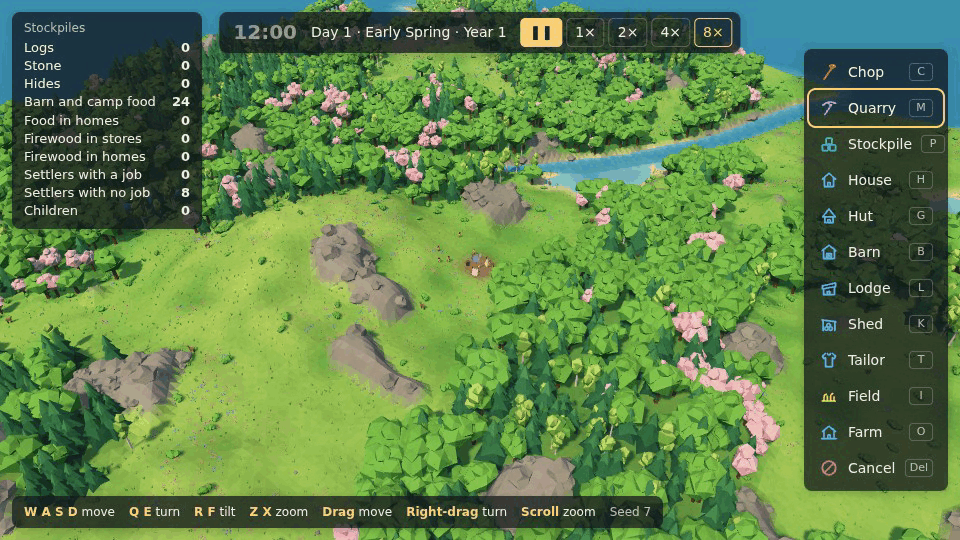

### The verification skill's maintenance pass (#56) and what it left open (#64)

#56 brought the verification skill in line with the game after stage 5. It fixed four harness faults: a crash on an untracked worktree, a held key that fell into one slow frame and moved nothing, clips that opened on white frames of the page load, and no count line at the end of a scenario. It corrected the feature files wherever the source or a live run contradicted them, and it added the rule that a clip showing when something happens keeps the clock or a dated news line in its picture. Every scenario but `frames` passed in a sweep of 3 h 31 min 52 s. (#56)

#64 fixed the four findings #56 left open, which the owner decided on 2026-11-26. Every pull request since inherits three changes. `frames` runs only by name, and where Playwright's own Chromium is missing, as in a pylon, it prints that it did not run and counts no failure, so the game's real frame rate stays unmeasured until the owner runs it on the Mac. The settler clip of `selecting` keeps only drawn frames, at most 200, so its size follows the game minutes and not the machine's speed. It read 5.6 MB, where the old cut read 6.7 MB at normal load and 8.6 MB under load, over the 8 MB limit. `panelReadings` is now derived from the game's word tables in `src/ui/selection.ts`, so a new reading of an existing row reaches the overlap checks without being added by hand. It found that the hand-kept list had missed `1 piece of clothing`, the longest `Carries` reading. `camera`'s corner legs became 10 drawn frames each. #64 checked that the game shows the same words: 101,872 reads replayed from the panel tests and 169,289 reads from two simulated settlements, each against `main`'s module, all identical. (#64)

## What the stage measured

Every number below is taken from the pull request named beside it, except where a command is named. No command was run for this summary except the size and frame checks of its media and `lscpu`.

### The first spring on seed 7 (#60)

`bun scripts/first-spring.ts` plays a farm on (136, 127), a field of 24 tiles from (129, 122) to (134, 125), and 4 trees chopped for its logs, all at 08:00 on day 1. The farm stands at 12:18 on day 1 with Ysa and Jorrin. They sow 10 tiles on day 1, 14 on day 2, and none on day 3, all 24 in the spring. Each farmer sows for 781 or 780 daylight ticks on day 1 and 1,020 or 1,019 on day 2, and stands idle for about 700 ticks of day 2 and all 1,800 of day 3. (#60)

The brief estimated 4 tiles a farmer on a spring day. At 150 ticks a tile and 1,800 ticks of spring daylight a farmer can sow 12 before any walking, and with about 10 ticks of walking a tile it sows about 11. A tile would need about 450 ticks of work for 4 a day. #60 left 150, as the brief has it, as the orchestrator's call. (#60)

### The first year with a farm on seed 7 (#63, #65)

`bun scripts/farm-year.ts` plays stage 3's year with a hut, a barn, and a lodge, the year that measured 97 food at autumn's end, plus a farm, #60's field, and 4 trees for the farm's logs. The farm stands on (131, 120), because stage 3's hut takes #60's farm site. A second run fells 7 more trees and orders a woodshed and a tailor's hut, so that no settler is free to carry. (#63)

| Run | Sown | Cut | Food cut | In by farmers | In by settlers without a job | Spoiled on the fields | Barn at the year's end |
| --- | --- | --- | --- | --- | --- | --- | --- |
| As ordered | 24 | 22 | 88 | 59 | 27 | 0 | 120 |
| No settler free | 24 | 24 | 96 | 95 | 0 | 0 | 120 |

In both runs the barn is full at 120 at autumn's end and at the year's end, against stage 3's 97 at autumn's end and stage 4's year "wood", which ended with 32. With free hands 17 tiles are cut by the end of day 8, and without them 14 by then and 20 by the end of day 9. The barn fills on day 8 or 9, and in the first run 2 tiles are never cut for lack of room. A farmer cuts about 3 to 4 tiles on an autumn day, carrying included, close to the brief's estimate of 600 ticks a tile. #63's finding is that one barn of 120 does not hold a hut's, a lodge's, and a field's food. (#63)

These are #63's numbers before the frost existed, when a ripe tile could still be cut in winter. With #65's frost the same runs cut fewer tiles. (#65)

| Run | Frost | Cut | Lost | Barn at the year's end | #63, no frost |
| --- | --- | --- | --- | --- | --- |
| As ordered | day 9 | 18 | 6 | 120 | 22 cut, 120 |
| As ordered | day 8 | 17 | 7 | 120 | 22 cut, 120 |
| No settler free | day 9 | 20 | 4 | 120 | 24 cut, 120 |
| No settler free | day 8 | 14 | 10 | 112 | 24 cut, 120 |

The 6 tiles lost to a day-9 frost in the run as ordered stood for lack of room, and before the frost they were cut in winter as the camp's meals freed room. The food cut falls from 88 to 72 and the camp's food at the year's end from 32 to 20 in that run. In the run with no settler free the cut falls from 24 to 20 and the camp from 32 to 16. (#65) The script forces the day-8 frost by writing the frost's tick, which the game never does. (#65)

The orders differ between the pull requests, and so do the first days of sowing. #60's orders sow 10 tiles on day 1 and 14 on day 2. #63's `farm-year.ts` sows 20 on day 2 and 4 on day 3, and its `harvest` scenario 4 on day 1 and 20 on day 2. #65's "Play it" field of 54 tiles is sown 10 on day 1 and 22 on each of days 2 and 3. (#60, #63, #65)

### The frost on seed 7 (#65)

`bun scripts/frost-year.ts` gives the day of the frost in each of the first 20 years on seed 7. 5 of 20 come a day early, on day 8: years 2, 7, 10, 12, and 15. The others fall on day 9. A unit test draws 4,000 years on two seeds and finds 1 in 4 early within 0.02. (#65)

**The "Play it" field, with both frost days.** A farm on (136, 127), two barns, and a field of 54 tiles from (127, 119) to (135, 124). Two farmers sow its 54 tiles in spring and cut 10 on day 6, 14 on day 7, and 14 on day 8. (#65)

| Frost | Standing at the warning | Cut | Lost | Barn + second barn at the year's end |
| --- | --- | --- | --- | --- |
| day 9 | 16 | 51 | 3 | 116 + 48 |
| day 8 | 30 | 38 | 16 | 76 + 36 |

The early frost costs 13 more tiles and 52 food, about 4 people's meals for a year. On the morning of the warning the farm's 2 places are full, the settlers without a job already carry everything in, and no store runs out of room that day. A second farm ordered at the warning stands at about 12:27 and saves 2 of the 16 tiles. A second farm ordered at the first ripe dawn cuts 53 of 54 even with an early frost, and a warning a day earlier, answered then, would save 12 of the 16. With these orders the 8 settlers have no warmth, and the last of them freezes at 17:54 on day 12, before spring. (#65)

### The farm's counts (#66)

The `farm-counts` scenario plays the `frost` scenario's orders and presses into year 2, and checks the panel at 12 paused stops against `scripts/farmCounts.ts`, whose counts come from the settlement's tallies and not from the farm's own table. Year 1 reads `40 food cut, 14 tiles lost`, because the farmers were taken away from the night of day 6 to the frost. Year 2 reads `96 food cut, 0 tiles lost`. Year 2's frost falls a day early, at 19:12 on day 20, and finds nothing standing. Without the presses, the farmers cut the whole field before the frost in year 1 too. (#66)

### Twenty years with farms on seed 7 (#67)

**The farm rule.** It runs on the first morning of each calendar year from year 2, at the rule's hour and before #53's rule reads the screen. When 3 field tiles for each living settler are more than 40 for each farm standing or ordered, it orders a farm on the place nearest the camp that the rules accept, with chop orders for its 8 logs. When the field tiles in the farms' reach are fewer than 3 for each living settler, it marks the missing tiles, nearest the middle of the newest farm first. It never changes a farm's places and orders no barn beyond #53's rule, which orders one when the barns and the camp are within 20 food of full. 40 is about what two farmers cut before the frost. 3 tiles a person is 12 meals at 4 food a tile. (#67) #67 takes the 40 from the `frost` feature file, which says two farmers cut about 44 of 54 tiles on fields of 48, 72, and 96 (`.claude/skills/verify-survive-n-conquest/features/frost.md`). #65's "Play it" field of 54 had 51 cut with a day-9 frost. (#65)

The rule first started at tick 0 of year 1. That farm took the place nearest the camp, where #45's woodshed goes, and 2 of the 3 settlers who build and haul, so no firewood was split in year 1, 7 froze, and the settlement died out in year 3 at every hour. #67 moved the rule's start to year 2, where #53's rule starts, and tuned nothing else. (#67)

**The living, with farms and without, the rule at 08:00.** The run without farms is today's `main`, with #58, #59, and #61, so it differs from #53's table, which ended year 20 with 12 living. (#53, #67)

| year | living, no farms | born | starved/froze/old age | living, farms | born | starved/froze/old age | house/hut/barn/lodge/shed/tailor/farm, farms |
| --- | --- | --- | --- | --- | --- | --- | --- |
| 1 | 10 | 2 | 0/0/0 | 10 | 2 | 0/0/0 | 4/1/1/1/1/0/0 |
| 2 | 16 | 6 | 0/0/0 | 16 | 6 | 0/0/0 | 4/2/1/1/1/0/1 |
| 3 | 19 | 3 | 0/0/0 | 19 | 3 | 0/0/0 | 4/2/1/1/1/0/2 |
| 4 | 16 | 0 | 3/0/0 | 19 | 0 | 0/0/0 | 4/4/1/1/1/0/2 |
| 5 | 16 | 0 | 0/0/0 | 19 | 0 | 0/0/0 | 7/4/3/1/1/0/2 |
| 6 | 17 | 1 | 0/0/0 | 21 | 2 | 0/0/0 | 8/4/3/1/1/0/2 |
| 7 | 23 | 6 | 0/0/0 | 28 | 7 | 0/0/0 | 9/4/3/1/1/0/2 |
| 8 | 25 | 4 | 0/0/2 | 30 | 4 | 0/0/2 | 9/4/3/1/1/0/3 |
| 9 | 26 | 1 | 0/0/0 | 32 | 2 | 0/0/0 | 9/4/3/1/1/0/3 |
| 10 | 24 | 1 | 0/0/3 | 30 | 1 | 0/0/3 | 10/4/3/1/1/0/3 |
| 11 | 27 | 5 | 0/0/2 | 32 | 5 | 0/0/3 | 12/4/3/1/1/0/3 |
| 12 | 35 | 8 | 0/0/0 | 39 | 7 | 0/0/0 | 12/4/3/1/1/0/3 |
| 13 | 39 | 4 | 0/0/0 | 44 | 5 | 0/0/0 | 12/4/3/1/1/0/3 |
| 14 | 37 | 1 | 0/3/0 | 49 | 5 | 0/0/0 | 16/4/3/1/1/0/4 |
| 15 | 0 | 0 | 0/37/0 | 27 | 5 | 0/26/1 | 18/8/3/1/1/0/4 |
| 16 | - | - | - | 18 | 2 | 0/7/4 | 18/8/4/1/1/0/4 |
| 17 | - | - | - | 3 | 1 | 0/12/4 | 18/8/5/1/1/0/4 |
| 18 | - | - | - | 0 | 0 | 0/3/0 | 18/8/5/1/1/0/4 |

Without farms nobody lives from day 12 of year 15. It held 40 living at most, and 3 died of hunger, 40 of cold, and 7 of old age. With farms nobody lives from day 12 of year 18. It held 53 at most, and 0 died of hunger, 48 of cold, and 17 of old age. (#67)

**The fields of each year, the rule at 08:00.** Field tiles are those at the year's end, and farms and barns those standing. Sown, ripened, cut, and lost count the tiles of the year. Food cut is what the cut tiles put down, then what the farmers and the settlers without a job carried in. The frost marks the years whose frost fell at the dusk of day 8 as early. (#67)

| year | field tiles | farms | barns | sown | ripened | cut | lost | food cut | by farmers | by settlers | spoiled on fields | frost | food barns | barns+camp |
| --- | --- | --- | --- | --- | --- | --- | --- | --- | --- | --- | --- | --- | --- | --- |
| 1 | 0 | 0 | 1 | 0 | 0 | 0 | 0 | 0 | 0 | 0 | 0 | day 9 | 24 | 24 |
| 2 | 36 | 1 | 1 | 31 | 31 | 14 | 17 | 56 | 44 | 11 | 0 | day 8, early | 15 | 15 |
| 3 | 48 | 2 | 1 | 48 | 48 | 47 | 1 | 188 | 164 | 21 | 0 | day 9 | 74 | 74 |
| 4 | 57 | 2 | 1 | 57 | 57 | 34 | 23 | 136 | 120 | 13 | 0 | day 9 | 109 | 109 |
| 5 | 57 | 2 | 3 | 57 | 57 | 42 | 15 | 168 | 79 | 84 | 0 | day 9 | 219 | 219 |
| 6 | 57 | 2 | 3 | 57 | 57 | 57 | 0 | 228 | 55 | 170 | 0 | day 9 | 209 | 209 |
| 7 | 66 | 2 | 3 | 66 | 66 | 66 | 0 | 264 | 40 | 218 | 0 | day 8, early | 177 | 177 |
| 8 | 84 | 3 | 3 | 84 | 84 | 84 | 0 | 336 | 98 | 229 | 0 | day 9 | 213 | 213 |
| 9 | 90 | 3 | 3 | 90 | 90 | 90 | 0 | 360 | 71 | 284 | 0 | day 9 | 261 | 261 |
| 10 | 96 | 3 | 3 | 96 | 96 | 92 | 4 | 368 | 39 | 323 | 0 | day 8, early | 281 | 281 |
| 11 | 96 | 3 | 3 | 96 | 96 | 96 | 0 | 384 | 54 | 327 | 0 | day 9 | 290 | 292 |
| 12 | 96 | 3 | 3 | 96 | 96 | 94 | 2 | 376 | 42 | 330 | 0 | day 8, early | 245 | 245 |
| 13 | 120 | 3 | 3 | 120 | 120 | 109 | 11 | 436 | 69 | 361 | 0 | day 9 | 266 | 266 |
| 14 | 135 | 4 | 3 | 135 | 135 | 100 | 35 | 400 | 73 | 327 | 0 | day 9 | 256 | 256 |
| 15 | 144 | 4 | 3 | 144 | 144 | 74 | 70 | 296 | 151 | 142 | 0 | day 8, early | 231 | 231 |
| 16 | 144 | 4 | 4 | 144 | 144 | 40 | 104 | 160 | 154 | 8 | 0 | day 9 | 333 | 333 |
| 17 | 144 | 4 | 5 | 144 | 144 | 77 | 67 | 308 | 262 | 46 | 0 | day 9 | 458 | 474 |
| 18 | 144 | 4 | 5 | 77 | 77 | 41 | 36 | 164 | 164 | 0 | 0 | day 9 | 562 | 602 |

Farms were ordered in years 2, 3, 8, and 14. The second barn came from #53's barn rule in year 4, against year 6 without farms, a third in year 5, and two more in years 16 and 17. Over the run the settlers without a job carried 2,894 units of the cut food and the farmers 1,679, and in years 5 to 14 most food came in by the free hands. Without farms the barns and the camp held 7 to 184 food at the ends of years 5 to 14. (#67) The by-farmers and by-settlers columns, added for this summary, do not reach the food cut in every year, for example 44 and 11 of 56 in year 2. #67 does not say where the rest lies at the year's end.

**A farmer's daylight.** Every daylight tick of every living villager who works at a farm, by the task it holds. (#67)

| season | farmer ticks | works | sowing | cutting | fetching | idle | other |
| --- | --- | --- | --- | --- | --- | --- | --- |
| Spring | 477544 | 56% | 56% | 0% | 0% | 35% | 10% |
| Summer | 585013 | 29% | 0% | 21% | 8% | 63% | 8% |
| Autumn | 502200 | 51% | 0% | 33% | 18% | 44% | 5% |
| Winter | 376650 | 1% | 0% | 0% | 1% | 90% | 9% |
| year | 1941407 | 36% | 14% | 15% | 7% | 57% | 8% |

A farmer works 36% of its daylight over a year. With 4 farms, 8 settlers stand idle most of the year while the run dies of cold for want of firewood. (#67)

**The stores full while a crop stood.** A tick counts when a ripe tile stands and no common store has room for food. Each year in which that happened was played again with room for all its food at the camp, and the tiles lost for lack of room are the year's loss less the loss with room. Over the run the stores were full for 11.1 days of daylight while a ripe crop stood, in years 4, 5, and 10 to 17, and 176 of the 385 tiles lost were lost for lack of room. The largest years were year 16, 4,317 ticks and 47 of 104 tiles lost for lack of room, and year 14, 3,144 ticks and all 35. (#67) #67's reviewer found that a first split counted 331 tiles, every tile of a frost on a day with one full tick, and #67 replaced it with the replay. (#67)

**The early frost.** The crop standing at the dusk of day 8 and of day 9 of each year shows what an early frost costs. The five early years, 2, 7, 10, 12, and 15, lost 18.6 tiles on mean and cut 272.0 food. The day-9 years lost 24.3 tiles and cut 272.3 food, and one day earlier would have cost them 4.5 tiles on mean, 0 to 11. (#67)

**The rule at four hours.** (#67)

| hour | without farms | with farms | most living, without / with |
| --- | --- | --- | --- |
| 08:00 | dies out y15 | dies out y18 | 40 / 53 |
| 10:00 | dies out y11 | dies out y19 | 25 / 66 |
| 12:00 | 16 living | dies out y13 | 38 / 41 |
| 14:00 | 35 living | dies out y18 | 36 / 53 |

Without farms, the four hours end as #61 measured them at its head: dying out in year 15 at 08:00 and in year 11 at 10:00, and 16 and 35 living at 12:00 and 14:00. (#61, #67) With farms every run died out, 41 to 67 of cold in each. (#67)

### The tick time against the 4 ms limit

These are pylon numbers from `bun scripts/bench.ts`, with 1,500 living villagers and 3,000 monsters on seed 7. The 4 ms limit is defined on the owner's machine, and no pull request of the stage measured there. Each pull request ran its head and its base alternately on the same node. The table gives the p99 at the head, with the base in brackets, in the form its body gives: a median and range over 5 runs, a range, or each run. #46, #56, #57, #62, #64, and #67 ran no benchmark. (#46, #56, #57, #62, #64, #67)

| Pull request | Node | Form | Spring 256 | Spring 512 | Winter 256 | Winter 512 | Harvest 256 | Harvest 512 |
| --- | --- | --- | --- | --- | --- | --- | --- | --- |
| #58, empty house | rj-firebat | range of 5 | 1.014 to 1.135 (1.003 to 1.058) | 1.495 to 1.561 (1.468 to 1.525) | 0.662 to 0.827 (0.668 to 0.677) | 0.615 to 0.754 (0.606 to 0.652) | none | none |
| #59, lodgers | rj-firebat | median of 5 | 1.253 (1.179) | 1.781 (1.748) | 0.668 (0.767) | 0.723 (0.688) | none | none |
| #61, widowed pairing | rj-firebat | one run | 1.016 (1.267) | 1.580 (1.801) | 0.576 (0.651) | 0.630 (0.739) | none | none |
| 6.1 (#60), sowing | rj-firebat, inferred | range of 3 | 1.18 to 1.22 (1.17 to 1.25) | 1.57 to 1.63 (1.67 to 1.69) | 0.68 to 0.69 (0.80 to 0.85) | 0.95 to 1.00 (0.69 to 0.74) | none | none |
| 6.2 (#63), harvest | rj-firebat | median of 5 | 1.004 (0.989) | 1.306 (1.281) | 0.692 (0.560) | 0.701 (0.583) | 1.052 (none) | 1.110 (none) |
| 6.3 (#65), frost | rj-firebat | each of 3 | 1.017, 1.027, 1.010 (1.038, 0.986, 0.992) | 1.293, 1.294, 1.297 (1.351, 1.289, 1.293) | 0.663, 0.653, 0.647 (0.687, 0.705, 0.671) | 0.697, 0.701, 0.702 (0.702, 0.697, 0.692) | 1.055, 1.035, 1.050 (1.050, 1.051, 1.047) | 1.074, 1.090, 1.084 (1.118, 1.109, 1.108) |
| 6.4 (#66), farm counts | rj-firebat | each of 3 | 1.131, 1.149, 1.276 (1.261, 1.110, 1.244) | 1.530, 1.535, 1.642 (1.478, 1.480, 1.652) | 0.726, 0.775, 0.771 (0.710, 0.709, 0.792) | 0.768, 0.881, 0.828 (0.791, 0.829, 0.846) | 1.143, 1.212, 1.247 (1.155, 1.143, 1.216) | 1.163, 1.215, 1.266 (1.202, 1.174, 1.266) |

All values are in ms. Every p99 of every run passes. The highest at a head is 1.858 ms, the top of #59's range on spring 512. (#59) #59 and #61 measured before their merges, and #61's `main` already held #58 and #59. (#59, #61) #66's `main` holds #65, and its p99s on `main` are higher than #65's at its head on the same runs, for example 1.110 to 1.261 against 1.010 to 1.027 on spring 256. Neither body explains the difference. #62 reports a load average of 6 to 7 for its scenarios and #61 1.2 and 1.9 for its benchmark. #65 and #66 do not give one. (#61, #62, #65, #66)

- **The 512 winter run after 6.1.** Its p99 rose from about 0.71 to about 0.97 ms with the farms' map, and with `--no-farms` it read 0.80, so #60 infers, without a profile, that most of the rise comes from the cleared field tiles and the extra buildings, not from the farmers' look. (#60)
- **The winter runs after 6.2.** They rose by about 0.13 ms. With every field cancelled at the start of the measured ticks they stayed at 0.75 to 0.81 ms, so #63 measured the cause as the larger settlement the warm-up's harvest leaves, 9 more living, not the farm work in the tick. (#63)

**The harvest run moved in 6.3.** #63 added a third run that warms up to the midnight that opens day 6 and measures the harvest, as the brief asked. #65 moved it to warm up to the midnight that opens day 7 and measure to 08:00 on day 10, so that the frost at the dusk of day 9 falls inside the 10,000 measured ticks. No window of that length holds both the dawn of day 6 and the frost, so day 6's ripening is now in the warm-up, and the run starts on the first day of autumn, not in late summer as the brief has it. #65's `main` column is the old window, so its harvest row compares two different stretches of the year. (#65) The tiles in the measured ticks moved with it. In #63 the harvest run cut 82 tiles on the 256 map and 16 on the 512, and the winter run cut 12 on each map. (#63) In #65 and #66 the harvest run cut 88 and lost 22 on the 256 map and cut 18 and lost 33 on the 512, and the winter runs cut none, because the frost now kills in their warm-up what was cut in winter. The spring runs sowed 110 and 51 tiles in every pull request from 6.1. (#60, #63, #65, #66)

**The largest ticks.** Only the p99 has a limit.

- At the frost's dusk, the largest tick of the 10 from the dusk read 0.75 to 1.04 ms across #65's three runs and both maps. (#65) In #66 it read 1.178, 1.145, and 1.378 ms on harvest 256 and 1.258, 1.528, and 1.535 ms on harvest 512 at the head, against 1.013, 1.181, and 2.325 ms and 1.247, 1.265, and 1.321 ms on `main`. #66's frost adds a loop over the site slots in use, once a year. (#66)
- At a dawn at which tiles ripen, the largest tick read 5.9, 6.0, and 5.0 ms on the 256 map, at dawns of 14, 64, and 46 tiles, and 11.5, 9.8, and 11.3 ms on the 512 map in #63, whose window held day 6. (#63) In #65's window it read 4.7 to 5.9 ms on the 256 map, at 64 and 46 tiles, and 9.7 to 11.3 ms on the 512 map, at 32 and 19 tiles. (#65) In #66 it read 6.105, 6.365, and 6.333 ms at 64 tiles and 5.078, 5.232, and 5.072 ms at 46 tiles on the 256 map, and 9.986, 10.362, and 10.774 ms at 32 tiles and 11.959, 12.007, and 11.935 ms at 19 tiles on the 512 map, at the head. The same dawns on `main` read about as much, 10.470 and 12.084 ms at most on the 512 map, and #63 says other dawns reach 6 to 17 ms on `main` too. (#63, #66) A tick at 8× has 12.5 ms. (#60)
- At other dawns, the fixes give the largest tick of the dawn as 20.270 ms against 22.447 ms on `main` on spring 512 (#59), and 17.993 ms against 19.498 ms on spring 512 and 16.172 ms against 12.932 ms on winter 512 (#61). #61 timed each step of that winter dawn at 0.2 ms at most together, 0.13 ms of it the pairing, and traces the rise to a different settlement after the warm-up's widowed pairings. (#61)

**Allocation.** No test measures whether a tick allocates. Each pull request read its code for it. #63 found that the spring run kept about 677 KB of heap across its measured ticks against 625 KB on `main`, and guesses that the 50 KB is code compiled for the new paths, without proof. (#63) #66's tables are made once, 4 arrays of 1,024 counts. (#66)

### Checks that moved in existing scenarios

No check was loosened in any pull request of the stage or of the fixes. These are the checks whose readings or fixtures moved.

- **The toolbar's tools.** `firewood`'s list of tools in order went from 10 to 12, and `clothing`'s own copy of the 10 was deleted, so it checks 12 from the same list. (#60)
- **The farm's panel in `readiness`.** It measures the farm's panel with 197 `Doing` candidates and the farmer's `Job Farmer`. (#60) With #66's three rows the farm's copy first read 305 px of 255 at 960 by 540, because the candidates had assumed 5 field states at once and 4-digit food. A killed tile never stands beside a sown or a ripe one, and 2 farmers cut at most 844 food and lose 282 tiles in a year's daylight, so those candidates went, and the copy reads 300 by 250. (#66)
- **`sowing`'s farmer at noon on day 4** read `Idle, nothing is sown until spring` and now reads `Idle, the crop is growing`, because a crop grows there. Its shoot check now counts the pixels of any of the five stage colors instead of one, and still needs 20 in a sown tile's box and at most 2 on a bare tile. (#63) Its note check matches the new note. (#66)
- **The crop's pixel classes.** They now class withered pixels too, and a tile needs 45 of them to read killed. In `harvest` a settler's dark clothes put 28 such pixels on one tile, and stones 33 to 50. (#65)
- **The longest news line** is still the 1,500-settler clothing line, 54 px by 771 px, after the two frost lines. (#65)
- **`pairing`** grew from 20 to 37 checks with #59's roof pages and to 56 with #61's widow pages, and keeps every old check. Four unit tests of #59 and two of #61 now assert the new rules. (#59, #61)
- **`orders`** grew from 85 to 92 checks, with the arrows in the toolbar and the arrows that still pan the camera without it. (#62)
- **The harness changes of #64.** `frames` exits 0 where it cannot run, the settler clip keeps at most 200 drawn frames under the same 8 MB limit, the corner legs of `camera` are 10 drawn frames, and `readiness` and `selecting` read every derived reading. `selecting` checks the settler panel at the three sizes and grew from 40 to 42 checks. (#64)

### The scenario runs

From #63 on, a pull request ran only the scenarios its change can reach, one at a time, and named those it left out.

- **#58**, on rj-firebat: all 34 but `frames`, every check, in 4 h 4 min. `empty-house` passed 11 of 11, and 9 of 11 on `main`. (#58)
- **#59**, on rj-firebat: all 33 but `frames` before its merge, in 4 h 9 min. `eating` failed its first-tick check once and passed on a second run. After the merge, `pairing` 37 of 37 and five others passed. (#59)
- **#61**, on rj-firebat: all 34 but `frames`, 649 of 649 checks in 4 h 16 min. (#61)
- **#62**, on rj-firebat: six scenarios, `orders` 92 of 92. (#62)
- **#56**, on rj-firebat: all 33 but `frames`, every check, in 3 h 31 min 52 s. (#56)
- **#64**, on rj-firebat: seven scenarios, with `readiness`, `selecting`, and `camera` also under 12 busy processes. (#64)
- **6.1 (#60)**, on a pylon: every scenario but `frames` before the merge of `main`, all passing, and seven after it, `sowing` 25 of 25. (#60)
- **6.2 (#63)**, on rj-firebat: `harvest` 32 of 32, `sowing`, `readiness`, and `selecting`. (#63)
- **6.3 (#65)**, on rj-firebat: `frost` 27 of 27, `harvest`, `sowing`, `readiness`, and `selecting` 42 of 42. (#65)
- **6.4 (#66)**, on rj-firebat: `farm-counts` 18 of 18, `readiness`, `selecting`, `frost`, `harvest`, and `sowing`. (#66)
- **#46, #57, and #67** ran no scenario. (#46, #57, #67)

## What the stage decided

The brief asked the stage to settle nine things. Nobody has played the stage. Each answer below comes from the scripts and the scenarios of one seed, and the owner decides each.

- **Whether a field feeds a settlement through its winter.** In the first year on seed 7 the barn is full at 120 at the year's end with a farm, against stage 3's 97 at autumn's end and stage 4's 32. (#63) With the frost it still ends at 120, or at 112 with an early frost and no settler free. (#65) Over 20 years at 3 tiles a person nobody starved in any run with farms, at any hour. (#67)
- **Whether the first 8 settlers can spare 2 farmers.** Not in year 1 under #67's rule. A farm at the start took the woodshed's place and 2 of its 3 builders, and 7 froze. From year 2 they can. (#67) #63's first year with a woodshed and a tailor's hut beside the farm leaves no settler free, and the barn still fills. #63 does not report the winter of that year. (#63)
- **How many tiles feed a person, and whether 4 food a tile and the times of sowing and cutting are right.** A farmer sows about 11 tiles on a full spring day against the brief's 4 (#60), and cuts about 3 to 4 tiles on an autumn day, close to the brief's 600 ticks a tile (#63). 3 tiles a person matched the meals over 20 years, and #67 proposes no change to 4 food a tile or to the times. (#67) The owner has not decided.
- **Whether the harvest is a time at which the player needs every hand.** Not on #63's field: with free hands 17 tiles are cut by the end of day 8, without them 14, and nothing spoils either way. The barn limits the harvest, not the hands. (#63) Over 20 years the free hands carried 2,894 units and the farmers 1,679. (#67)
- **Whether an early frost with a warning that morning is a loss the player can answer.** #65 says no. On its "Play it" field the early frost costs 13 more tiles, and a farm ordered at the warning saves 2 of 16. (#65) #67 says it costs little over 20 years: one day earlier would have cost 4.5 tiles on mean in the day-9 years. (#67) The two read different fields, see "Left open for the owner".
- **Whether idle farmers are a cost the player manages with places.** A farmer works 36% of its daylight over a year. #67 names the choice and makes no recommendation between the two ways. (#67)
- **Whether a barn's 120 food hold a harvest, and what a farmer's stop for lack of room costs.** No, under #53's barn rule. One barn fills on day 8 or 9 of the first year (#63). Over 20 years the stores stopped the cut for 11.1 days of daylight, and 176 of 385 lost tiles were lost for lack of room. (#67)
- **How fast a settlement grows with farms.** Faster, then it dies of cold. The runs with farms peak at 53, 66, 41, and 53 living against 40, 25, 38, and 36 without, and every one dies out. (#67)
- **The tick time with fields, against the 4 ms limit, and the largest tick at the frost.** Every p99 passes on rj-firebat, at most 1.858 ms at a head. The largest tick at the frost's dusk is 0.75 to 1.535 ms. The largest at a ripening dawn reaches 12.007 ms on the 512 map, as large as on `main`. (#59, #65, #66) Nothing was measured on the owner's machine.

## Choices made along the way

No decision in `docs/design.md` changed. These are the calls of the orchestrator and the workers, which the owner may overrule.

- **Only the reachable scenarios.** From #63 on, a pull request ran only the scenarios its change can reach, not every scenario, while the owner decides the rule. #63's worker chose it when the orchestrator's answer did not arrive within 20 minutes, and each body lists what it ran and left out. (orchestrator; #63, #65, #66)
- **Two merges without the last review round.** #63 and #64 merged without the review loop's last round, which never started while Nexus was unreachable at night. The orchestrator read the change after the approved round, and for #64 a reviewer of another model family read the merge. (orchestrator; #63, #64)
- **#60 on top of #61, untested together.** #60 merged on top of #61 without a run of the combined tree, so the next pull request's checks were the first at that tree. (orchestrator)
- **150 ticks a tile.** A farmer sows about 11 tiles on a full spring day, not the 4 of the brief's estimate, and the orchestrator kept the brief's 150 ticks a tile. (orchestrator; #60)
- **The cut in any season, until the frost.** Until #65 a ripe tile could be cut in any season, and one that nobody cut stayed ripe into the next year. (#63) The news of the first ripe tile shows once a year. (#63)
- **Five colors for five stages.** After the orchestrator's review, #63 drew the five stages of a growing crop in five colors a player can tell apart, each at least 20 from the next in 8-bit RGB by day and at midnight. (orchestrator; #63)
- **The first year's orders.** #63 moved the farm of its first year to (131, 120), because stage 3's hut stands on #60's farm site, and used stage 3's year with a barn because #60's year has none. (#63)
- **A cut stops when the stores fill.** A cut under way stops, and the tile keeps its work, when no common store has room, from #63's review. (#63)
- **The warning on every map with a field.** The frost's warning shows on every map with a field, also when no crop stands, from the review loop's first round on #65. A map with no field gets no warning. (#65)
- **The withered look.** Dark rows of `#1f1c1a`, 0.6 of a row wide. The first color read only 17.7 from bare at midnight, so #65 made the rows darker and wider instead of loosening the check. (#65)
- **The harvest run's window.** #65 moved it to start on the first day of autumn so that the frost falls in it. (#65)
- **6.4 in two pull requests.** The orchestrator cut 6.4 into #66 and #67. In #66, food counts for the farm of the farmer who cut it, and lost tiles for the farm whose farmer sowed them. The panel also shows last year, so a player can compare years. (orchestrator; #66)
- **#67's farm rule starts in year 2,** not at the start, because a farm at the start took the woodshed's place and its builders. 40 tiles a farm and 3 tiles a settler are its numbers, not tuned. The rule never takes places away, as a player who does not manage them would play, and orders barns only by #53's rule. (#67)
- **#64's tables.** #64 widened the brief's "one export" from `src/ui/selection.ts` into word tables, and the orchestrator agreed. (#64)
- **The rules of #58, #59, and #61 as built.** The owner's words were three sentences, and these details are the orchestrator's reading of them, as the workers built them.
  - #58. An empty house is a source of firewood too, not only of food. An equally near camp, barn, or woodshed comes before it. The camp can draw from it, a path that does not run today. (orchestrator's reading; #58)
  - #59. A lodger counts among its parents' house's people for the limit of 5 and the 3 days of food, and carries for that house. One of the pair from the camp stays at the camp. A lodger's household takes a freed house ahead of the order by number. A house reads a lodger who is no child of its couple as kin. When both partners were the last of their parents' houses, the man's house is kept. (orchestrator's reading; #59)
  - #61. A never-partnered settler joins the widowed settler's household, and two widowed households merge into the lower number. The household waits more than 6 dawns from the new pairing before a birth. The news reads `formed a couple`. A widow can pair with her dead husband's brother or his son by an earlier partner, never her own son. (orchestrator's reading; #61)
- **Left and Right in the toolbar.** Left goes to the tool above and Right to the tool below, because the tools stand in one column, and both wrap. (#62)
- **The model.** Every pull request from #56 to #67 but the brief ran on `claude-opus-5-5` in a pylon, the crop's colors and the withered look too, because Fable is not available in a pylon. The brief, #57, ran on `claude-fable-5-2` on the owner's machine. (#56, #57, #58, #59, #60, #61, #62, #63, #64, #65, #66, #67)

## Left open for the owner

The orchestrator has made no recommendation on these. A recommendation written in a pull request is marked as its author's.

- **#68 waits for your merge.** It records your rule fixes of 2026-11-25 in `docs/design/stage-5-life-cycle.md`, with the details beyond your words marked as the orchestrator's reading. Do you accept its text?
- **When should the frost's warning come?** On #65's "Play it" field of 54 tiles the early frost costs 13 more tiles and 52 food, a farm ordered at the warning saves 2 of 16 tiles, and a warning a day earlier, answered then, would save 12 of 16. #65 proposes, as its author's recommendation, moving the warning to the dawn of the day before the frost, or a line at the first dawn of autumn that a frost comes at its end. (#65) Over #67's 20 years one day earlier would have cost 4.5 tiles on mean in the day-9 years, 0 to 11, and the early years lost no more than the others, 18.6 tiles on mean against 24.3. The stores' room cost 176 tiles. #67 proposes, as its author's recommendation, keeping the warning at the dawn of the frost's day. (#67) #65's field is too large for its farmers by design, and #67's rule sizes fields to what two farmers cut.
- **Do the new numbers change the woodshed's place?** You decided on 2026-11-23 and 2026-11-25 that the woodshed gets no priority over the building sites. Every run of #67 with farms dies of cold, 41 to 67 frozen in each, after nobody starves. (#67) #59's 08:00 and 14:00 runs and #61's 08:00 and 10:00 runs died out in their 20 years too, and #59 traces its two to the firewood limit #53 described: year 16 opened with 29 living and 2 firewood in homes, and all 29 froze. (#59, #61) #67's rule, like #53's, never gives the woodshed priority, and #67 does not measure a rule that does.
- **Who manages an idle farmer?** A farmer works 56% of its spring daylight, 29% of summer, 51% of autumn, and 1% of winter, 36% of a year. With 4 farms, 8 settlers stand idle most of the year. #67 names the two ways: the player managing the places, or a farmer doing common work when its own has none. (#67) The brief chose the first. (#57)
- **Is a barn's 120 food enough, and who orders barns ahead of a harvest?** One barn fills on day 8 or 9 of the first year (#63). Over 20 years the stores stopped the cut for 11.1 days of daylight, and 176 of 385 lost tiles were lost for lack of room. #67 proposes no change to the 120, and says a player orders barns ahead of the harvest and #53's barn rule does not. (#63, #67)
- **Are 4 food a tile, 150 ticks to sow, and 200 to cut right?** A farmer sows about 11 tiles a spring day, and 4 a day would need about 450 ticks a tile (#60). A farmer cuts 3 to 4 tiles an autumn day, carrying included (#63). 3 tiles a person matched the meals over 20 years (#67). #60, #63, and #67 propose no change.
- **A site's label over the selection panel.** A building site's label draws over the farm's panel where they meet, as in #66's spring screenshot above. It comes from the label layer on `main`, not from #66. (#66)
- **A year without warmth.** With #65's "Play it" orders the 8 settlers have no warmth, and the last of them freezes at 17:54 on day 12, before spring, so the field is not sown again. To see that, the `frost` scenario adds a woodshed and two houses. (#65)
- **Every scenario or only the reachable ones?** From #63 on, each pull request ran only the scenarios its change can reach, named those it left out, and gave its reasons. #58, #59, #61, and #56 ran every scenario, each in 3 h 31 min to 4 h 16 min. (#56, #58, #59, #61, #63, #65, #66)
- **The tick time on the owner's machine.** Every tick time of the stage is a pylon number, with p99s of 1.858 ms at most. The largest tick at a dawn at which tiles ripen reaches 10 to 12 ms on the 512 map, 12.007 ms at most, close to the 12.5 ms a tick has at 8×, while the p99 passes. That dawn is as large on `main`. (#65, #66) `frames` runs only on your Mac, and has run nowhere in the stage, so the frame rate with fields, five crop colors, and the farm's rows is unmeasured. (#64)
- **No test proves that a game with no farm plays as on `main`.** #66's reviewer asked for one, and #66 says a test cannot run `main`. The evidence is that every script prints the same output and the benchmark's counts match. (#66)
- **The fields wait a year.** #67's rule marks fields only on the first morning of a year, so a settlement that grows within a year waits a year for its tiles. (#67)

## Known gaps

- No pull request measured anything on the owner's machine, and `frames` ran in none. (#56, #58, #59, #60, #61, #62, #63, #64, #65, #66)
- Every capture comes from headless Chromium drawing on the CPU, and the clips' frame rate says nothing about real hardware.
- #67 ran one seed and one ordering rule. A rule that ordered barns earlier or gave the woodshed priority would give other numbers. (#67)
- Nobody played the "Play it" steps by hand. #65's "Play it" field was played in `src/sim` only, and the page plays the `frost` scenario's field. (#65)
- The page never reaches `Idle, no field within 20 tiles of the farm`. Only unit tests cover it. (#60)
- A cut tile turning bare at the first dawn of spring was not shown in the browser by #63, whose scenario stops on day 9. #65's screenshot at 05:00 on day 13 shows every tile bare after the first dawn of spring. (#63, #65)
- The clips' first and last minutes differ from their bodies' by up to 13 minutes. #60's clip starts at 12:16 where #60 says 12:15, #63's at 03:33 where #63 says 03:30, and #66's runs from 03:13 to 11:51 where #66 says 03:00 to 12:00. #65 says the frost's rows turn at 19:12, and they are dark from 19:13. (#60, #63, #65, #66)
- #60 does not name its node. Its processor is rj-firebat's, so the node is inferred. (#60)
- The 512 winter p99's rise after 6.1 is inferred to come from the farms' map, not profiled. (#60) #63's 50 KB of heap is a guess. (#63)
- #66's tick-time difference between its `main` and #65's head is not explained, and neither body gives its load average. (#65, #66)
- #59 did not trace who the 2 settlers are who froze in year 5 of its births-off run, nor the 20 extra deaths of its winter benchmark beyond a different start. (#59)
- #58 did not drive a page in which settlers without a job carry from an empty house to a home of children only. (#58)
- Playwright does not repeat a held key, so #62's checks press each arrow once. In a real browser a held arrow repeats through several tools. #62's clips come from a scratch scenario that is not committed. (#62)
- #56's reported `clock` W failure did not reproduce, and that #56's fix covers it is an inference. Nothing ran on infra-testbench. (#56, #64)

## What the demo set leaves out

The set holds the files embedded above. It leaves out these files of the pull requests the page covers, which `pr-media` prunes when the stage closes. Sizes are from `git ls-tree -l origin/pr-media`. #46, #56, #57, and #67 uploaded no media.

- **#58.** The before and after clips of both dawns, 4,872,427 and 4,903,843 bytes, whose last stops the screenshots above show. The house's panel at 04:10 on day 6 before and after, 60,422 and 60,104 bytes, reading 4 of 16 and 2 of 16.
- **#59.** The before and after clips from the dawn of the pairing to its dusk, 7,080,883 and 7,298,291 bytes, which show Tilde walking to the camp on `main` and home after. Ulvar and Ysa's house at 09:00 on day 6 before and after, 101,148 and 101,580 bytes. The camp at 22:05 before and after, 69,882 and 69,046 bytes, with `Settlers here` 2 and 0. The move into the fourth house at 15:46 and 15:56 on day 8, 108,278 and 105,924 bytes.
- **#60.** The orders at 08:00 on day 1, 58,582 bytes. The field bare at 12:00 on day 1, 63,822 bytes. The farm's and Ysa's panels at 13:00 on day 1, 69,268 and 71,776 bytes, whose readings the clip shows. The field at midnight on day 2, 49,732 bytes. The farmer idle in summer, 73,130 bytes. The cancelled tile on day 5, 53,170 bytes.
- **#61.** The before and after clips from the dawn to the dusk of day 6, 6,325,498 and 6,445,337 bytes, which show Pell at home in his parents' house on `main` and in Elsi's after. Elsi's panel and Pell's panel at 09:00 on day 6 before and after, 112,450, 112,686, 112,634, and 112,806 bytes.
- **#62.** The before clip on `main`, 5,951,671 bytes, in which a held Left pans the map and the focus stays on `Quarry`. It would take the set to 19,776,448 bytes.
- **#63.** The farmer's panel reading `Idle, the crop is growing` and `Carrying food to a barn`, 73,790 and 71,760 bytes. The news of the first ripe crop at 03:40 on day 6, 54,104 bytes, which the clip shows.
- **#64.** The settler clip of `selecting` at normal load, 5,607,598 bytes.
- **#65.** The warning at 04:50 on day 9, 58,474 bytes. The killed field at 12:00 and at 00:00 on day 10, 72,214 and 62,648 bytes, the second with the news of 14 tiles. Every tile bare at 05:00 on day 13, 55,058 bytes.
- **#66.** The farm's panel at the harvest of day 6 and on day 21 of year 2, 77,792 and 73,840 bytes, whose readings the clip and the screenshots above cover.
